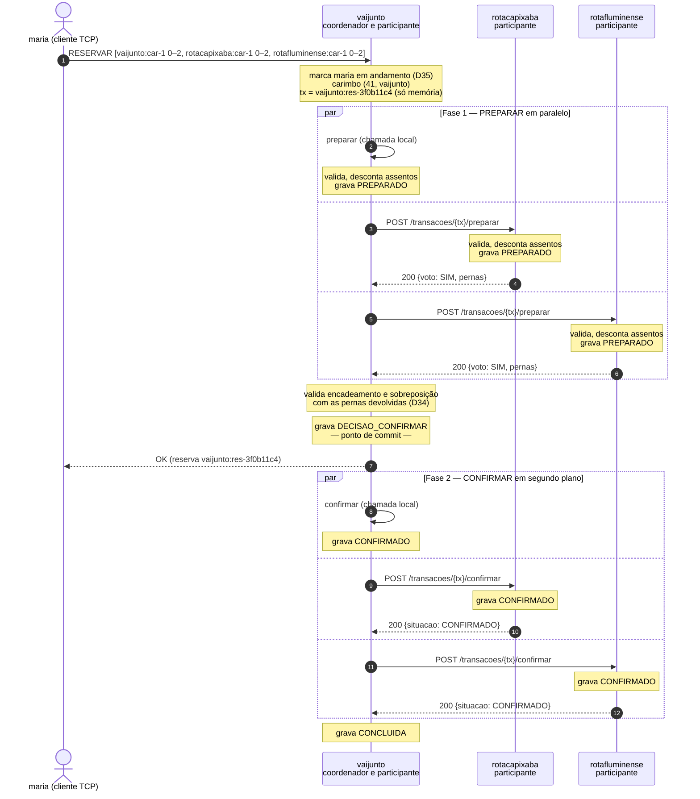
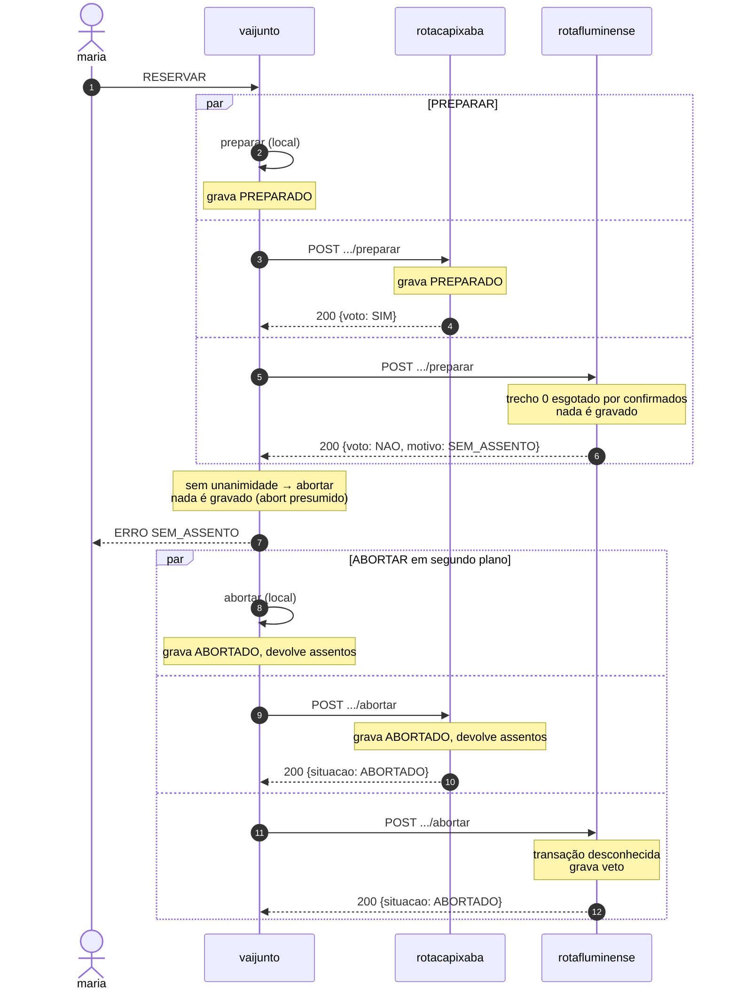
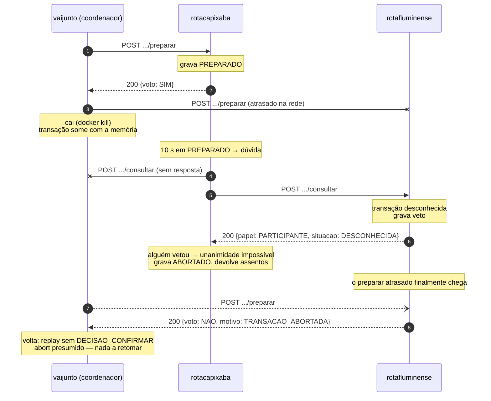
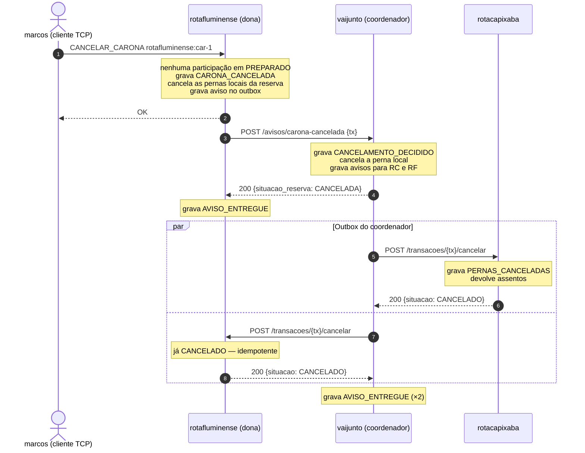

# API do consórcio VAIJUNTO — v1

Especificação da API REST entre os servidores das empresas do consórcio. Este
documento é o contrato: um servidor escrito em qualquer linguagem que o respeite
participa do consórcio.

A comunicação dos clientes com o servidor da própria empresa não passa por aqui:
ela continua no protocolo TCP do `PROTOCOL.md`. As decisões que justificam este
contrato estão no `PROJETO_P2.md` e são citadas pelo número (D21, D38…).

## Índice

1. [Transporte e convenções](#1-transporte-e-convenções)
2. [Status HTTP e respostas de erro](#2-status-http-e-respostas-de-erro)
3. [Tipos](#3-tipos)
4. [Recursos](#4-recursos) — [`/saude`](#41-get-saude) · [`/federacao/caronas`](#42-get-federacaocaronas) · [`preparar`](#43-post-transacoestxpreparar) · [`confirmar`](#44-post-transacoestxconfirmar) · [`abortar`](#45-post-transacoestxabortar) · [`consultar`](#46-post-transacoestxconsultar) · [`cancelar`](#47-post-transacoestxcancelar) · [`/avisos/carona-cancelada`](#48-post-avisoscarona-cancelada) · [`/auditoria`](#49-get-auditoria)
5. [Códigos](#5-códigos)
6. [Diagramas de sequência](#6-diagramas-de-sequência)
7. [Exemplo com `curl`](#7-exemplo-com-curl)

---

## 1. Transporte e convenções

- HTTP/1.1. Porta padrão **8080**, configurável por `--endereco-pares`.
- Corpo em JSON, UTF-8, com `Content-Type: application/json`, nas requisições
  com corpo e em todas as respostas.
- Nomes de campo em `snake_case`, como no `PROTOCOL.md`.
- **Campos desconhecidos são ignorados**, na requisição e na resposta, pelo
  mesmo motivo da seção 2.1 do `PROTOCOL.md`: um campo opcional novo não quebra
  um par mais antigo.
- Corpo de requisição limitado a **64 KB**. Corpo maior responde `413`.
- Requisições sem corpo útil (`confirmar`, `abortar`, `consultar`) enviam `{}`.

### 1.1 Cabeçalhos

| Cabeçalho | Em | Conteúdo |
|---|---|---|
| `X-VaiJunto-Empresa` | Requisição e resposta | Identificador da empresa que envia (`vaijunto`, `rotacapixaba`, `rotafluminense`) |
| `X-VaiJunto-Lamport` | Requisição e resposta | Relógio de Lamport de quem envia, inteiro decimal `≥ 0` |

Regras do relógio (D24, `PROJETO_P2.md` seção 8.1):

- quem envia uma requisição ou uma resposta coloca nela o seu `L` atual;
- quem recebe faz `L ← max(L, recebido) + 1` **antes** de processar a
  requisição ou de usar a resposta.

Os dois cabeçalhos são obrigatórios em todos os recursos, exceto `/saude` e
`/auditoria`, que aceitam chamadas sem eles para que o simulador, o teste e uma
pessoa com `curl` possam usá-los. Quando presentes, são processados normalmente.

Cabeçalho ausente ou malformado responde `400 CABECALHO_INVALIDO`. Empresa fora
da lista de pares (D20) responde `403 EMPRESA_DESCONHECIDA`.

### 1.2 Papéis

Cada recurso de transação só é aceito da empresa com o papel certo. O servidor
compara `X-VaiJunto-Empresa` com o papel exigido e responde
`403 PAPEL_INVALIDO` em caso de divergência.

| Recurso | Quem pode chamar |
|---|---|
| `preparar`, `confirmar`, `abortar`, `cancelar` | Só o coordenador: a empresa do prefixo do `txID` |
| `consultar` | Qualquer empresa do consórcio. Quem é consultado sobre uma transação desconhecida não tem como saber quem participa dela |
| `/avisos/carona-cancelada` | Só um participante da reserva citada |
| `/federacao/caronas` | Qualquer empresa do consórcio |

A verificação de papel não substitui autenticação, que fica como trabalho futuro
(`PROJETO_P2.md`, seção 15). Ela impede que um bug ou um par mal configurado mexa
em transações que não são dele.

### 1.3 Prazos e repetição

Quem chama aplica os prazos da D41: **2 s** por chamada. Para quem chama, uma
chamada **falhou** quando estoura o prazo, quando a conexão é recusada ou quando
a resposta não é `2xx`.

**Toda operação de transação é idempotente pelo `txID`** (D28). Receber duas vezes
a mesma requisição produz o mesmo efeito e a mesma resposta que recebê-la uma
vez. É o que torna seguro repetir depois de uma falha, que pode ter sido só da
resposta.

| Recurso | Política de repetição de quem chama |
|---|---|
| `/federacao/caronas` | Não repete: a empresa entra como indisponível e a busca segue parcial (D26) |
| `preparar` | Repete enquanto houver prazo de votação (5 s); após `AGUARDE`, repete em 200 ms |
| `confirmar`, `cancelar`, `/avisos/carona-cancelada` | Repete a cada 2 s, sem limite, até receber `2xx`, inclusive depois de uma queda (o pedido está no log) |
| `abortar` | Repete a cada 2 s enquanto o servidor estiver no ar. Não é gravado: quem não recebe descobre a decisão consultando (D23) |
| `consultar` | Repete a cada 3 s enquanto o participante estiver em dúvida |

**Exceção: `409` encerra a repetição.** Ele indica violação de protocolo
(seção 2), que nenhuma repetição corrige. Quem recebe registra a violação no log
e para.

### 1.4 Convenções de tipos

As mesmas do `PROTOCOL.md`, seção 3:

| Conceito | Representação | Exemplo |
|---|---|---|
| Instante | RFC 3339 com deslocamento | `"2026-11-05T14:00:00-03:00"` |
| Dinheiro | Inteiro em centavos | `21500` (R$ 215,00) |
| Cidade | Grafia canônica do catálogo (D33) | `"Cachoeiro de Itapemirim"` |
| Carona | `<empresa>:car-<8 hex>`; a semente usa `car-1`, `car-2`… | `"rotacapixaba:car-1"` |
| Transação e reserva | `<empresa>:res-<8 hex>` | `"vaijunto:res-3f0b11c4"` |
| Passageiro de outra empresa | `<empresa>:<usuario>` | `"vaijunto:maria"` |

O `txID` vai no caminho sem codificação: o caractere `:` é válido num segmento de
URL.

---

## 2. Status HTTP e respostas de erro

**Princípio:** `2xx` significa que o par **processou a requisição e respondeu**,
qualquer que seja a resposta. Um voto NÃO é uma resposta processada, então volta
como `200`, com o voto no corpo.

A separação importa para o coordenador. A lógica do 2PC só precisa distinguir
"o participante respondeu" (use o voto) de "o participante não respondeu direito"
(repita). Se o NÃO fosse um código de erro, o coordenador poderia confundir uma
recusa legítima com uma falha e repetir à toa.

| Status | Uso |
|---|---|
| `200` | Requisição processada, inclusive voto NÃO e consulta de transação desconhecida |
| `400` | Corpo, cabeçalho ou parâmetro malformado |
| `403` | Empresa desconhecida, ou sem o papel exigido (seção 1.2) |
| `404` | Recurso inexistente; `/auditoria` sem a flag `--auditoria` |
| `409` | Violação de protocolo: transição impossível pela seção 7.4 do `PROJETO_P2.md` |
| `413` | Corpo acima de 64 KB |
| `500` | Erro interno |

Toda resposta de erro tem o mesmo formato do `PROTOCOL.md`:

```json
{"codigo":"PAPEL_INVALIDO","mensagem":"Só o coordenador da transação pode prepará-la."}
```

O `409` merece uma nota. Pelo argumento de atomicidade do `PROJETO_P2.md`
(seção 7.4), ele **nunca** deveria acontecer: um `CONFIRMAR` para uma participação
abortada significaria que o coordenador decidiu confirmar sem unanimidade. Ele
existe para que, se acontecer, o erro seja visível, registrado e verificável pelo
teste, em vez de silenciosamente corrompido.

---

## 3. Tipos

### 3.1 Carimbo

```json
{"lamport":41,"empresa":"vaijunto"}
```

Prioridade da transação no wait-die (D24). Carimbo menor é transação mais velha:
compara-se `lamport` e, em empate, `empresa` em ordem alfabética.

### 3.2 Item

Uma perna pedida, como no `RESERVAR` do `PROTOCOL.md`:

```json
{"carona_id":"rotacapixaba:car-1","de":0,"ate":2}
```

`de` e `ate` são índices de parada da rota da carona, com `de < ate`.

### 3.3 Perna

Os dados autoritativos de uma perna, devolvidos pelo dono no voto SIM (D34) e
guardados pelo coordenador na reserva (D42):

```json
{
  "carona_id": "rotacapixaba:car-1",
  "empresa": "rotacapixaba",
  "motorista_nome": "Rafael Moreira",
  "de": 0,
  "ate": 2,
  "cidades": ["Vitória da Conquista", "Vitória", "Cachoeiro de Itapemirim"],
  "partida": "2026-11-05T14:00:00-03:00",
  "chegada": "2026-11-06T06:30:00-03:00",
  "preco_centavos": 21500
}
```

`cidades` traz todas as paradas de `de` a `ate`, inclusive as intermediárias: o
coordenador precisa delas para verificar cidade repetida no itinerário (D13).

### 3.4 Carona federada

Uma carona como aparece na busca federada:

```json
{
  "id": "rotacapixaba:car-1",
  "empresa": "rotacapixaba",
  "motorista_nome": "Rafael Moreira",
  "rota": ["Vitória da Conquista", "Vitória", "Cachoeiro de Itapemirim"],
  "horarios": ["2026-11-05T14:00:00-03:00", "2026-11-06T04:00:00-03:00", "2026-11-06T06:30:00-03:00"],
  "precos_centavos": [18000, 3500],
  "assentos": 3,
  "livres": [3, 3]
}
```

`livres[t] = assentos − confirmados − em espera` no trecho `t` (D25, D40). É uma
fotografia: o valor que vale é o que o dono verifica no `preparar`.

### 3.5 Passageiro

```json
{"ref":"vaijunto:maria","nome":"Maria Souza"}
```

Tudo o que um participante recebe e guarda sobre um passageiro de outra empresa
(D32).

### 3.6 Situações

| Situação | De quê | Significado |
|---|---|---|
| `PREPARADO` | Participação | Votou SIM; assentos em espera |
| `CONFIRMADO` | Participação | Recebeu a decisão de confirmar |
| `ABORTADO` | Participação | Abortada, inclusive por veto |
| `CANCELADO` | Participação | Pernas canceladas após a confirmação (D39) |
| `DESCONHECIDA` | Participação | Resposta da `consultar` para transação que o servidor não conhecia. O veto já foi gravado |
| `CONFIRMADA` | Decisão do coordenador | Há `DECISAO_CONFIRMAR` no log |
| `EM_ANDAMENTO` | Decisão do coordenador | A transação está na memória, ainda votando |
| `ABORTADA` | Decisão do coordenador | Abort presumido: nem na memória, nem no log (D23) |

---

## 4. Recursos

Cada recurso traz quem chama e quando, o formato, as respostas possíveis e o
efeito de uma repetição.

### 4.1 `GET /saude`

Verifica se o servidor está no ar (D30). Usado pelo simulador, pelo teste de
sistema e no laboratório.

**Resposta `200`:**

```json
{"empresa":"rotacapixaba","versao_api":1,"instante":"2026-11-05T08:15:02-03:00"}
```

`versao_api` é a versão deste documento. Uma divergência entre pares aparece no
registro de operações. `instante` é informativo, para conferência no
laboratório: **nenhuma decisão do consórcio usa o relógio físico de outro
servidor**.

### 4.2 `GET /federacao/caronas`

Caronas da empresa na janela de uma busca federada (D26, D40).

- **Quem chama:** o servidor de origem de uma busca, em paralelo para todos os
  pares.
- **Parâmetros:** `desde` e `ate`, instantes RFC 3339 codificados na URL. O
  servidor devolve as caronas não canceladas com **alguma parada** em
  `[desde, ate)`.

```
GET /federacao/caronas?desde=2026-11-05T00:00:00-03:00&ate=2026-11-07T00:00:00-03:00
```

**Resposta `200`:**

```json
{"empresa":"rotacapixaba","caronas":[ /* Carona federada, seção 3.4 */ ]}
```

| Status | Código | Quando |
|---|---|---|
| `400` | `PARAMETRO_INVALIDO` | Parâmetro ausente, malformado, `desde ≥ ate` ou janela acima de 72 h |

Leitura sem efeito: pode ser repetida, mas quem chama não repete (seção 1.3).

### 4.3 `POST /transacoes/{tx}/preparar`

Fase 1 do 2PC (`PROJETO_P2.md`, seção 7.2).

- **Quem chama:** o coordenador da transação.
- **Quando:** no passo 5 do algoritmo do coordenador, para cada empresa dona de
  alguma perna.

**Requisição:**

```json
{
  "coordenador": "vaijunto",
  "participantes": ["vaijunto", "rotacapixaba", "rotafluminense"],
  "carimbo": {"lamport": 41, "empresa": "vaijunto"},
  "passageiro": {"ref": "vaijunto:maria", "nome": "Maria Souza"},
  "itens": [{"carona_id": "rotacapixaba:car-1", "de": 0, "ate": 2}]
}
```

| Campo | Regra |
|---|---|
| `coordenador` | Igual ao prefixo de `{tx}` e a `X-VaiJunto-Empresa` |
| `participantes` | Todas as empresas da transação, incluindo quem recebe. É a lista usada na terminação cooperativa (D38) |
| `carimbo` | Carimbo da transação; o mesmo em todas as tentativas da reserva (D36) |
| `itens` | Só pernas de caronas de quem recebe, não vazio |

**Resposta `200` — três formas:**

```json
{"voto":"SIM","pernas":[ /* Perna, seção 3.3 */ ]}
```

```json
{"voto":"NAO","motivo":"SEM_ASSENTO","carona_id":"rotacapixaba:car-1","trecho":1}
```

```json
{"voto":"AGUARDE","carona_id":"rotacapixaba:car-1","trecho":1}
```

| Voto | Significado | O que o participante gravou |
|---|---|---|
| `SIM` | Assentos em espera para esta transação | `PREPARADO`, com `fsync`, **antes** de responder |
| `NAO` | Recusa, com o motivo da seção 5.2 | Nada |
| `AGUARDE` | Wait-die: a transação é mais velha que todos os portadores dos trechos esgotados (`PROJETO_P2.md`, seção 8.2) | Nada |

`carona_id` e `trecho` acompanham `SEM_ASSENTO`, `PRECEDENCIA` e `AGUARDE`,
indicando o primeiro trecho esgotado. Servem ao diagnóstico e ao registro de
operações.

| Status | Código | Quando |
|---|---|---|
| `400` | `CORPO_INVALIDO` | Corpo malformado, campo obrigatório ausente ou `coordenador` divergente do caminho |
| `400` | `ITEM_DE_OUTRA_EMPRESA` | Algum item é de carona de outra empresa: erro do coordenador |
| `403` | `PAPEL_INVALIDO` | Quem chama não é o coordenador |

**Repetição.** Se a participação já existe, a resposta é a mesma:

- `PREPARADO`, `CONFIRMADO` ou `CANCELADO` → SIM com as mesmas pernas;
- `ABORTADO`, inclusive por veto → NÃO com `TRANSACAO_ABORTADA`.

Um NÃO por falta de assento ou por precedência não é gravado, então a repetição
é uma **nova avaliação**, e pode dar outro resultado se um assento vagou nesse
meio-tempo. Isso é seguro. Se o coordenador já decidiu abortar com base no NÃO,
o `abortar` que ele envia grava um veto, e um `preparar` atrasado que chegue
depois recebe NÃO. Se o `preparar` atrasado chega antes do `abortar`, o
participante fica em `PREPARADO`, e o `abortar` o desfaz em seguida.

### 4.4 `POST /transacoes/{tx}/confirmar`

Fase 2: decisão de confirmar.

- **Quem chama:** o coordenador, depois de gravar `DECISAO_CONFIRMAR`
  (`PROJETO_P2.md`, seção 7.1, passo 9), e de novo após uma queda, até receber
  `200`.
- **Requisição:** `{}`.

**Resposta `200`:**

```json
{"situacao":"CONFIRMADO"}
```

| Situação antes | Efeito | Resposta |
|---|---|---|
| `PREPARADO` | Grava `CONFIRMADO` com `fsync` | `200 CONFIRMADO` |
| `CONFIRMADO` | Nenhum | `200 CONFIRMADO` |
| `CANCELADO` | Nenhum: o cancelamento chegou antes (`PROJETO_P2.md`, seção 7.3) | `200 CANCELADO` |
| `ABORTADO` ou desconhecida | Nenhum; registra a violação | `409 VIOLACAO_PROTOCOLO` |

### 4.5 `POST /transacoes/{tx}/abortar`

Fase 2: decisão de abortar.

- **Quem chama:** o coordenador, quando a votação termina sem unanimidade ou a
  validação do passo 7 falha.
- **Requisição:** `{}`.

**Resposta `200`:**

```json
{"situacao":"ABORTADO"}
```

| Situação antes | Efeito | Resposta |
|---|---|---|
| `PREPARADO` | Grava `ABORTADO`, devolve os assentos | `200 ABORTADO` |
| Desconhecida | Grava o **veto** (`ABORTADO` sem itens): um `preparar` atrasado será recusado | `200 ABORTADO` |
| `ABORTADO` | Nenhum | `200 ABORTADO` |
| `CONFIRMADO` ou `CANCELADO` | Nenhum; registra a violação | `409 VIOLACAO_PROTOCOLO` |

### 4.6 `POST /transacoes/{tx}/consultar`

Pergunta a situação de uma transação: a base da terminação cooperativa (D38,
`PROJETO_P2.md` seção 9.4).

- **Quem chama:** um participante em `PREPARADO` há mais que o prazo de dúvida.
  Primeiro o coordenador; sem resposta, os demais participantes.
- **Requisição:** `{}`.

**É `POST` e não `GET` de propósito.** Consultar uma transação desconhecida
**grava um veto**. Em REST, `GET` não pode ter efeito colateral, e um
intermediário (proxy, cache, ferramenta de depuração) que repetisse um `GET` por
conta própria estaria gravando vetos sem que ninguém pedisse.

**Resposta `200`, se quem responde é o coordenador** (a empresa do prefixo de
`{tx}`, que responde sempre nesse papel, mesmo que também seja participante):

```json
{"papel":"COORDENADOR","decisao":"CONFIRMADA"}
```

| Estado no coordenador | `decisao` |
|---|---|
| `DECISAO_CONFIRMAR` no log | `CONFIRMADA` |
| Transação na memória, sem decisão | `EM_ANDAMENTO` |
| Nenhum dos dois | `ABORTADA`. Abort presumido; nada é gravado |

Uma reserva confirmada e depois cancelada continua respondendo `CONFIRMADA`: a
pergunta é sobre a **decisão** da transação. O cancelamento chega ao
participante pelo `cancelar` (seção 4.7).

**Resposta `200`, se quem responde é um participante:**

```json
{"papel":"PARTICIPANTE","situacao":"PREPARADO"}
```

`situacao` é a da participação. Para uma transação que o participante não
conhece, ele **grava o veto antes de responder** e devolve `DESCONHECIDA`.

O que quem perguntou faz com cada resposta está no `PROJETO_P2.md`, seção 9.4.

### 4.7 `POST /transacoes/{tx}/cancelar`

Cancela as pernas de uma reserva confirmada (D39).

- **Quem chama:** o coordenador, pelo outbox, depois de gravar
  `CANCELAMENTO_DECIDIDO`, até receber `200`.

**Requisição:**

```json
{"motivo":"PASSAGEIRO"}
```

`motivo` é `PASSAGEIRO` (cancelamento da reserva) ou `CARONA_CANCELADA` (cascata
da D29). Só serve ao registro de operações: o efeito é o mesmo.

**Resposta `200`:**

```json
{"situacao":"CANCELADO"}
```

| Situação antes | Efeito | Resposta |
|---|---|---|
| `CONFIRMADO` | Grava `PERNAS_CANCELADAS`, devolve os assentos | `200 CANCELADO` |
| `PREPARADO` | O mesmo: o cancelamento implica que houve decisão de confirmar, e o `confirmar` ainda não tinha chegado | `200 CANCELADO` |
| `CANCELADO` | Nenhum | `200 CANCELADO` |
| `ABORTADO` ou desconhecida | Nenhum; registra a violação | `409 VIOLACAO_PROTOCOLO` |

### 4.8 `POST /avisos/carona-cancelada`

O dono de uma carona cancelada avisa o coordenador de uma reserva atingida (D29,
`PROJETO_P2.md` seção 10.2).

- **Quem chama:** o dono da carona, pelo outbox, até receber `200`.

**Requisição:**

```json
{"tx":"vaijunto:res-3f0b11c4","carona_id":"rotafluminense:car-1"}
```

O recurso fica fora de `/transacoes/{tx}` porque a direção é inversa: vai do
participante para o coordenador.

**Resposta `200`:**

```json
{"situacao_reserva":"CANCELADA"}
```

| Situação | Efeito | Resposta |
|---|---|---|
| Reserva ativa | Grava `CANCELAMENTO_DECIDIDO` e um aviso `cancelar` para **todos** os participantes, inclusive quem avisou | `200 CANCELADA` |
| Reserva já cancelada | Nenhum | `200 CANCELADA` |
| `tx` de outro coordenador | Nenhum | `400 NAO_COORDENADOR` |
| Quem avisa não participa da reserva | Nenhum | `403 PAPEL_INVALIDO` |
| Reserva desconhecida | Nenhum; registra a violação. Pela I-P2-2, um participante confirmado implica decisão gravada | `409 VIOLACAO_PROTOCOLO` |

O cancelamento por esse caminho não verifica a antecedência mínima: é a
assimetria da D13, como no P1.

### 4.9 `GET /auditoria`

Estado completo da empresa, para o verificador de invariantes (`PROJETO_P2.md`,
seção 11.2). **Só existe com a flag `--auditoria`**; sem ela, responde `404`. É
somente leitura e não participa de nenhuma decisão.

**Resposta `200`:**

```json
{
  "empresa": "rotacapixaba",
  "lamport": 57,
  "caronas": [
    {"id":"rotacapixaba:car-1","assentos":3,"cancelada":false,
     "livres":[2,2],"confirmados":[1,1],"em_espera":[0,0]}
  ],
  "participacoes": [
    {"tx":"vaijunto:res-3f0b11c4","coordenador":"vaijunto","situacao":"CONFIRMADO",
     "carimbo":{"lamport":41,"empresa":"vaijunto"},
     "passageiro":{"ref":"vaijunto:maria","nome":"Maria Souza"},
     "itens":[{"carona_id":"rotacapixaba:car-1","de":0,"ate":2}]}
  ],
  "reservas": [],
  "outbox": []
}
```

| Campo | Conteúdo |
|---|---|
| `caronas` | Contadores por trecho. A I-P2-1 é verificada linha a linha: `livres + confirmados + em_espera == assentos` |
| `participacoes` | Visão de dono |
| `reservas` | Visão de coordenador: `id`, `passageiro`, `ativa`, `concluida`, `participantes` |
| `outbox` | Avisos pendentes: `id`, `destino`, `tipo`, `tx` |

O campo `passageiro` das participações é a própria verificação da I-P2-4: só
referência e nome.

---

## 5. Códigos

### 5.1 Códigos de erro HTTP

| Código | Status | Onde | Significado |
|---|---|---|---|
| `CABECALHO_INVALIDO` | `400` | Todos, exceto `/saude` e `/auditoria` | `X-VaiJunto-Empresa` ou `X-VaiJunto-Lamport` ausente ou malformado |
| `CORPO_INVALIDO` | `400` | Recursos com corpo | JSON malformado ou campo obrigatório ausente |
| `PARAMETRO_INVALIDO` | `400` | `/federacao/caronas` | Janela ausente, malformada ou grande demais |
| `ITEM_DE_OUTRA_EMPRESA` | `400` | `preparar` | Item de carona que não é de quem recebe |
| `NAO_COORDENADOR` | `400` | `/avisos/carona-cancelada` | A reserva citada é coordenada por outra empresa |
| `EMPRESA_DESCONHECIDA` | `403` | Todos com cabeçalho | Empresa fora da lista de pares |
| `PAPEL_INVALIDO` | `403` | Recursos de transação e aviso | Empresa sem o papel exigido (seção 1.2) |
| `RECURSO_INEXISTENTE` | `404` | — | Caminho ou método desconhecido; `/auditoria` sem a flag |
| `VIOLACAO_PROTOCOLO` | `409` | `confirmar`, `abortar`, `cancelar`, aviso | Transição impossível pela seção 7.4 do `PROJETO_P2.md`; registrada no log |
| `CORPO_GRANDE` | `413` | Recursos com corpo | Corpo acima de 64 KB |
| `ERRO_INTERNO` | `500` | Todos | Falha inesperada |

### 5.2 Motivos do voto NÃO

Respostas `200` do `preparar`.

| Motivo | Significado | Código ao passageiro (`PROTOCOL.md`) |
|---|---|---|
| `SEM_ASSENTO` | Trecho esgotado só por assentos confirmados | `SEM_ASSENTO` |
| `PRECEDENCIA` | Wait-die: a transação é mais nova que algum portador | Nova tentativa (D36); esgotadas as 3, `DISPUTA_PERDIDA` |
| `CARONA_NAO_ENCONTRADA` | Carona inexistente nesta empresa | `CARONA_NAO_ENCONTRADA` |
| `CARONA_CANCELADA` | Carona cancelada | `CARONA_CANCELADA` |
| `ITINERARIO_INVALIDO` | Índices fora da rota ou `de ≥ ate` | `ITINERARIO_INVALIDO` |
| `TRANSACAO_ABORTADA` | A transação já foi abortada aqui, inclusive por veto | `EMPRESA_INDISPONIVEL`: só acontece quando a rede atrasou a ponto de alguém consultar antes do `preparar` chegar |

Quando a votação termina por prazo, o coordenador responde
`EMPRESA_INDISPONIVEL` se alguma empresa não respondeu, ou `DISPUTA_PERDIDA` se
todas responderam e a última resposta pendente era `AGUARDE`.

---

## 6. Diagramas de sequência

Os quatro diagramas usam o cenário de demonstração do `PROJETO_P2.md` (seção
12): maria, passageira da `vaijunto`, viaja de Salvador a Petrópolis com uma
perna em cada empresa. As notas marcam o que é gravado no log com `fsync`.

### 6.1 Confirmação de um itinerário com trechos de três empresas

O diagrama exigido pelo enunciado. A `vaijunto` é coordenadora, porque maria é
passageira dela, e também participante, porque a primeira perna é de uma carona
dela.



Três pontos para ler no diagrama:

- **Antes do ponto de commit, nada está decidido.** Uma queda da `vaijunto`
  antes dele leva ao abort presumido; depois dele, à retomada da fase 2
  (`PROJETO_P2.md`, seção 9.5).
- **maria recebe `OK` antes da fase 2 terminar.** A decisão já está gravada, e
  os assentos em `PREPARADO` já contam como ocupados.
- **Os assentos são descontados na fase 1**, sob o mutex de cada dono. É ali, e
  não na fase 2, que se garante que nenhum assento é vendido duas vezes.

### 6.2 Abort por falta de assento

A carona da `rotafluminense` está esgotada por assentos confirmados.



maria não fica com o assento da `rotacapixaba`, que tinha vaga: é o RD01 visto de
fora. O veto na `rotafluminense` parece inútil aqui, mas é o que protege contra
um `preparar` repetido que chegue atrasado.

### 6.3 Queda do coordenador e terminação cooperativa

A `vaijunto` cai depois de enviar os `PREPARAR`, e o da `rotafluminense` se
perde. A `rotacapixaba` votou SIM e fica em dúvida.



Se a `rotafluminense` também tivesse votado SIM antes da queda, as duas
responderiam `PREPARADO` uma à outra, e ambas continuariam em dúvida até a
`vaijunto` voltar e responder `ABORTADA`. É o bloqueio residual do 2PC,
delimitado no `PROJETO_P2.md`, seção 9.6.

Na prática, a mensagem atrasada (passo 7) chegaria com a `vaijunto` já fora do
ar e não teria a quem responder. O diagrama a mostra assim para deixar visível
o efeito do veto.

### 6.4 Cancelamento de carona em cascata entre empresas

marcos cancela a carona da `rotafluminense` que maria usa. A reserva é da
`vaijunto` e tem pernas nas três empresas.



Se a `vaijunto` estivesse fora do ar, o aviso ficaria no outbox da
`rotafluminense` e seria entregue quando ela voltasse. Até lá, os assentos de
joao e de rafael continuariam ocupados: a propagação é conservadora e nunca
devolve um assento antes da hora (`PROJETO_P2.md`, seção 10.3).

---

## 7. Exemplo com `curl`

A API pode ser exercitada à mão, o que é útil na arguição para mostrar que o
protocolo é só HTTP e JSON.

**Saúde de um par:**

```bash
curl -s http://10.0.0.2:8080/saude
```

```json
{"empresa":"rotacapixaba","versao_api":1,"instante":"2026-11-05T08:15:02-03:00"}
```

**Um `preparar` feito à mão, fingindo ser a `vaijunto`:**

```bash
curl -s -i -X POST http://10.0.0.2:8080/transacoes/vaijunto:res-0000abcd/preparar \
  -H 'Content-Type: application/json' \
  -H 'X-VaiJunto-Empresa: vaijunto' \
  -H 'X-VaiJunto-Lamport: 100' \
  -d '{
    "coordenador": "vaijunto",
    "participantes": ["vaijunto", "rotacapixaba"],
    "carimbo": {"lamport": 100, "empresa": "vaijunto"},
    "passageiro": {"ref": "vaijunto:maria", "nome": "Maria Souza"},
    "itens": [{"carona_id": "rotacapixaba:car-1", "de": 0, "ate": 2}]
  }'
```

```
HTTP/1.1 200 OK
Content-Type: application/json
X-Vaijunto-Empresa: rotacapixaba
X-Vaijunto-Lamport: 101

{"voto":"SIM","pernas":[{"carona_id":"rotacapixaba:car-1","empresa":"rotacapixaba","motorista_nome":"Rafael Moreira","de":0,"ate":2,"cidades":["Vitória da Conquista","Vitória","Cachoeiro de Itapemirim"],"partida":"2026-11-05T14:00:00-03:00","chegada":"2026-11-06T06:30:00-03:00","preco_centavos":21500}]}
```

O `X-Vaijunto-Lamport: 101` da resposta é a regra de recebimento da seção 1.1:
`max(L, 100) + 1`. O Go canoniza os nomes de cabeçalho, daí a grafia
`X-Vaijunto`; cabeçalhos HTTP não diferenciam maiúsculas.

**Este exemplo é também uma demonstração do abort presumido.** A transação
`vaijunto:res-0000abcd` nunca existiu na `vaijunto`. Depois de 10 s, a
`rotacapixaba` fica em dúvida e consulta a `vaijunto`, que não encontra a
transação nem na memória nem no log e responde `ABORTADA`. O assento volta
sozinho, e o registro de operações mostra cada passo. É uma forma de exibir a
terminação no laboratório sem derrubar nenhum servidor.

**A consulta que a `rotacapixaba` faz, reproduzida à mão:**

```bash
curl -s -X POST http://10.0.0.1:8080/transacoes/vaijunto:res-0000abcd/consultar \
  -H 'Content-Type: application/json' \
  -H 'X-VaiJunto-Empresa: rotacapixaba' \
  -H 'X-VaiJunto-Lamport: 102' \
  -d '{}'
```

```json
{"papel":"COORDENADOR","decisao":"ABORTADA"}
```
