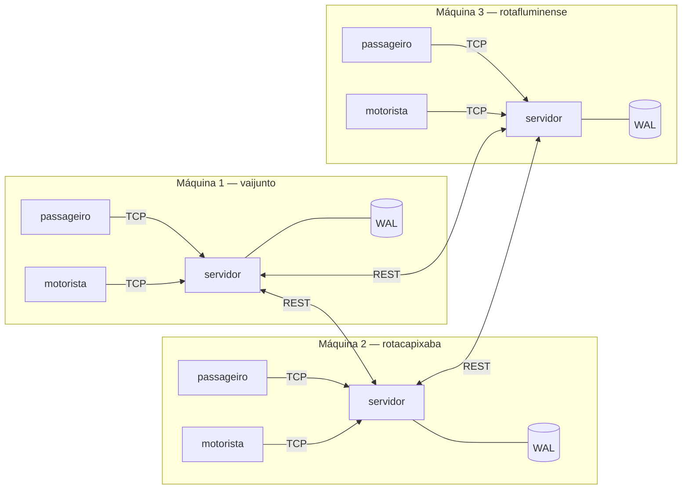
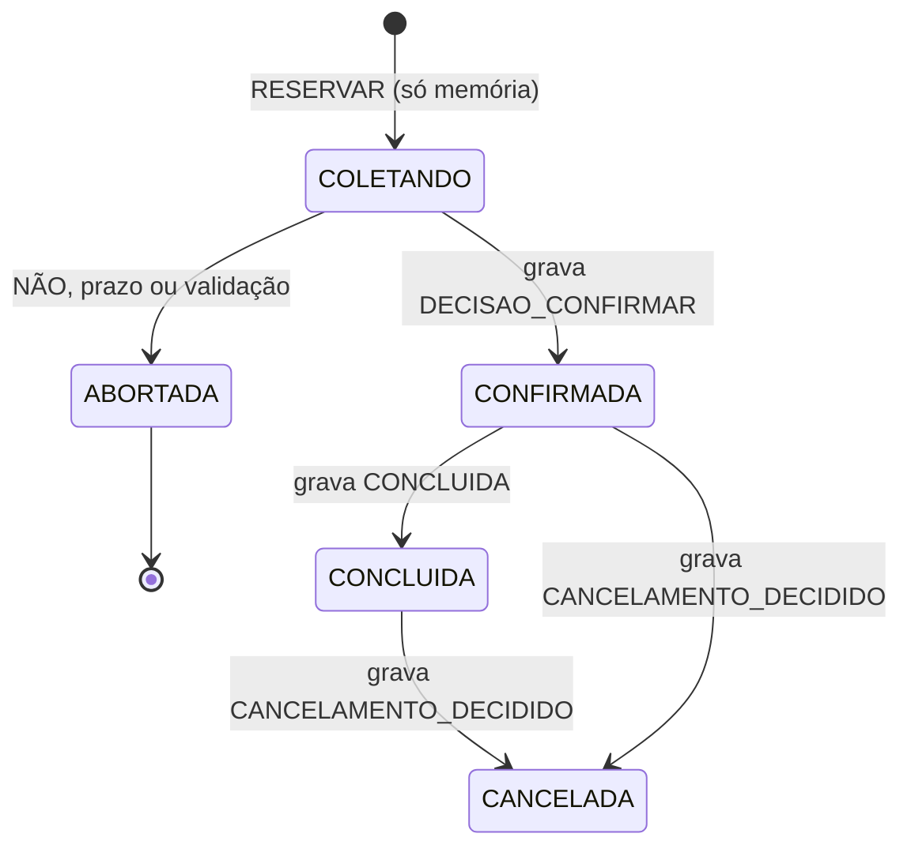
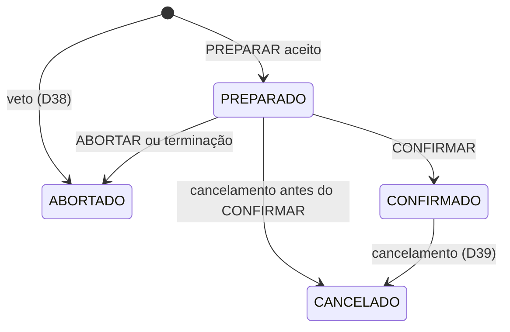

# VAIJUNTO — Documento de projeto do Problema 2

Problema 2 de TEC502 (Concorrência e Conectividade). Consórcio de empresas de
caronas compartilhadas: cada empresa opera o próprio servidor, e os servidores
cooperam por uma API REST para que um passageiro reserve, de forma atômica,
itinerários com trechos de caronas de empresas diferentes.

Este documento sucede o `PROJETO.md`, que permanece como registro do Problema 1
e explica o código herdado. As decisões continuam a numeração do P1 (D20 em
diante), e a seção 3.1 diz quais decisões antigas valem, quais foram
reinterpretadas e quais foram revogadas. A especificação da API REST entre
servidores está em `API_CONSORCIO.md`; o protocolo cliente↔servidor continua em
`PROTOCOL.md`, na versão 2.

## Índice

1. [Escopo](#1-escopo)
2. [Requisitos](#2-requisitos)
3. [Decisões de projeto](#3-decisões-de-projeto)
4. [Modelo](#4-modelo)
5. [Arquitetura](#5-arquitetura)
6. [Algoritmo de busca federada](#6-algoritmo-de-busca-federada)
7. [Reserva atômica distribuída](#7-reserva-atômica-distribuída)
8. [Precedência na disputa por assentos](#8-precedência-na-disputa-por-assentos)
9. [Falhas e recuperação](#9-falhas-e-recuperação)
10. [Cancelamentos](#10-cancelamentos)
11. [Invariantes e plano de teste](#11-invariantes-e-plano-de-teste)
12. [Dados e cenários de demonstração](#12-dados-e-cenários-de-demonstração)
13. [Containerização e laboratório](#13-containerização-e-laboratório)
14. [Fases e estado](#14-fases-e-estado)
15. [Trabalho futuro](#15-trabalho-futuro)

---

## 1. Escopo

### 1.1 O problema

O VaiJunto e outras empresas regionais formaram um consórcio. Cada empresa
mantém o próprio servidor, onde os seus motoristas publicam caronas e os seus
passageiros se conectam. Três regras de negócio definem o cenário:

1. O motorista publica a carona **apenas** na empresa em que está cadastrado, e
   essa empresa é a **única** responsável pelos assentos daquela carona.
2. O passageiro conecta-se **apenas** ao servidor da própria empresa, mas busca e
   reserva itinerários com trechos de caronas de **qualquer** empresa.
3. Nenhuma empresa transfere os seus dados a outra, e nenhuma depende de um
   servidor mantido por terceiros.

No P1, uma única seção crítica dentro do servidor central garantia que um
itinerário fosse reservado por inteiro ou não fosse reservado. Agora os assentos
de um mesmo itinerário estão em servidores diferentes, cada um com a sua
memória, o seu relógio e a sua fila de requisições. Nenhuma trava local protege
o itinerário inteiro, e o problema passa a ser **coordenar os donos dos
assentos** sem que nenhum deles seja central.

### 1.2 O que muda em relação ao P1

A tabela é o esqueleto da comparação que o relatório exige.

| Aspecto | P1 — servidor central | P2 — consórcio |
|---|---|---|
| Onde está o estado | Uma memória | Uma memória por empresa; cada uma guarda só o que é seu |
| Exclusão mútua | Um mutex global (D04) | Um mutex por servidor, que protege só os assentos daquela empresa |
| Atomicidade do itinerário | Validar e escrever na mesma seção crítica (D07) | Two-phase commit com assento em espera (D21) |
| Ordem entre requisições | Ordem de aquisição do mutex | Ordem de chegada no dono do assento, mais relógio de Lamport na disputa cruzada (D24) |
| Persistência | Nenhuma (D02) | Write-ahead log por empresa (D22) |
| Prazos | Só no transporte (D17) | Timeouts decidem aborts e liberam assentos (D23, D41) |
| Falha relevante | Queda de cliente | Queda de servidor, inclusive no meio de uma reserva |
| Busca | Local | Federada: o servidor de origem consulta os pares (D26) |
| Comunicação | TCP com clientes | TCP com clientes (inalterado) e REST entre servidores |
| Ponto único de falha | O servidor | Nenhum: cada falha afeta só o que depende da empresa que caiu |

### 1.3 Empresas do consórcio

| Empresa | Identificador | Região dos motoristas da semente |
|---|---|---|
| VaiJunto | `vaijunto` | Bahia |
| Rota Capixaba | `rotacapixaba` | Espírito Santo |
| Rota Fluminense | `rotafluminense` | Rio de Janeiro |

A região descreve os dados, não restringe o sistema: qualquer empresa publica
caronas entre quaisquer cidades do catálogo (D33).

---

## 2. Requisitos

### 2.1 Funcionais

Os requisitos RF01 a RF11 do P1 continuam valendo, agora dentro de cada empresa.
Os novos tratam do que atravessa empresas:

| ID | Requisito |
|---|---|
| RF12 | Passageiro busca itinerários com caronas de todas as empresas do consórcio, conectado só ao servidor da própria empresa |
| RF13 | Passageiro reserva, de forma atômica, itinerário com trechos de caronas de empresas diferentes |
| RF14 | Motorista vê, no detalhe da carona, os passageiros confirmados de qualquer empresa |
| RF15 | Cancelamentos de reserva e de carona se propagam a todas as empresas envolvidas |

### 2.2 Requisitos distribuídos

Os quatro primeiros são os problemas numerados do enunciado; os demais, as suas
restrições arquiteturais.

| ID | Requisito | Origem |
|---|---|---|
| RD01 | A confirmação de um itinerário é atômica, inclusive com trechos de empresas diferentes | Problema 1 |
| RD02 | Nenhum assento de um trecho é confirmado para dois passageiros, mesmo com requisições simultâneas por servidores diferentes | Problema 2 |
| RD03 | Na disputa pelo último assento, um critério de precedência bem definido e justificado, sem relógios sincronizados e com mensagens atrasadas | Problema 3 |
| RD04 | A falha de um servidor, inclusive no meio de uma reserva, não deixa itinerário pela metade nem assento bloqueado indefinidamente | Problema 4 |
| RD05 | As demais empresas continuam operando para as caronas que não dependem do servidor que falhou | Problema 4 |
| RD06 | Após a recuperação, o estado das reservas é consistente em todo o consórcio | Problema 4 |
| RD07 | Sem servidor central, coordenador fixo ou armazenamento compartilhado | Restrição |
| RD08 | Exclusão mútua, atomicidade e recuperação implementadas pelo aluno | Restrição |
| RD09 | Comunicação entre servidores por API REST | Restrição |
| RD10 | Queda de um par detectada por timeout, sem erro fatal | Restrição |
| RD11 | Cada empresa em contêiner Docker isolado, em computadores distintos | Restrição |

### 2.3 Entregáveis

| ID | Entregável | Onde |
|---|---|---|
| E1 | Servidor de empresa em ao menos três instâncias, com caronas, armazenamento e API REST próprios | `cmd/servidor`, seção 13 |
| E2 | Clientes motorista e passageiro, conectados só à própria empresa | `cmd/motorista`, `cmd/passageiro` |
| E3 | Especificação da API REST com recursos, métodos, formatos, códigos de retorno e diagrama de sequência | `API_CONSORCIO.md` |
| E4 | Simulador de passageiros sem interface gráfica | `cmd/simulador`, seção 11.4 |
| E5 | Teste automatizado sob carga e com injeção de falhas | `testes/`, seção 11.5 |

### 2.4 Rastreabilidade

| ID | Decisão e seção | Verificação (seção 11) |
|---|---|---|
| RD01 | D21, D34, seção 7 | TR2, TF1–TF8; I-P2-2 |
| RD02 | D04, D25, seção 7.5 | TR1; **I-P2-1** |
| RD03 | D24, D36, seção 8 | TR3, TR4 |
| RD04 | D22, D23, D38, seção 9 | TF1–TF10; **I-P2-3** |
| RD05 | D26, D30, seção 9.7 | TB2, TF9 |
| RD06 | D22, seção 9.3 | TS1; I-P2-2, I-P2-5 |
| RD07 | D20, D21 | Revisão de arquitetura (seção 5) |
| RD08 | D01, D22 | `go.mod` sem `require` |
| RD09 | D28 | `API_CONSORCIO.md` |
| RD10 | D30, D41 | TB2, TF1–TF10 |
| RD11 | Seção 13 | `ROTEIRO.md` |
| RF12 | D26, D40, seção 6 | TB1, TB2 |
| RF13 | D21, D34, seção 7 | TR2 |
| RF14 | D32 | TC4 |
| RF15 | D29, D39, seção 10 | TC1, TC2, TC3 |

Três linhas concentram a dificuldade. RD02 e RD04 são, como no P1, os dois lados
de uma mesma invariante (I-P2-1 limita por cima, I-P2-3 garante que o que está
em espera volta). RD03 é a única que não tem resposta direta no P1, e a seção 8
é dedicada a ela.

---

## 3. Decisões de projeto

Cada decisão traz a justificativa, porque, como no P1, elas são o conteúdo
central do relatório e da arguição.

### 3.1 Herança do P1

| Decisão do P1 | Situação no P2 |
|---|---|
| D01 Go, biblioteca padrão | **Mantida**, agora como escolha e não como restrição: o enunciado do P2 permite framework REST, e `net/http` basta |
| D02 Estado só em memória | **Revogada** → D22. Sem persistência, um servidor que cai no meio de uma reserva não tem como saber, ao voltar, o que prometeu aos pares |
| D03 Goroutine por conexão | Mantida para os clientes TCP; o `net/http` aplica o mesmo modelo às requisições REST |
| D04 Mutex global | **Reinterpretada**: um mutex **por servidor**, sobre todo o estado daquela empresa. Protege os assentos dela, não o itinerário inteiro |
| D05 Só a camada de estado trava | Mantida |
| D06 JSON por linha | Mantida no TCP; entre servidores, JSON no corpo HTTP |
| D07 Sem reserva em duas fases | **Revogada** → D21. É a mudança central do P2 |
| D08 Identidade na conexão | Mantida no TCP. Entre servidores não há sessão: cada requisição identifica a empresa de origem |
| D09, D11, D13, D15, D16, D18 | Mantidas |
| D10 Contadores por trecho | **Reinterpretada** → D25: o contador passa a descontar os assentos em espera |
| D12 Usuários de arquivo fixo | Mantida, **por empresa**: cada servidor carrega só os seus usuários |
| D14 Sem sobreposição | Mantida; verificada pelo coordenador, com D35 impedindo corrida entre reservas do mesmo passageiro |
| D17 Prazos só no transporte | **Revogada**: timeouts passam a decidir aborts e a liberar assentos (D23, D41) |
| D19 Registro de operações | **Estendida**: operações entre servidores também são registradas, com empresa, `txID` e Lamport (seção 5.2) |
| RNF10 Servidor único | **Revogado** |

### D20 — Pares por lista estática

Cada servidor recebe por flag a lista dos demais (`empresa=url`). Não há
descoberta de serviço: um serviço de descoberta seria exatamente o componente
central que o enunciado proíbe, e um consórcio com três empresas conhecidas não
tem o problema que a descoberta resolve. Entrada e saída dinâmica de empresas
ficam como trabalho futuro.

### D21 — Two-phase commit com coordenador por transação

A atomicidade do itinerário é garantida por **two-phase commit**. O coordenador
de cada transação é o **servidor da empresa do passageiro**, que é quem recebe o
`RESERVAR`. Os participantes são as empresas donas de cada trecho; quando a
empresa do passageiro também é dona de algum trecho, ela é participante de si
mesma, pelo mesmo código, sem passar pela rede.

Por que o coordenador não é fixo: cada empresa coordena as reservas dos seus
passageiros, então o papel de coordenador se distribui naturalmente pelo
consórcio. A queda de uma empresa afeta apenas as transações dos passageiros
dela, que de qualquer forma não conseguiriam usar o sistema.

Por que 2PC e não Saga: a Saga reserva trecho a trecho e compensa com
cancelamentos quando algo falha. Ela nunca bloqueia, mas expõe estados
intermediários em que o primeiro trecho está confirmado e o segundo não, e o
enunciado exige "ou todos os trechos, ou nenhum". No 2PC nenhum trecho é
confirmado antes de todos terem garantido o assento. O custo é o bloqueio
residual descrito na seção 9.6, assumido e delimitado.

### D22 — Write-ahead log por empresa

Cada servidor mantém um log append-only em disco local, um registro JSON por
linha, com `fsync` a cada registro. No boot, o servidor carrega a semente de
`dados/<empresa>/` e reaplica o log (D37). O log fica num volume Docker da
própria empresa: não é compartilhado com ninguém.

O log é implementado à mão, sobre `os.File`. Um banco de dados, inclusive
embarcado, resolveria sozinho a parte de recuperação que o enunciado exige que
seja implementada (RD08).

### D23 — Abort presumido e prazos que decidem

Se o coordenador não tem registro de decisão de uma transação, a decisão é
**abortar**. Em consequência, o coordenador não grava nada antes de decidir, e
só a decisão de confirmar vai ao log. As regras de cada lado:

- **Coordenador:** sem todos os votos SIM dentro do prazo de votação, aborta.
- **Participante antes de votar:** pode recusar sozinho. Na prática, o voto é
  imediato ao PREPARAR, e a recusa unilateral aparece como veto (D38).
- **Participante depois de votar SIM:** não pode decidir sozinho. Após o prazo
  de dúvida, consulta o coordenador e, sem resposta, os demais participantes
  (D38).

Os prazos estão na D41. São eles que tornam RD04 verificável: todo assento em
espera tem um caminho definido de volta.

### D24 — Precedência por relógio de Lamport com wait-die

Toda transação recebe, ao nascer no coordenador, o carimbo `(lamport,
empresaID)`, que define uma ordem total igual em todos os servidores. A disputa
por assento usa wait-die: a transação mais velha espera, a mais nova desiste. A
seção 8 detalha o critério, que tem duas camadas, e a justificativa.

### D25 — Contadores por trecho com assentos em espera

Mantém a D10: não há numeração de assentos. O contador `Livres[t]` passa a
descontar também os assentos em espera, e a invariante mestra vira
`confirmados + em espera ≤ capacidade` (I-P2-1). O "mesmo assento" do enunciado
corresponde a uma unidade de capacidade de um trecho: com assentos
intercambiáveis, vender um assento a mais que a capacidade é exatamente vender o
mesmo assento duas vezes.

### D26 — Busca federada sob demanda

O servidor de origem consulta os pares em paralelo a cada busca, junta as
caronas recebidas com as locais e roda o algoritmo de busca do P1 sobre o
conjunto. Não há cache nem réplica das caronas alheias: a disponibilidade
informada na busca é só indicativa, como já era no P1 (D07), e é revalidada pelo
dono no PREPARAR. Um par que não responde no prazo fica de fora, e a resposta
avisa que o resultado é parcial.

### D27 — Identificadores globais com prefixo da empresa

Todo identificador de carona e de reserva leva o prefixo da empresa que o criou:
`rotacapixaba:car-91c2a07e`, `vaijunto:res-3f0b11c4`. O prefixo responde, sem
consulta a ninguém, quem é o dono de cada trecho e quem coordena cada reserva.
Usuários são identificados por `empresa:usuario` fora da própria empresa.

### D28 — REST com `net/http`, JSON e idempotência

A API entre servidores é REST sobre HTTP, com JSON no corpo. Toda operação de
transação é **idempotente** pela chave `txID`: receber duas vezes o mesmo
PREPARAR, CONFIRMAR, ABORTAR ou aviso produz o mesmo efeito e a mesma resposta
que recebê-lo uma vez. Retransmitir passa a ser sempre seguro, e é assim que o
sistema lida com respostas perdidas e timeouts.

### D29 — Cancelamento de carona derruba o itinerário inteiro

Como no P1, quando o motorista cancela uma carona, toda reserva que usa algum
trecho dela é cancelada **por inteiro**, devolvendo os assentos de todas as
pernas, inclusive as de outras empresas. Cancelar só a perna afetada deixaria o
passageiro com um itinerário pela metade, exatamente o estado que RD01 proíbe. A
propagação entre empresas usa outbox persistido (D39).

### D30 — Detecção de falha por timeout

Toda chamada a um par tem prazo (D41). Estourar o prazo não é erro fatal: cada
operação tem um caminho seguro definido para esse caso (abortar, devolver
resultado parcial ou tentar de novo mais tarde). O recurso `/saude` responde se
o servidor está no ar, e serve ao simulador, ao teste e ao registro de
operações. Não há protocolo de pertencimento nem heartbeat contínuo, porque
nenhuma decisão depende de saber antecipadamente quem está vivo.

### D31 — Injeção de falhas por pontos nomeados

A variável de ambiente `FALHAR_EM=<ponto>` faz o servidor encerrar com
`os.Exit` exatamente no ponto nomeado do protocolo (seção 9.5). Sem a variável,
nenhum ponto está ativo. Isso torna os testes de falha determinísticos, em vez
de depender de acertar um `docker kill` no milissegundo certo.

### D32 — Privacidade entre empresas

O participante guarda, de cada passageiro de outra empresa, apenas a referência
opaca (`vaijunto:maria`) e o nome de exibição, que o motorista vê no detalhe da
carona (RF14). Senha, perfil e demais dados de conta nunca saem da empresa de
origem.

### D33 — Catálogo de cidades comum ao consórcio

O consórcio atende 10 cidades em três estados:

| UF | Cidades |
|---|---|
| BA | Salvador, Feira de Santana, Jequié, Vitória da Conquista |
| ES | Vitória, Cachoeiro de Itapemirim, Marataízes |
| RJ | Rio de Janeiro, Nilópolis, Petrópolis |

O catálogo é uma constante compilada no binário de todas as empresas. Não é
armazenamento compartilhado: é um padrão do consórcio, como a lista de siglas de
estado.

**Cidade não pertence a empresa.** Qualquer empresa publica caronas entre
quaisquer cidades do catálogo. O enunciado amarra a carona à empresa do
motorista, nunca à geografia, e restringir regiões impediria as caronas
interestaduais que conectam as empresas. O nome continua sendo a chave em todo o
sistema; a UF serve só à exibição, para separar "Vitória (ES)" de "Vitória da
Conquista (BA)" num menu de dez itens.

**Fuso de referência único** (`America/Bahia`). As três UFs estão em UTC−3 sem
horário de verão desde 2019, e os instantes trafegam em RFC 3339 com deslocamento
explícito. Se o horário de verão voltar, será preciso fuso por cidade (seção 15).

### D34 — Validação dividida entre participante e coordenador

Os passos do `RESERVAR` do P1 (seção 7 do `PROJETO.md`) se dividem assim:

- **Cada participante** valida o que só ele sabe: a carona existe e não está
  cancelada, os índices são válidos e há assento (passos 1 e 3).
- **O coordenador** valida o que envolve mais de uma empresa: encadeamento,
  margem de baldeação, teto de espera, cidade repetida (passo 2) e sobreposição
  com outras reservas do passageiro (passo 4).

O coordenador não confia no resultado da busca, que pode estar desatualizado.
Junto com o voto SIM, cada participante devolve os dados autoritativos das suas
pernas — cidades, horários, preço e nome do motorista —, e o coordenador valida
sobre eles **antes** de decidir. Se a validação falhar, a decisão é abortar.

### D35 — No máximo uma reserva em andamento por passageiro

No P1, o mutex global impedia que duas reservas simultâneas do mesmo passageiro
furassem a checagem de sobreposição (T8). No P2, entre a votação e a decisão
passa-se tempo de rede, e duas reservas do mesmo passageiro poderiam ambas
passar na checagem. O servidor de origem recusa um segundo `RESERVAR` do mesmo
passageiro enquanto o primeiro está em andamento, com o erro
`RESERVA_EM_ANDAMENTO`.

### D36 — Uma transação por tentativa

Cada tentativa de reserva é uma transação, com `txID` próprio. Quando uma
tentativa desiste pelo wait-die, o coordenador aborta essa transação e refaz a
reserva sozinho, até 3 tentativas no total, **mantendo o carimbo de Lamport
original**. Como o carimbo não muda, a transação fica relativamente mais velha a
cada nova disputa, o que impede inanição (seção 8.5). A reserva confirmada
recebe o identificador da tentativa que venceu.

### D37 — Conteúdo do log e replay

Os registros estão na seção 4.8. Três regras:

1. **O coordenador não grava nada antes de decidir** (abort presumido, D23).
2. **O replay aplica sem revalidar.** As regras temporais da D13 dependem do
   relógio; revalidar no boot rejeitaria fatos que foram aceitos no passado.
3. **A semente é carregada antes do log, em todo boot.** Ela nunca muda depois
   do primeiro boot; para recomeçar uma empresa do zero, apaga-se o volume.

### D38 — Terminação cooperativa com veto

O participante em dúvida pergunta primeiro ao coordenador e, sem resposta, aos
demais participantes, cuja lista recebeu no PREPARAR. As respostas e a ação de
quem perguntou estão na seção 9.4. A peça que torna o procedimento seguro é o
**veto**: um participante consultado sobre uma transação que ele não conhece
grava `ABORTADO` para ela antes de responder. Um PREPARAR que chegue atrasado
depois disso recebe NÃO, então o coordenador nunca obterá unanimidade, e quem
perguntou pode abortar sem risco.

Como a consulta pode gravar um veto, ela é um `POST`
(`/transacoes/{tx}/consultar`), e não um `GET`. Em REST, `GET` não pode ter
efeito colateral, e um intermediário que repetisse um `GET` por conta própria
estaria gravando vetos sem que ninguém pedisse.

### D39 — Cancelamentos com decisão unilateral e outbox

Um cancelamento não pode ser recusado pelas empresas participantes, então não
precisa de votação:

- **Cancelamento de reserva.** O servidor de origem verifica o prazo de
  antecedência, grava a decisão e avisa os participantes pelo outbox até cada um
  confirmar. Enquanto o aviso não chega, o assento continua ocupado no dono.
  Isso é conservador: atrasa a devolução, mas nunca causa venda dupla.
- **Cancelamento de carona.** O dono cancela as pernas locais e avisa, pelo
  outbox, o coordenador de cada reserva atingida, que cancela o restante do
  itinerário (D29).
- **Carona com assento em espera.** O cancelamento é recusado com
  `CARONA_EM_TRANSACAO`, e o motorista tenta de novo. A espera dura segundos, e
  isso evita ter de abortar um participante que já votou SIM.

O outbox é uma fila persistida no log: cada aviso é gravado antes de ser
enviado, retransmitido até ser confirmado, e retomado após uma queda.

### D40 — Janela da busca federada

Cada par devolve as caronas não canceladas com **alguma parada** dentro de uma
janela de 48 h a partir do início do dia pedido. A janela cobre o teto de espera
de 12 h da D13 encadeado em várias pernas, e o critério "alguma parada" mantém o
embarque no meio da rota. Os assentos livres informados são
`assentos − confirmados − em espera`.

### D41 — Prazos padrão

Todos são configuráveis por flag, para os testes rodarem em milissegundos.

| Prazo | Valor |
|---|---|
| Cada chamada HTTP a um par | 2 s |
| Busca federada (pares consultados em paralelo) | 2 s |
| Votação do coordenador, incluindo as esperas do wait-die | 5 s |
| Intervalo de repetição após `AGUARDE` | 200 ms |
| Participante em dúvida, antes da primeira consulta | 10 s |
| Repetição da consulta do participante em dúvida | 3 s |
| Repetição de CONFIRMAR, ABORTAR e avisos do outbox | 2 s, sem limite, até a confirmação |

A relação entre os valores é intencional. A dúvida do participante (10 s) é
maior que a votação (5 s) somada a uma chamada (2 s): no caso normal, a decisão
chega antes de alguém precisar perguntar.

### D42 — A reserva guarda cópia das pernas remotas

No P1, a reserva guardava só índices, e os dados legíveis eram resolvidos contra
as caronas a cada listagem, para evitar duas cópias do mesmo dado
(`PROJETO.md`, seção 4). No P2, as caronas das pernas remotas estão em outros
servidores, e listar as reservas não pode depender de todos eles estarem no ar
(RD05).

O coordenador guarda, na reserva, a cópia das pernas que recebeu dos
participantes no voto SIM (D34). A cópia não diverge porque rota, horários e
preços são imutáveis após a publicação (D09). O único dado mutável, o
cancelamento, chega ao coordenador pelo aviso da D39.

---

## 4. Modelo

O modelo do P1 (`PROJETO.md`, seção 4) continua valendo para usuários e
caronas. Esta seção descreve o que muda e o que é novo.

### 4.1 Cidade

```go
// Cidade é uma entrada do catálogo do consórcio (D33). O Nome é a chave em
// todo o sistema; a UF serve só à exibição.
type Cidade struct {
	Nome string
	UF   string
}
```

`CidadesAtendidas()` continua devolvendo `[]string`, para que as validações e os
menus do P1 não mudem. A função nova `UFDaCidade(nome)` atende à exibição.

### 4.2 Identificadores

| Entidade | Formato | Exemplo | Quem cria |
|---|---|---|---|
| Carona | `<empresa>:car-<8 hex>` | `rotacapixaba:car-91c2a07e` | Empresa do motorista |
| Reserva e transação | `<empresa>:res-<8 hex>` | `vaijunto:res-3f0b11c4` | Empresa do passageiro (coordenador) |
| Usuário fora da própria empresa | `<empresa>:<usuario>` | `vaijunto:maria` | — |

As caronas da semente usam identificadores curtos (`vaijunto:car-1`), como no
P1; as publicadas pelo protocolo recebem o formato da tabela.

Cada tentativa de reserva é uma transação com identificador próprio (D36); a
reserva confirmada fica com o identificador da tentativa que venceu. Por isso a
mesma família de prefixo `res-` serve às duas.

### 4.3 Carona e assentos

A `Carona` do P1 não muda de forma. Muda o significado de `Livres[t]`:

```
Livres[t] = Assentos − (confirmados em t) − (em espera em t)
```

Um assento em espera é contado como ocupado desde o PREPARAR. É isso que impede
que dois PREPARAR simultâneos garantam o mesmo último assento (seção 7.5).

Quem está em espera em cada trecho não é guardado em paralelo: é derivado das
participações em `PREPARADO` que cobrem o trecho, pela mesma razão do P1 de não
guardar dado derivável (`PROJETO.md`, seção 4). O wait-die precisa dessa
informação para comparar carimbos (seção 8.2).

### 4.4 Participação

Guardada pelo **dono das caronas**. É a visão que uma empresa tem de uma
transação que usa assentos dela.

| Campo | Conteúdo |
|---|---|
| `TxID` | Identificador global da transação |
| `Coordenador` | Empresa do passageiro |
| `Participantes` | Todas as empresas da transação, para a terminação cooperativa (D38) |
| `Itens` | Pernas locais: `{carona, de, ate}` |
| `Carimbo` | `(lamport, empresa)` da transação (D24) |
| `PassageiroRef`, `PassageiroNome` | Referência opaca e nome de exibição (D32) |
| `Situacao` | `PREPARADO`, `CONFIRMADO`, `ABORTADO` ou `CANCELADO` |
| `PreparadaEm` | Instante monotônico local que arma o prazo de dúvida. Não vai ao log: após um reboot, o prazo recomeça |

Um **veto** (D38) é uma participação `ABORTADO` sem itens.

### 4.5 Reserva

Guardada pelo **coordenador**, isto é, pela empresa do passageiro. É a reserva
que o passageiro lista e cancela.

| Campo | Conteúdo |
|---|---|
| `ID` | O `TxID` da tentativa que venceu |
| `PassageiroID` | Usuário local |
| `Itens` | Pernas com identificadores globais de carona |
| `Pernas` | Cópia dos dados das pernas devolvidos no voto SIM (D42), incluindo a empresa de cada uma |
| `Participantes` | Empresas envolvidas |
| `Ativa` | Falso após cancelamento |
| `CriadaEm` | Instante da decisão |
| `Concluida` | Verdadeiro quando todos os participantes confirmaram o recebimento do CONFIRMAR |

### 4.6 Transação em andamento

Existe **apenas na memória** do coordenador, entre o `RESERVAR` e a decisão.

| Campo | Conteúdo |
|---|---|
| `TxID`, `Carimbo`, `Tentativa` | Identidade e prioridade (D36) |
| `Passageiro`, `ItensPorEmpresa` | O que está sendo reservado |
| `Votos` | Resposta de cada participante, com as pernas devolvidas nos votos SIM |
| `Prazo` | Fim do prazo de votação |

Se o coordenador cai antes de decidir, esta estrutura some, e é exatamente isso
que o abort presumido assume: transação sem decisão gravada foi abortada.

### 4.7 Aviso

Entrada do outbox (D39).

| Campo | Conteúdo |
|---|---|
| `ID` | Identificador local do aviso |
| `Destino` | Empresa que deve recebê-lo |
| `Tipo` | `CANCELAR_PERNAS` (coordenador → participante) ou `CARONA_CANCELADA` (dono → coordenador) |
| `TxID` | Transação a que se refere |

### 4.8 Registros do log

Cada linha do log é um objeto JSON com número de sequência, carimbo de Lamport
do servidor no momento da gravação, tipo e dados:

```json
{"seq":182,"lamport":57,"tipo":"PREPARADO","dados":{"tx":"vaijunto:res-3f0b11c4","coordenador":"vaijunto","participantes":["vaijunto","rotacapixaba","rotafluminense"],"itens":[{"carona":"rotacapixaba:car-1","de":0,"ate":2}],"carimbo":{"lamport":41,"empresa":"vaijunto"},"passageiro":{"ref":"vaijunto:maria","nome":"Maria Souza"}}}
```

| Tipo | Quem grava | Quando | Efeito no replay |
|---|---|---|---|
| `CARONA_PUBLICADA` | Dono | `PUBLICAR_CARONA` aceito | Cria a carona |
| `CARONA_CANCELADA` | Dono | `CANCELAR_CARONA` aceito | Cancela a carona e as pernas locais das transações listadas no registro |
| `PREPARADO` | Participante | Antes de votar SIM | Cria a participação e desconta os assentos |
| `CONFIRMADO` | Participante | Ao receber CONFIRMAR | Muda a situação; os assentos continuam descontados |
| `ABORTADO` | Participante | Ao receber ABORTAR, ao vetar ou ao concluir a terminação | Devolve os assentos, se havia |
| `PERNAS_CANCELADAS` | Participante | Ao receber o cancelamento da D39 | Devolve os assentos |
| `DECISAO_CONFIRMAR` | Coordenador | Ponto de commit | Cria a reserva |
| `CONCLUIDA` | Coordenador | Todos os participantes confirmaram | Marca a reserva como concluída |
| `CANCELAMENTO_DECIDIDO` | Coordenador | Cancelamento pelo passageiro ou por aviso de carona cancelada | Desativa a reserva |
| `AVISO_REGISTRADO` | Ambos | Antes de enviar um aviso | Coloca o aviso no outbox |
| `AVISO_ENTREGUE` | Ambos | Destino confirmou | Retira o aviso do outbox |

Depois do replay, o relógio de Lamport do servidor é restaurado como o maior
valor encontrado no log, para nunca andar para trás.

---

## 5. Arquitetura

### 5.1 Visão geral



Cada servidor tem duas portas: a TCP do P1, para os clientes da própria empresa,
e a HTTP, para os pares. Nenhum componente fica fora das empresas.

### 5.2 Camadas do servidor

| # | Camada | Responsabilidade | Pacote |
|---|---|---|---|
| 1–4 | Pilha TCP do P1 | Conexão, enquadramento, sessão e roteamento dos clientes | `servidor`, `protocolo` |
| 1–4' | Pilha REST | Handlers HTTP para os pares e cliente HTTP para chamá-los | `federacao` |
| 5 | Coordenação distribuída | Coordenador e participante do 2PC, Lamport, wait-die, terminação, recuperação, outbox | `transacao` |
| 6 | Domínio | Regras de negócio sobre o estado já travado | `dominio` |
| 7 | Estado | Mutex por servidor e gravação no log na mesma seção crítica | `dominio` |
| 8 | Persistência | Arquivo de log, `fsync` e leitura no boot | `persistencia` |

A camada 5 é a única que conhece prazos e retransmissões, e é a única que espera.
Ela nunca espera segurando o lock da camada 7: chama o estado, solta, faz a E/S
de rede, e volta ao estado com o resultado.

O registro de operações da D19 ganha linhas para as operações entre servidores,
emitidas pela camada 1–4':

```
2026/11/05 08:15:02.431 [rotacapixaba] ← vaijunto PREPARAR tx=vaijunto:res-3f0b11c4 L=(41,vaijunto) → SIM (1.8 ms)
2026/11/05 08:15:02.437 [vaijunto] DECISAO tx=vaijunto:res-3f0b11c4 → CONFIRMAR
```

Na demonstração, é por essas linhas que o protocolo fica visível.

### 5.3 Pacotes e importação

```
cmd/servidor           liga as peças: flags, semente, replay, portas TCP e HTTP
cmd/motorista          CLI do motorista (P1)
cmd/passageiro         CLI do passageiro (P1)
cmd/simulador          gerador de carga sem interface (seção 11.4)
internal/protocolo     protocolo TCP (P1)
internal/servidor      pilha TCP (P1); lê a semente do disco (CarregarSemente); RESERVAR e BUSCAR passam a delegar
internal/federacao     handlers REST, cliente HTTP dos pares, busca federada, rede em memória
internal/transacao     2PC, Lamport, wait-die, terminação, recuperação, outbox
internal/dominio       regras, estado, mutex, assentos em espera, catálogo
internal/persistencia  log em arquivo
internal/cliente       conexão dos CLIs (P1)
testes/                integração multiempresa, carga e falhas
dados/<empresa>/       usuarios.json e caronas.json de cada empresa
```

Regras de importação, que eliminam ciclos por construção:

- `dominio` não importa nenhum outro pacote interno, nem pacotes de rede ou de
  disco. O log entra por uma interface definida no próprio `dominio`, que recebe
  bytes já serializados.
- `persistencia` não importa nenhum pacote interno: só grava e lê linhas.
- `transacao` importa `dominio`. A rede entra por uma interface definida no
  próprio `transacao` (seção 5.4).
- `federacao` importa `transacao` (os handlers chamam o participante) e
  `dominio`, e implementa a interface de rede da `transacao`.
- `servidor` importa `federacao`, `transacao`, `dominio` e `protocolo`.

### 5.4 A rede como interface

O coordenador e o participante não chamam HTTP diretamente: falam com uma
interface `transacao.Rede`, com uma operação para cada recurso da API. Em
produção, quem a implementa é o cliente HTTP do pacote `federacao`. Nos testes,
uma rede em memória implementa a mesma interface e permite **injetar atraso,
perda de mensagem e partição** de forma determinística. As duas implementações
moram no pacote `federacao`, para que o voto NÃO saia da mesma tabela de
tradução da borda (seção 5.5) nos dois caminhos.

É isso que torna testáveis os cenários que dependem de ordem de chegada, como a
disputa cruzada da seção 8.3: o teste decide em que ordem cada PREPARAR chega a
cada dono, em vez de torcer para o escalonador produzir a ordem certa.

### 5.5 Tradução de erros

Como no P1, o domínio define erros sentinela sem nenhum código de protocolo. Há
agora duas tabelas de tradução, uma em cada borda:

- `internal/servidor`: sentinela → código do `PROTOCOL.md`;
- `internal/federacao`: sentinela → status HTTP e motivo do `API_CONSORCIO.md`.

Um teste por tabela percorre todos os sentinelas exportados e verifica que cada
um tem entrada, como a seção 5.3 do `PROJETO.md` já fazia.

### 5.6 Impacto no protocolo cliente↔servidor

O `PROTOCOL.md` passa à versão 2. O formato de enquadramento e de envelope não
muda, e os clientes do P1 continuam compatíveis com pequenas alterações:

| Mudança | Onde |
|---|---|
| Catálogo de cidades com 10 cidades e UF | Seção 3.1 |
| Identificadores com prefixo da empresa | Seção 3 e exemplos |
| Cada perna do itinerário informa a empresa | `BUSCAR_ITINERARIOS`, `LISTAR_MINHAS_RESERVAS` |
| Busca devolve `parcial` e `empresas_indisponiveis` | `BUSCAR_ITINERARIOS` |
| Passageiros de outras empresas no detalhe da carona | `DETALHAR_CARONA` |
| Erro `RESERVA_EM_ANDAMENTO` | `RESERVAR` (D35) |
| Erro `EMPRESA_INDISPONIVEL` | `RESERVAR`, quando um dono não responde no prazo |
| Erro `DISPUTA_PERDIDA` | `RESERVAR`, quando as 3 tentativas do wait-die se esgotam (D36) |
| Erro `CARONA_EM_TRANSACAO` | `CANCELAR_CARONA` (D39) |

### 5.7 Recursos da API REST

Resumo; a especificação completa, com formatos, códigos de retorno e o diagrama
de sequência, está no `API_CONSORCIO.md`.

| Método | Recurso | Uso |
|---|---|---|
| `GET` | `/saude` | Verificar se o servidor está no ar (D30) |
| `GET` | `/federacao/caronas?desde=…&ate=…` | Caronas da empresa na janela da busca (D26, D40) |
| `POST` | `/transacoes/{tx}/preparar` | Fase 1 do 2PC |
| `POST` | `/transacoes/{tx}/confirmar` | Fase 2, decisão de confirmar |
| `POST` | `/transacoes/{tx}/abortar` | Fase 2, decisão de abortar |
| `POST` | `/transacoes/{tx}/consultar` | Consultar a decisão ou a situação; `POST` porque pode gravar veto (D38) |
| `POST` | `/transacoes/{tx}/cancelar` | Cancelar as pernas de uma reserva confirmada (D39) |
| `POST` | `/avisos/carona-cancelada` | Dono avisa o coordenador de uma reserva atingida (D29) |
| `GET` | `/auditoria` | Estado completo para o teste; só existe com a flag `--auditoria` |

Toda requisição e toda resposta levam os cabeçalhos `X-VaiJunto-Empresa` e
`X-VaiJunto-Lamport`. Cada operação de transação só é aceita da empresa com o
papel certo: `preparar`, `confirmar`, `abortar` e `cancelar` só do coordenador
(a empresa do prefixo do `txID`); o aviso de carona cancelada, só de
participantes da reserva; e `consultar`, de qualquer empresa do consórcio,
porque quem é consultado sobre uma transação desconhecida não tem como saber
quem participa dela. Não substitui autenticação (seção 15), mas impede que um
par mal configurado mexa em transações que não são dele.

Um único ponto do código, no pacote `federacao`, atualiza o relógio de Lamport
ao enviar e ao receber, para que nenhum caminho esqueça a regra.

---

## 6. Algoritmo de busca federada

Entrada: cidade de origem, cidade de destino e data, como no
`BUSCAR_ITINERARIOS` do P1.

1. **Validar.** Origem e destino pertencem ao catálogo (D33) e são diferentes.
2. **Calcular a janela.** De 00:00 da data pedida, no fuso de referência, até
   48 h depois (D40).
3. **Copiar as caronas locais.** Sob o lock, copiar as caronas da própria
   empresa com alguma parada na janela. Soltar o lock.
4. **Consultar os pares em paralelo.** `GET /federacao/caronas` em cada par, com
   um prazo único de 2 s para todos (D41). Um par que não responde no prazo, ou
   responde com erro, entra na lista de indisponíveis.
5. **Filtrar o que chegou.** Descartar, com registro no log, toda carona recebida
   com cidade fora do catálogo ou com forma inválida. Isso protege a busca de um
   par rodando outra versão do binário.
6. **Buscar.** Executar o algoritmo do P1 (`PROJETO.md`, seção 6, passos 2 a 4)
   sobre a união das caronas locais e recebidas. O algoritmo é refatorado para
   receber a lista de caronas como parâmetro em vez de ler o estado: vira uma
   função pura, que roda fora do lock porque só trabalha sobre cópias.
7. **Responder.** No máximo 10 itinerários (D16), cada perna informando a
   empresa. Se algum par ficou de fora, a resposta leva `parcial: true` e a lista
   `empresas_indisponiveis`.

O determinismo do P1 continua valendo: as duas ordenações da seção 6 do
`PROJETO.md` usam o identificador da carona, agora global. A busca segue
informativa: não reserva e não promete nada.

**Equivalência federada.** O resultado não pode depender de qual empresa
hospeda cada carona. As oito caronas da regressão do P1, distribuídas entre as
três empresas, têm de produzir exatamente os mesmos quatro itinerários, na mesma
ordem (teste TB1). A ordem se preserva porque os quatro itinerários esperados
não empatam em nenhum dos três critérios de negócio da D16; o teste compara os
itinerários ignorando o prefixo da empresa.

---

## 7. Reserva atômica distribuída

### 7.1 Coordenador

O servidor da empresa do passageiro recebe o `RESERVAR` com a lista ordenada de
pernas `{carona, de, ate}`.

1. **Formato.** Lista não vazia; todo identificador com prefixo de empresa do
   consórcio; `de < ate`; nenhuma carona repetida. Qualquer falha → erro, nada
   muda.
2. **Exclusividade (D35).** Sob o lock: se o passageiro já tem reserva em
   andamento, responder `RESERVA_EM_ANDAMENTO`; senão, marcá-lo. A marca é
   retirada em qualquer saída deste algoritmo.
3. **Carimbo (D24).** Avançar o relógio de Lamport e fixar o carimbo
   `(lamport, empresa)`. Ele vale para todas as tentativas desta reserva.
4. **Nova tentativa (D36).** Gerar o `txID`, registrar a transação em andamento
   na memória e agrupar as pernas por empresa dona.
5. **Votação.** Enviar `PREPARAR` em paralelo a cada participante; o
   participante local é chamado diretamente, pelo mesmo código. Cada resposta é
   SIM (com os dados das pernas), NÃO (com motivo), `AGUARDE` ou falha de
   comunicação.
   - `AGUARDE`: repetir o `PREPARAR` àquele participante após 200 ms, enquanto
     houver prazo.
   - Falha de comunicação: repetir também. O `PREPARAR` é idempotente, e a falha
     pode ter sido só da resposta.
6. **Fim da votação sem unanimidade.** Algum NÃO, ou o prazo de 5 s esgotado:
   enviar `ABORTAR` a todos os participantes, em segundo plano. O abort não é
   gravado: quem não receber o `ABORTAR` descobre a decisão perguntando (D23).
   - Se o motivo foi `PRECEDENCIA` e ainda há tentativas, voltar ao passo 4 com
     o mesmo carimbo.
   - Senão, responder o erro correspondente: `SEM_ASSENTO`, `CARONA_CANCELADA`,
     `CARONA_NAO_ENCONTRADA`, `ITINERARIO_INVALIDO`, `EMPRESA_INDISPONIVEL` ou
     `DISPUTA_PERDIDA`.
7. **Validação do coordenador (D34).** Com as pernas devolvidas nos votos,
   verificar o encadeamento (passo 2 do P1) e a sobreposição com as reservas
   ativas do passageiro (passo 4 do P1). Se falhar, abortar como no passo 6, sem
   nova tentativa, e responder `ITINERARIO_INVALIDO` ou `CONFLITO_HORARIO`.
8. **Ponto de commit.** Sob o lock: gravar `DECISAO_CONFIRMAR` com `fsync`, criar
   a reserva com a cópia das pernas (D42) e retirar a transação em andamento.
   Responder `OK` ao passageiro.
9. **Fase 2.** Em segundo plano, enviar `CONFIRMAR` a todos os participantes,
   repetindo a cada 2 s até cada um confirmar o recebimento. Quando todos
   confirmarem, gravar `CONCLUIDA`.

O passageiro recebe `OK` antes do fim da fase 2, e isso é seguro. A decisão já
está gravada e será levada a todos os participantes, inclusive depois de uma
queda (seção 9.3). Enquanto o `CONFIRMAR` não chega, o assento está em
`PREPARADO`, que já conta como ocupado.

### 7.2 Participante

**`PREPARAR`.** Tudo sob o lock do dono:

1. **Idempotência.** Se a participação já existe: em `PREPARADO`, `CONFIRMADO`
   ou `CANCELADO`, responder SIM com as mesmas pernas; em `ABORTADO`, inclusive
   por veto, responder NÃO.
2. **Validar** (passos 1 e 3 do P1, D34). As caronas pertencem a esta empresa,
   existem, não estão canceladas e os índices são válidos. Falha → NÃO com
   motivo.
3. **Disponibilidade.** Se todo trecho pedido tem `Livres ≥ 1`, seguir para o
   passo 4. Se não, aplicar o wait-die (seção 8.2), que responde NÃO
   (`SEM_ASSENTO` ou `PRECEDENCIA`) ou `AGUARDE`. Nenhuma dessas respostas grava
   nada.
4. **Escrever.** Gravar `PREPARADO` com `fsync`, descontar os assentos, criar a
   participação e armar o prazo de dúvida. Responder SIM com os dados das
   pernas.

Os passos 1 a 3 só leem e o passo 4 só escreve: é a separação do P1, aplicada
dentro de cada dono.

**`CONFIRMAR`.** Em `PREPARADO`, gravar `CONFIRMADO` e responder. Em
`CONFIRMADO` ou `CANCELADO`, só responder. Participação desconhecida ou
`ABORTADO` é impossível pela seção 7.4: o servidor responde conflito e registra
a violação no log, e o teste verifica que isso nunca acontece.

**`ABORTAR`.** Em `PREPARADO`, gravar `ABORTADO` e devolver os assentos. Em
`ABORTADO`, só responder. Participação desconhecida: gravar o veto antes de
responder, para que um `PREPARAR` atrasado seja recusado. Em `CONFIRMADO`,
impossível pela seção 7.4: conflito e registro da violação.

### 7.3 Máquinas de estado

Reserva, vista pelo coordenador:



Participação, vista pelo dono:



`ABORTADA` no coordenador não deixa rastro: some com a memória, e o abort
presumido responde por ela. A transição `PREPARADO → CANCELADO` existe porque o
aviso de cancelamento pode chegar antes do `CONFIRMAR` atrasado; o cancelamento
implica que houve decisão de confirmar.

### 7.4 Por que é atômico

O argumento tem quatro passos, e cada um corresponde a uma regra do algoritmo:

1. **Nenhum participante confirma sem decisão gravada.** O `CONFIRMAR` só é
   enviado depois do `DECISAO_CONFIRMAR` com `fsync`. Na terminação, um
   participante só confirma se o coordenador responde que confirmou, ou se outro
   participante já está `CONFIRMADO`, o que pela mesma regra implica decisão
   gravada.
2. **A decisão de confirmar exige todos os votos SIM.** E cada SIM foi dado
   depois de gravar `PREPARADO`, com os assentos já descontados.
3. **Quem votou SIM não aborta sozinho.** Um participante em `PREPARADO` só
   aborta por ordem do coordenador, por resposta `ABORTADA` do coordenador ou
   por evidência de que a unanimidade é impossível (outro participante em
   `ABORTADO` ou vetado). O coordenador só responde `ABORTADA` para transação que
   não está na memória e não tem decisão no log, e uma transação nesse estado
   nunca mais pode ser confirmada, porque decisões só nascem na memória.
4. **Decisão gravada sempre chega.** O coordenador repete o `CONFIRMAR` até cada
   participante confirmar, inclusive depois de cair e voltar (seção 9.3).

Logo, ou todos os participantes chegam a `CONFIRMADO`, ou nenhum chega.

### 7.5 Por que nunca vende o mesmo assento duas vezes

O assento é descontado no `PREPARAR`, sob o mutex do **único** dono daquela
carona. Dois `PREPARAR` pelo último assento, venham de onde vierem, são
serializados por esse mutex, e só o primeiro encontra `Livres ≥ 1`. O assento
volta apenas por abort ou cancelamento, nunca por prazo de quem votou SIM. A
garantia não depende da rede, de relógios nem do coordenador: depende de cada
carona ter um único dono (D21, regra 1 do enunciado), o que torna a I-P2-1 uma
propriedade local de cada servidor.

---

## 8. Precedência na disputa por assentos

### 8.1 Relógio de Lamport

Cada servidor mantém um contador `L`:

- ao criar uma transação, `L ← L + 1`, e o carimbo da transação é `(L, empresa)`;
- ao enviar qualquer mensagem a um par, o valor de `L` vai no cabeçalho
  `X-VaiJunto-Lamport`;
- ao receber, `L ← max(L, recebido) + 1`.

Dois carimbos se comparam primeiro pelo número e, em empate, pelo identificador
da empresa em ordem alfabética. Carimbo menor é transação **mais velha**.

A comparação define uma ordem **total** e **igual em todos os servidores**: dois
servidores que comparam as mesmas duas transações chegam sempre ao mesmo
resultado, sem trocar nenhuma mensagem a mais. E respeita a causalidade: se a
criação de T₁ aconteceu antes da criação de T₂ no sentido de Lamport (por
exemplo, o coordenador de T₂ já tinha recebido uma mensagem posterior a T₁), o
carimbo de T₁ é menor.

### 8.2 Wait-die com contadores

Quando o `PREPARAR` de T encontra algum trecho com `Livres = 0`, o participante
olha, para cada trecho esgotado, os **portadores**: as participações em
`PREPARADO` que cobrem aquele trecho.

| Situação | Resposta |
|---|---|
| Algum trecho esgotado não tem portadores: só assentos confirmados | NÃO, `SEM_ASSENTO`. Não há o que esperar |
| T é mais velha que **todos** os portadores de todos os trechos esgotados | `AGUARDE`. O coordenador repete o `PREPARAR` |
| Caso contrário | NÃO, `PRECEDENCIA`. T desiste e o coordenador tenta de novo com o mesmo carimbo (D36) |

Como os assentos são contadores (D25), um trecho esgotado pode ter vários
portadores ao mesmo tempo. Exigir que T seja mais velha que **todos** preserva a
propriedade que importa: uma transação só espera por transações mais novas que
ela.

"Esperar" não prende o handler HTTP nem o lock. O participante responde
`AGUARDE` na hora e o coordenador repete a cada 200 ms (D41). A regra de nunca
fazer E/S de rede com o lock preso continua valendo.

### 8.3 As duas camadas do critério

O wait-die **não preempta** quem já está em espera: ele decide quem espera e
quem desiste. Por isso o critério de precedência tem duas camadas.

**Camada 1 — disputa num único dono.** Quando duas transações disputam o último
assento de uma mesma carona, leva o assento quem chega primeiro ao mutex do
dono. Não há relógio envolvido: o dono é o único ponto de serialização daquele
assento. A segunda transação desiste na hora se for mais nova; se for mais
velha, espera, e só leva o assento se a primeira abortar (por exemplo, porque
falhou em outro trecho).

**Camada 2 — disputa cruzada.** Aqui o Lamport decide. T₁ e T₂ precisam, cada
uma, dos últimos assentos nas empresas B e C, e T₁ é a mais velha:

| Instante | Empresa B | Empresa C |
|---|---|---|
| 1 | `PREPARAR` de T₁ chega primeiro → SIM | `PREPARAR` de T₂ chega primeiro → SIM |
| 2 | `PREPARAR` de T₂: mais nova que T₁ → NÃO, `PRECEDENCIA` | `PREPARAR` de T₁: mais velha que T₂ → `AGUARDE` |
| 3 | — | Coordenador de T₂ aborta; `ABORTAR` libera o assento de T₂ |
| 4 | — | `PREPARAR` repetido de T₁ → SIM; T₁ confirma |

Sem um critério global, cada transação esperaria pela outra (deadlock), ou as
duas abortariam e tentariam de novo indefinidamente (livelock).

### 8.4 Por que não o relógio físico nem a ordem de chegada

- **Relógio físico:** os relógios dos servidores não estão sincronizados, e uma
  diferença de poucos segundos inverteria a precedência de requisições
  realmente simultâneas. Sincronizá-los exigiria um serviço externo, fora do
  escopo.
- **Ordem de chegada pura:** é a camada 1, e basta quando há um único dono. Na
  disputa cruzada ela falha, porque **a ordem de chegada pode ser diferente em
  cada servidor**, como no instante 1 da tabela acima. A ordem de Lamport é a
  mesma em todos, e é isso que permite que todos tomem decisões coerentes sem
  combinar nada.
- **Relógios vetoriais:** detectam concorrência, mas não definem ordem total, e
  é ordem total que o wait-die precisa.

### 8.5 Ausência de deadlock e de inanição

**Deadlock.** Uma transação só espera por transações mais novas. Um ciclo de
espera exigiria que alguma delas esperasse por uma mais velha, o que a regra
proíbe. Além disso, toda espera é limitada pelo prazo de votação do coordenador.

**Inanição.** A transação que desiste tenta de novo com o carimbo original
(D36). A cada nova disputa, ela é mais velha que todas as transações criadas
depois dela, então passa a esperar em vez de desistir. Como as tentativas são
limitadas a 3, sob contenção extrema o passageiro pode receber
`DISPUTA_PERDIDA`. Esse é o limite assumido, e ele aparece nas métricas do
simulador.

**Espera por transação em dúvida.** Se o portador do assento está em `PREPARADO`
e o coordenador dele caiu, a transação mais velha espera até o fim do prazo de
votação e desiste com `DISPUTA_PERDIDA`. É a forma como o bloqueio residual da
seção 9.6 aparece para os outros passageiros, e ele cessa quando o coordenador
volta.

---

## 9. Falhas e recuperação

### 9.1 Princípio: o boot é sempre uma recuperação

O servidor não tem rotina de desligamento. `docker stop` e `docker kill` têm o
mesmo efeito do ponto de vista do protocolo, e todo boot passa pelo mesmo
caminho de recuperação. A durabilidade vem de uma única regra: **nenhuma
resposta que comprometa o servidor sai antes do `fsync` do registro
correspondente**. Assim, o que um par ouviu deste servidor está sempre no log
dele.

### 9.2 Log e replay

No boot:

1. Carregar a semente de `dados/<empresa>/`.
2. Ler o log linha a linha e aplicar cada registro **sem revalidar** (D37).
3. Se a **última** linha estiver incompleta, descartá-la. Ela foi interrompida
   pela queda e nunca foi confirmada a ninguém, porque nenhuma resposta sai
   antes do `fsync`. Uma linha inválida **no meio** do log é corrupção: o
   servidor recusa subir, com mensagem clara, em vez de seguir com estado
   duvidoso.
4. Restaurar o relógio de Lamport (seção 4.8).
5. Abrir as portas TCP e HTTP e disparar as tarefas de recuperação (seção 9.3).

### 9.3 Tarefas de recuperação

| Encontrado após o replay | Ação |
|---|---|
| Participação em `PREPARADO` | Arma o prazo de dúvida; ao vencer, terminação (seção 9.4) |
| Reserva confirmada e não concluída | Retoma a fase 2: `CONFIRMAR` a todos os participantes |
| Aviso no outbox | Retoma o envio |
| Transação em andamento | Não existe: estava só na memória. Abort presumido |
| Passageiro marcado pela D35 | Não existe: estava só na memória |

### 9.4 Terminação cooperativa

O participante em `PREPARADO` há mais que o prazo de dúvida:

1. Pergunta ao coordenador (`POST /transacoes/{tx}/consultar`):
   - `CONFIRMADA` → grava `CONFIRMADO`;
   - `ABORTADA` → grava `ABORTADO` e devolve os assentos;
   - `EM_ANDAMENTO` → continua em dúvida e pergunta de novo em 3 s.
2. Sem resposta do coordenador, pergunta aos demais participantes:
   - algum em `CONFIRMADO` ou `CANCELADO` → grava `CONFIRMADO`;
   - algum em `ABORTADO`, ou que responde `DESCONHECIDA` (e por isso vetou) →
     grava `ABORTADO` e devolve os assentos;
   - todos em `PREPARADO`, ou sem resposta → continua em dúvida e repete em 3 s.

O que cada um responde quando é consultado:

| Quem responde | Situação | Resposta |
|---|---|---|
| Coordenador | Decisão de confirmar no log | `CONFIRMADA` |
| Coordenador | Transação na memória, ainda sem decisão | `EM_ANDAMENTO` |
| Coordenador | Nenhuma das anteriores | `ABORTADA` (abort presumido) |
| Participante | Conhece a transação | A própria situação |
| Participante | Não conhece | Grava o veto e responde `DESCONHECIDA` |

### 9.5 Pontos de falha

Cada linha é um valor de `FALHAR_EM` (D31) e um teste (TF1 a TF8). Nos testes
dentro de um processo, o ponto aciona um gancho que derruba só aquela instância
e a reabre a partir do mesmo log; no Docker, o ponto chama `os.Exit` de verdade.

| Teste | Ponto | Momento | Comportamento esperado |
|---|---|---|---|
| TF1 | `coord-apos-preparar` | Coordenador enviou todos os `PREPARAR`, sem decidir | Participantes ficam em dúvida. Com o coordenador de volta, ele responde `ABORTADA` (sem registro) e os assentos voltam |
| TF2 | `coord-apos-decidir` | `DECISAO_CONFIRMAR` gravada, nenhum `CONFIRMAR` enviado | Na volta, o coordenador retoma a fase 2 e todos confirmam. O passageiro perdeu a resposta, mas encontra a reserva ao listar |
| TF3 | `coord-durante-confirmar` | Primeiro `CONFIRMAR` enviado, os demais não | Na volta, retoma a fase 2; quem já confirmou responde de novo, idempotente. Os demais podem confirmar antes pela terminação, perguntando a quem já está `CONFIRMADO` |
| TF4 | `part-antes-de-gravar` | Participante recebeu o `PREPARAR`, antes do `fsync` | Nada gravado. O coordenador esgota o prazo e aborta; na volta, o participante não tem o que recuperar |
| TF5 | `part-apos-gravar` | `PREPARADO` gravado, sem responder | O coordenador esgota o prazo e aborta. Na volta, o participante fica em dúvida, pergunta e recebe `ABORTADA` |
| TF6 | `part-apos-responder` | Voto SIM enviado | O coordenador decide confirmar e repete o `CONFIRMAR`. Na volta, o participante confirma pela repetição ou pela terminação |
| TF7 | `part-apos-confirmar` | `CONFIRMADO` gravado, sem responder | O coordenador repete o `CONFIRMAR`; na volta, a resposta é idempotente |
| TF8 | `aviso-apos-registrar` | Aviso gravado no outbox, não enviado | Na volta, o outbox retoma o envio |

TF2 expõe um efeito clássico de sistemas distribuídos que vale citar no
relatório: o cliente pode não saber o resultado de uma operação que deu certo.
Como a reserva fica na lista do passageiro, o resultado é observável depois.

### 9.6 O bloqueio residual do 2PC

Se todos os participantes estão em `PREPARADO` e o coordenador está fora, nenhum
deles pode decidir. Ninguém sabe se o coordenador gravou a decisão antes de cair,
e qualquer escolha unilateral poderia contradizê-la. Esse é o limite conhecido do
2PC: com quedas de processo e atrasos de mensagem sem limite, nenhum protocolo de
commit atômico evita bloqueio em todos os casos. Evitá-lo exige hipóteses de
sincronia (como o 3PC) ou replicar o coordenador (como o Paxos Commit).

O bloqueio fica delimitado:

- afeta só os assentos daquela transação;
- só ocorre se o coordenador cai depois de todos os votos SIM e antes de entregar
  a decisão, uma janela curta;
- dura só enquanto a empresa do passageiro está fora, e nesse período o próprio
  passageiro não teria como usar o sistema;
- termina quando o coordenador volta, que é exatamente o que RD04 exige: nenhum
  assento bloqueado **após a queda e a recuperação**.

### 9.7 As demais empresas continuam operando

Com uma empresa X fora do ar:

| Operação | Comportamento |
|---|---|
| Busca em outra empresa | Resultado parcial, sem as caronas de X, avisando a indisponibilidade |
| Reserva sem pernas em X | Normal |
| Reserva com perna em X | `EMPRESA_INDISPONIVEL` após o prazo de votação; nenhum assento fica preso |
| Passageiros e motoristas de X | Sem serviço, porque só se conectam a X |
| Cancelamento que precisa avisar X | Fica no outbox e é entregue quando X volta |
| Assento de outra empresa em `PREPARADO` por transação coordenada por X | Bloqueio residual (seção 9.6) |

---

## 10. Cancelamentos

### 10.1 Pelo passageiro

No coordenador:

1. Validar que a reserva é do passageiro, está ativa e respeita a antecedência
   da D13, contada da partida da primeira perna da cópia guardada (D42).
2. Sob o lock: gravar `CANCELAMENTO_DECIDIDO` e desativar a reserva. Se esta
   empresa também é participante, cancelar as pernas locais (gravando
   `PERNAS_CANCELADAS`). Para cada participante remoto, gravar um aviso
   `CANCELAR_PERNAS`. Responder `OK`.
3. O outbox envia `POST /transacoes/{tx}/cancelar` a cada participante. O
   participante, em `PREPARADO` ou `CONFIRMADO`, grava `PERNAS_CANCELADAS` e
   devolve os assentos; em `CANCELADO`, só responde.

### 10.2 Pelo motorista

No dono da carona:

1. Validar que a carona é do motorista e que ainda não partiu (D13).
2. Se alguma participação em `PREPARADO` usa a carona, responder
   `CARONA_EM_TRANSACAO` (D39).
3. Sob o lock: gravar `CARONA_CANCELADA` com a lista das transações atingidas,
   cancelar a carona e, para cada transação atingida, cancelar **todas** as
   pernas locais dela, inclusive em outras caronas desta empresa. Então:
   - se esta empresa é a coordenadora da transação, decidir o cancelamento da
     reserva como no passo 2 da seção 10.1, sem o prazo de antecedência;
   - se não é, gravar um aviso `CARONA_CANCELADA` para o coordenador.
4. O coordenador que recebe o aviso faz o mesmo que no passo 2 da seção 10.1,
   sem o prazo de antecedência (a assimetria da D13), e avisa **todos** os
   participantes, inclusive o que o avisou. A repetição é inofensiva porque o
   cancelamento é idempotente.

### 10.3 O que fica visível durante a propagação

Entre a decisão e a entrega dos avisos, uma reserva pode estar cancelada no
coordenador e ainda ocupar assentos em outros donos. A propagação é conservadora:
o assento volta **depois**, nunca antes, então ela nunca causa venda dupla. E
converge: o outbox entrega mesmo após quedas, e a I-P2-5 verifica o estado final.

A diferença em relação à confirmação é deliberada. Confirmar exige concordância
de todos, porque qualquer dono pode não ter o assento. Cancelar não pode ser
recusado por ninguém, então basta **entrega confiável** da decisão.

---

## 11. Invariantes e plano de teste

### 11.1 Invariantes

As invariantes I2 a I6 do P1 continuam valendo dentro de cada empresa. A I1 é
substituída pela I-P2-1, e as demais são novas.

| ID | Propriedade | Quando vale |
|---|---|---|
| I-P2-1 | Em cada dono, para toda carona e trecho: `Livres + confirmados + em espera == Assentos`, com `Livres ≥ 0` | Sempre |
| I-P2-2 | Para toda transação: se algum participante está em `CONFIRMADO`, o coordenador tem a decisão gravada; e, após a quiescência, todos os participantes de uma transação decidida estão em `CONFIRMADO` ou `CANCELADO` | A primeira parte sempre; a segunda após a quiescência |
| I-P2-3 | Nenhuma participação em `PREPARADO` e outbox vazio em todas as empresas | Após recuperação e quiescência |
| I-P2-4 | Nenhuma empresa guarda dado de outra empresa além de referência opaca e nome de exibição | Sempre |
| I-P2-5 | Reserva ativa no coordenador ⇔ participações `CONFIRMADO` em todos os donos; reserva cancelada ⇔ `CANCELADO` em todos | Após a quiescência |

**Quiescência:** nenhuma requisição nova, todas as empresas no ar, e passado o
maior encadeamento de prazos da D41 (dúvida mais algumas repetições), com folga.

I-P2-1 é, como a I1 do P1, a invariante mestra local: o lado esquerdo nunca
passa da capacidade (RD02) e nada some da conta (RD04). As outras quatro
existem porque, no P2, uma parte do estado correto é **a concordância entre
empresas**, e ela só pode ser observada olhando todas.

### 11.2 Auditoria

No P1, o verificador reconstruía as invariantes pelo próprio protocolo dos
clientes. No P2 isso não basta: assentos em espera e participações não aparecem
para os clientes. Cada servidor iniciado com `--auditoria` expõe
`GET /auditoria`, somente leitura, com caronas, contadores, participações,
reservas e outbox. O verificador consulta as três empresas e confere a seção
11.1.

A auditoria não participa de nenhuma decisão, existe só nos testes e fica
desligada por padrão. Não é um componente central: é um instrumento de
observação, como o `-race`.

### 11.3 Cenários

| ID | Cenário | Verificação |
|---|---|---|
| TB1 | Caronas da regressão do P1 distribuídas entre as 3 empresas | Os mesmos quatro itinerários, na mesma ordem, e nenhum controle negativo (seção 12.4) |
| TB2 | Busca com um par fora do ar | Resposta parcial dentro do prazo, avisando a empresa indisponível |
| TR1 | 1 carona, 1 assento, 50 passageiros das 3 empresas reservam ao mesmo tempo | Exatamente 1 `OK`; I-P2-1 |
| TR2 | Itinerário A+B+C; C com 1 assento, A e B com 10; 50 passageiros simultâneos | 1 sucesso; após a quiescência, A e B com exatamente 9 livres. É o T2 do P1, agora entre empresas |
| TR3 | Disputa cruzada da seção 8.3, com a rede em memória forçando a ordem do instante 1 | A mais velha confirma; sem deadlock e sem esperar o fim do prazo |
| TR4 | Transação desiste pelo wait-die e tenta de novo | A nova tentativa usa o carimbo original e espera em vez de desistir |
| TR5 | Mesmo passageiro, dois `RESERVAR` simultâneos | Um recebe `RESERVA_EM_ANDAMENTO`; a sobreposição nunca é furada. É o T8 do P1 |
| TF1–TF8 | Um por ponto de falha da seção 9.5 | Comportamento da tabela; após recuperação e quiescência, I-P2-1 a I-P2-5 |
| TF9 | Coordenador fora; um participante nunca recebeu o `PREPARAR` | O participante em dúvida aborta pelo veto |
| TF10 | Coordenador fora depois de todos os votos SIM | Participantes permanecem em dúvida; com o coordenador de volta, convergem. Documenta a seção 9.6 |
| TP1 | Log com última linha truncada; log com linha inválida no meio | Boot descarta a primeira; recusa subir com a segunda |
| TC1 | Passageiro cancela com um participante fora | O aviso é entregue quando ele volta; I-P2-5 |
| TC2 | Motorista cancela carona usada por reserva de outra empresa, com o coordenador fora | O aviso é entregue quando ele volta; o itinerário inteiro é cancelado |
| TC3 | Motorista cancela carona com participação em `PREPARADO` | `CARONA_EM_TRANSACAO` |
| TC4 | Detalhe de carona com passageiro de outra empresa | Só referência e nome aparecem (D32) |
| TS1 | Teste de sistema (seção 11.5) | I-P2-1, I-P2-2, I-P2-3 e I-P2-5 após queda e recuperação sob carga |

Os testes de concorrência rodam com `-race` e `-count=20`. Os multiempresa sobem
as três empresas no mesmo processo, com `httptest` ou com a rede em memória da
seção 5.4.

### 11.4 Simulador de passageiros (E4)

`cmd/simulador` é um binário sem interface que fala o protocolo TCP do
`PROTOCOL.md`, como os clientes reais, com cada empresa ao mesmo tempo.

- **Preparação:** publica, pelos motoristas da semente, caronas sintéticas em
  datas futuras e com poucos assentos, para forçar disputa.
- **Carga:** cada passageiro virtual (`teste01` a `testeNN` de cada empresa)
  repete, pela duração pedida, uma sessão com busca entre cidades sorteadas,
  reserva do primeiro itinerário e, com probabilidade configurável,
  cancelamento.
- **Flags:** empresas e endereços, passageiros por empresa, duração,
  probabilidade de cancelamento e semente do sorteio (para rodadas
  reproduzíveis).
- **Saída:** tabela no terminal e CSV em `resultados/`, com latência p50, p95 e
  p99 por operação, vazão e contagem de respostas por código (`OK`,
  `SEM_ASSENTO`, `DISPUTA_PERDIDA`, `EMPRESA_INDISPONIVEL`…).

Roda sem `-race`, pelo mesmo motivo da seção 8.3 do `PROJETO.md`.

### 11.5 Teste automatizado com carga e falhas (E5)

O TS1 fica em `testes/` e só roda com `VAIJUNTO_SISTEMA=1`, porque precisa do
Docker:

1. Sobe as três empresas em contêineres, com `--auditoria`.
2. Roda o simulador.
3. No meio da carga, derruba uma empresa: numa rodada com `docker kill`, noutra
   com um ponto de `FALHAR_EM`.
4. Religa a empresa com o mesmo volume e espera a quiescência.
5. Consulta a auditoria das três e verifica as invariantes.

As três propriedades que o enunciado pede correspondem às invariantes: nenhum
assento confirmado para dois passageiros (I-P2-1), nenhum itinerário confirmado
pela metade (I-P2-2 e I-P2-5) e nenhum assento bloqueado após a queda e a
recuperação (I-P2-3).

### 11.6 Medição de desempenho

Como no P1, latência e vazão para 1, 10, 50 e 100 passageiros simultâneos, em
três configurações: reserva só com pernas locais, reserva com pernas em três
empresas, e a mesma com o servidor em outra máquina. A diferença entre as duas
primeiras é o custo da coordenação distribuída (rede e `fsync`), e entra na
comparação do relatório.

---

## 12. Dados e cenários de demonstração

### 12.1 Usuários

Cada empresa tem o seu `dados/<empresa>/usuarios.json`. Os nomes de usuário são
únicos **dentro** da empresa: `vaijunto:teste01` e `rotacapixaba:teste01` são
pessoas diferentes.

| Empresa | Motoristas (senha `1234`) | Passageiros (senha `abcd`) | Carga (senha `teste`) |
|---|---|---|---|
| `vaijunto` | joao, carlos, ana | maria, pedro, lucia | teste01 … teste50 |
| `rotacapixaba` | rafael, beatriz, gustavo | paulo, clara, renata | teste01 … teste50 |
| `rotafluminense` | marcos, fernanda, roberto | tiago, sofia, julia | teste01 … teste50 |

Os usuários da `vaijunto` são os do P1.

### 12.2 Caronas da semente

Todas em **05/11/2026** e **06/11/2026**, depois das apresentações (27 e
29/10). Como no P1, os prazos de cancelamento são aplicados com o relógio real, e
a demonstração cancela reserva e carona deste cenário.

| ID | Motorista | Rota e horários | Assentos | Preço por trecho (R$) | Papel |
|---|---|---|---|---|---|
| `vaijunto:car-1` | joao | 05/11 Salvador 05:00 → Feira de Santana 06:45 → Vitória da Conquista 12:30 | 3 | 25,00 · 70,00 | Perna 1 da viagem interestadual |
| `vaijunto:car-2` | carlos | 05/11 Feira de Santana 08:00 → Jequié 11:00 | 2 | 30,00 | Carona local, que não depende das outras empresas |
| `rotacapixaba:car-1` | rafael | 05/11 Vitória da Conquista 14:00 → 06/11 Vitória 04:00 → Cachoeiro de Itapemirim 06:30 | 3 | 180,00 · 35,00 | Perna 2: carona capixaba que parte da Bahia (D33) |
| `rotacapixaba:car-2` | beatriz | 06/11 Vitória 09:00 → Cachoeiro de Itapemirim 11:00 → Marataízes 12:00 | **1** | 35,00 · 15,00 | Disputa cruzada |
| `rotafluminense:car-1` | marcos | 06/11 Cachoeiro de Itapemirim 08:00 → Rio de Janeiro 13:00 → Petrópolis 14:30 | **2** | 90,00 · 30,00 | Perna 3; o último assento |
| `rotafluminense:car-2` | fernanda | 06/11 Cachoeiro de Itapemirim 12:00 → Nilópolis 16:30 → Rio de Janeiro 17:15 | **1** | 85,00 · 15,00 | Disputa cruzada |

As folgas de baldeação respeitam a D13: 90 min em Vitória da Conquista (12:30 →
14:00), 90 min em Cachoeiro para a perna de marcos (06:30 → 08:00) e 60 min em
Cachoeiro entre beatriz e fernanda (11:00 → 12:00).

**Resultado esperado** da busca **Salvador → Petrópolis em 05/11/2026**:
exatamente um itinerário, com duas baldeações e uma perna em cada empresa:
`vaijunto:car-1` (0–2), `rotacapixaba:car-1` (0–2) e `rotafluminense:car-1`
(0–2), por R$ 430,00, de 05/11 05:00 a 06/11 14:30. A perna de fernanda não
serve, porque chega ao Rio às 17:15, depois que a carona de marcos já passou por
lá.

### 12.3 O que a demonstração precisa exercitar

Esta é a especificação; o procedimento (máquinas, usuários e ordem) fica no
`ROTEIRO.md`.

| # | Propriedade | O que precisa ficar visível |
|---|---|---|
| D-1 | **Busca e reserva entre três empresas** | maria (`vaijunto`) busca Salvador → Petrópolis e reserva o itinerário da seção 12.2. Os assentos caem nas três empresas, e o registro mostra `PREPARAR`, os votos e a decisão |
| D-2 | **Último assento disputado de empresas diferentes** | Depois da D-1, resta um assento em `rotafluminense:car-1`. pedro (`vaijunto`, Salvador → Rio de Janeiro) e clara (`rotacapixaba`, Vitória → Rio de Janeiro) reservam ao mesmo tempo: um confirma, o outro recebe `SEM_ASSENTO` e **não** fica com o assento de `rotacapixaba:car-1`, que tinha vaga |
| D-3 | **Disputa cruzada** | paulo (`rotacapixaba`) e tiago (`rotafluminense`) reservam Vitória → Nilópolis ao mesmo tempo, pelas caronas de beatriz e fernanda, que têm um assento cada. Exatamente um confirma, e o registro mostra os carimbos de Lamport e as respostas `AGUARDE` e `PRECEDENCIA` |
| D-4 | **Queda de uma empresa** | O tutor derruba a `rotacapixaba`. A busca na `vaijunto` volta parcial; uma reserva com perna capixaba recebe `EMPRESA_INDISPONIVEL`; uma reserva em `vaijunto:car-2` funciona normalmente. A empresa volta, o registro mostra o replay, e as reservas anteriores continuam lá |
| D-5 | **Queda no meio de uma reserva** | Com `FALHAR_EM=coord-apos-decidir` na `vaijunto`, uma reserva derruba o servidor. Ele volta, retoma a fase 2, e a auditoria mostra zero assentos em espera |
| D-6 | **Cancelamento em cascata entre empresas** | marcos cancela `rotafluminense:car-1`. A reserva da maria, coordenada pela `vaijunto`, é cancelada por inteiro, e os assentos voltam nas caronas de joao e de rafael |

A D-3 mostra o resultado, mas a ordem de chegada cruzada não é garantida ao
vivo. A prova determinística da camada 2 é o teste TR3.

### 12.4 Fixture da regressão do P1

As oito caronas e os usuários do P1 passam a ser um fixture de teste em
`testes/dados/p1/`, separados da semente de demonstração. Assim, nenhuma carona
nova da semente pode alterar o resultado esperado da seção 9.2 do `PROJETO.md`.

Para o TB1, as caronas são distribuídas de modo que cada itinerário esperado
atravesse empresas:

| Empresa | Caronas | Efeito |
|---|---|---|
| `vaijunto` | car-1, car-5 | Primeira perna de todos os itinerários com baldeação |
| `rotacapixaba` | car-2, car-6 | O itinerário #3 usa duas empresas; o controle da margem de baldeação atravessa empresas |
| `rotafluminense` | car-3, car-4, car-7, car-8 | O itinerário #4 usa as três empresas; o ciclo do controle negativo atravessa empresas |

---

## 13. Containerização e laboratório

### 13.1 Flags do servidor

| Flag | Exemplo | Uso |
|---|---|---|
| `--empresa` | `vaijunto` | Identificador desta empresa |
| `--endereco` | `0.0.0.0:9000` | Porta TCP dos clientes (P1) |
| `--endereco-pares` | `0.0.0.0:8080` | Porta HTTP dos pares |
| `--pares` | `rotacapixaba=http://10.0.0.2:8080,rotafluminense=http://10.0.0.3:8080` | Lista estática de pares (D20) |
| `--dados` | `/dados` | Diretório com `usuarios.json` e `caronas.json` da empresa |
| `--log` | `/estado/vaijunto.wal` | Arquivo do log (D22) |
| `--auditoria` | desligada | Expõe `GET /auditoria` (seção 11.2) |
| `--log-operacoes` | ligada | Registro de operações (D19) |
| `--prazo-*` | ver D41 | Um por prazo da D41 |

A variável `FALHAR_EM` (D31) não é flag de propósito: ela não deve aparecer no
comando de uma execução normal.

### 13.2 Execução no laboratório

Uma empresa por máquina. Na máquina da `vaijunto`:

```bash
docker run --rm --name vaijunto -p 9000:9000 -p 8080:8080 -e TZ=America/Bahia \
  -v "$(pwd)/dados/vaijunto:/dados:ro" \
  -v "$(pwd)/estado:/estado" --user "$(id -u):$(id -g)" \
  vaijunto-servidor --empresa vaijunto \
  --pares rotacapixaba=http://<IP2>:8080,rotafluminense=http://<IP3>:8080 \
  --dados /dados --log /estado/vaijunto.wal
```

As outras duas máquinas usam o mesmo comando, trocando a empresa e os IPs.

- **O log fica num diretório da máquina** (`estado/`), e não dentro do
  contêiner. Por isso o `--rm` é seguro: o contêiner é descartável, o estado
  não. Isso também permite mostrar o log durante a arguição com
  `tail -f estado/vaijunto.wal`. O `--user` evita que o arquivo saia com dono
  `root`, como no P1.
- **Para religar** uma empresa derrubada pelo tutor, basta repetir o mesmo
  comando. O boot é a recuperação (seção 9.1).
- **Conectividade:** como no P1, cada contêiner fica na rede *bridge* da sua
  máquina, e as portas publicadas no host resolvem a comunicação. Agora são duas
  portas por máquina, 9000 e 8080, e o firewall precisa liberar as duas.
- **Relógios:** as máquinas do laboratório não precisam estar sincronizadas, e
  isso faz parte do argumento da seção 8. Nenhuma decisão entre servidores usa o
  relógio físico.

### 13.3 Desenvolvimento numa máquina

O `docker-compose.yml` sobe as três empresas, com portas TCP 9001 a 9003 e HTTP
8081 a 8083 no host. Entre contêineres, os pares se encontram pelo nome do
serviço (`http://rotacapixaba:8080`). Cada empresa tem o seu diretório de
estado. O compose é só para desenvolvimento; no laboratório, cada máquina usa o
`docker run` acima.

`FALHAR_EM` (D31) é declarada só no serviço `vaijunto`, e vazia por padrão: a
demonstração D-5 arma o ponto com
`FALHAR_EM=coord-apos-decidir docker compose up -d --force-recreate vaijunto` e
religa com `docker compose start vaijunto`. Nos outros dois serviços a variável
não entra, para que uma rodada sabotada seja sempre de uma empresa só.

---

## 14. Fases e estado

Cada fase é executada por um prompt próprio e só começa com a anterior
verificada. As fases 1, 3 e 6 são divididas em duas partes, cada uma numa
sessão. Os critérios de pronto são os que a fase precisa demonstrar, com
`go vet` e `go test -race` limpos.

| Fase | Entregável | Critério de pronto | Estado |
|---|---|---|---|
| 0 | Projeto | Este documento, `API_CONSORCIO.md` e aviso no topo do `PROJETO.md` | ✅ |
| 1A | Catálogo e identidade | D33, `--empresa`, IDs globais (D27), dados atuais em `dados/vaijunto/`, fixture do P1 (seção 12.4). Testes do P1 adaptados passam | ✅ |
| 1B | Sementes e ambiente | Sementes das três empresas (seção 12.2), `--dados`, `--pares`, compose com 3 empresas | ✅ |
| 2 | Persistência | Log com `fsync` e replay das caronas (seção 9.2). Estado sobrevive a reinício; TP1 passa | ✅ |
| 3A | Pilha REST | Servidor e cliente HTTP, cabeçalhos, **relógio de Lamport**, `/saude` | ✅ |
| 3B | Busca federada | Seção 6. TB1 e TB2 passam | ✅ |
| 4 | Participante do 2PC | `preparar`, `confirmar` e `abortar` com idempotência, **no-wait** (NÃO imediato quando falta assento) e verificação de papéis (seção 1.2); rede em memória | ✅ |
| 5 | Coordenador do 2PC | Seção 7.1, ainda com no-wait; `/auditoria` e verificador de invariantes. TR1, TR2 e TR5 passam | ✅ |
| 6A | Recuperação | Seções 9.3 e 9.4: retomada, `consultar`, veto e terminação. TF9 e TF10 passam | ✅ |
| 6B | Injeção de falhas | `FALHAR_EM` (seção 9.5). TF1 a TF7 passam | ✅ |
| 7 | Precedência | Wait-die (seção 8). Em disputa cruzada, a transação mais antiga completa, sem deadlock; TR3 e TR4 passam | ✅ |
| 8 | Cancelamentos | Seção 10, com outbox. TC1 a TC4 e TF8 passam | ✅ |
| 9 | Clientes e protocolo | `PROTOCOL.md` v2 (seção 5.6) e clientes adaptados; fluxo completo pelo CLI | ⏳ |
| 10 | Simulador | Seção 11.4 contra as três empresas | ⏳ |
| 11 | Teste de sistema | TS1 (seção 11.5) passa com `docker kill` e com `FALHAR_EM` | ⏳ |
| 12 | Documentação final | `README.md`, `ROTEIRO.md` e versão final do `API_CONSORCIO.md` | ⏳ |

Notas de sequência:

- **O 2PC funcionou primeiro com no-wait** (fases 4 e 5) e ganhou o wait-die na
  fase 7. A ordem existia para que, se algo desse errado na precedência,
  houvesse um 2PC correto para apresentar, com a precedência por ordem de
  chegada no dono (camada 1) já valendo.
- **O relógio de Lamport nasce na fase 3A**, porque a API exige o cabeçalho
  `X-VaiJunto-Lamport` desde a primeira chamada entre servidores. O carimbo da
  transação nasce na fase 5, e a fase 7 só acrescenta o wait-die.
- **Limitações temporárias.** Da fase 2 à 4, as reservas continuam só em memória
  e com o algoritmo do P1: gravá-las no log seria código descartado quando o
  2PC substituir o `RESERVAR`. Consequência da fase 2: só as caronas vão ao
  log; após um reinício toda carona volta com todos os assentos livres e as
  reservas somem, inclusive as atingidas por um cancelamento já gravado. Da
  fase 5 à 7, os cancelamentos que envolviam reservas respondiam um erro
  provisório; a fase 8 substituiu esse erro pelo efeito real (D39).

**Limitações da fase 5**, todas removidas nas fases que as resolviam:

| Limitação | Por quê | Saiu na |
|---|---|---|
| `LISTAR_MINHAS_RESERVAS` emite `empresa` por perna sem que a seção 5.10 do `PROTOCOL.md` a documente | O dado vem da cópia da D42 e a perna remota ficaria ilegível sem ele. A seção 5.10 e os clientes mudam juntos na fase 9 | 9 |

As duas outras limitações da fase 5 — `CANCELAR_RESERVA`/`CANCELAR_CARONA`
respondendo `OPERACAO_INDISPONIVEL` e os seis testes em `t.Skip` — saíram na
fase 8: o cancelamento agora tem efeito real por outbox (D39), o código do
erro provisório foi removido do protocolo, e os seis testes (T4, T5,
`TestSessaoCompletaDoPassageiro_Cancelamento`,
`TestCascataDoMotoristaIgnoraOPrazoDoPassageiro`,
`TestCancelarReserva_DevolveAssentosDeTodosOsTrechos` e
`TestCancelarCarona_CascataDevolveAssentosDeCaronasVizinhas`) estão
reativados e passam.

**Limitações da fase 6A**: a única — a parte "outbox vazio" da I-P2-3
verificada contra uma lista sempre vazia — saiu na fase 8: o outbox agora
nasce com os cancelamentos da D39, e `esperarQuiescencia`/`verificarIP23`
checam o esvaziamento de verdade.

**Limitações da fase 6B:**

| Limitação | Por quê | Sai na |
|---|---|---|
| No contêiner, a variável continua armada depois de um `docker compose start` | O ambiente é do contêiner, não da execução. Para `coord-apos-decidir` isso é inofensivo — o ponto só fica no caminho de um `RESERVAR` novo —, mas `coord-durante-confirmar` e `part-apos-confirmar` cairiam outra vez na retomada. Religar é sempre **sem** a variável, e é o que os testes em processo fazem | — |

A outra limitação da fase 6B — `aviso-apos-registrar` sem gatilho — saiu na
fase 8: o TF8 arma o ponto de verdade e passa.

**Limitações da fase 7:** nenhuma. A seção 8 está implementada por inteiro, e
as duas limitações da fase 5 que dependiam dela saíram: o TR2 passou a afirmar
**exatamente** um sucesso, e as tentativas esgotadas respondem
`DISPUTA_PERDIDA`.

**Limitações da fase 8:** nenhuma. O cancelamento tem efeito real nos dois
sentidos (D39), com outbox persistido, retomada no boot e TC1 a TC4 e TF8
passando; as quatro limitações pendentes das fases 5, 6A e 6B que dependiam
dela saíram todas, listadas acima.

O relatório SBC é escrito fora deste roteiro.

---

## 15. Trabalho futuro

Itens deliberadamente fora do escopo, úteis para a seção final do relatório:

- **Fuso por cidade**, caso o horário de verão volte (D33).
- **Autenticação entre servidores**, com TLS mútuo ou assinatura das mensagens.
  Hoje, quem alcança a porta HTTP de uma empresa pode se passar por outra.
- **Eliminar o bloqueio residual** (seção 9.6), replicando o coordenador com um
  protocolo de consenso, como no Paxos Commit.
- **Compactação do log** por snapshot. Hoje ele cresce indefinidamente, e o boot
  fica mais lento com o tempo.
- **Group commit**: um `fsync` para vários registros. O `fsync` dentro da seção
  crítica (D22) serializa as escritas da empresa e é o maior custo do P2.
- **Lock de granularidade fina por carona**, que fica mais atraente pelo mesmo
  motivo.
- **Entrada e saída dinâmica de empresas** no consórcio (D20).
- **Índice de reservas por passageiro**, herdado do P1.
- **Notificação ativa** do passageiro quando uma carona é cancelada.
