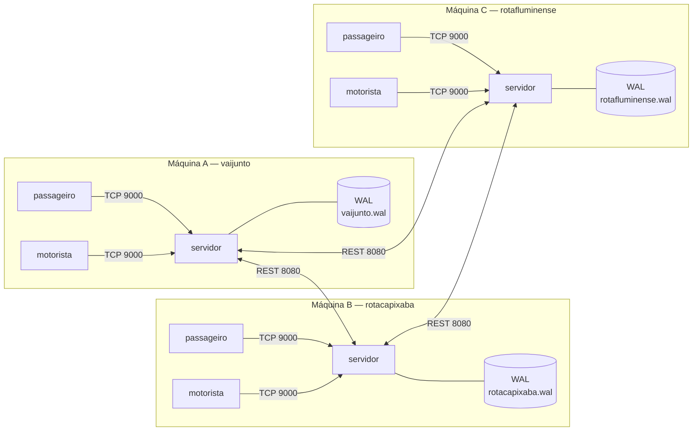

# VAIJUNTO

Consórcio de empresas de carona compartilhada. Cada empresa tem o **seu**
servidor, com os seus dados, e as três cooperam por uma API REST para que um
passageiro reserve, de forma atômica, um itinerário com trechos de empresas
diferentes. **Não há servidor central, coordenador fixo nem armazenamento
compartilhado.**

**Problema 2 de TEC502 — Concorrência e Conectividade.** Entrega individual,
com apresentação e relatório no formato SBC. O Problema 1, de servidor único,
está preservado na tag `p1-final`.

**Autor:** Davi Zardo Motté

## O problema

Motoristas publicam caronas com rota, horário, assentos e preço por trecho.
Passageiros buscam itinerários entre duas cidades e reservam assentos. Como o
veículo passa por cidades intermediárias, a disponibilidade é controlada **por
trecho**: um assento ocupado entre a primeira e a segunda cidade permanece livre
nos trechos seguintes.

No P1 isso acontecia dentro de um servidor só, e uma seção crítica única
resolvia tudo. No P2 as caronas de um itinerário podem pertencer a empresas
diferentes, em máquinas diferentes, e a confirmação continua tendo de ser
**atômica**: ou todos os trechos são reservados, ou nenhum. Com passageiros de
empresas distintas disputando o mesmo assento ao mesmo tempo, e com relógios que
não estão sincronizados, o sistema nunca pode vender o mesmo assento duas vezes
nem deixar assentos presos por uma reserva que não se concluiu — inclusive
quando um dos servidores cai no meio da operação.

## Arquitetura



Cada servidor tem **duas portas**: a TCP do P1 (9000), para os clientes da
própria empresa, e a HTTP (8080), para os pares do consórcio. Cada empresa
guarda só os dados dela; de outras empresas, apenas referências opacas e nome de
exibição (D32). Um cliente só fala com o servidor da sua empresa, e nunca com os
outros.

Oito camadas, das quais só uma conhece prazo e retransmissão
(`PROJETO_P2.md`, seção 5.2):

| # | Camada | Pacote |
|---|---|---|
| 1–4 | Pilha TCP dos clientes | `servidor`, `protocolo` |
| 1–4' | Pilha REST dos pares | `federacao` |
| 5 | Coordenação distribuída: 2PC, Lamport, wait-die, terminação, outbox | `transacao` |
| 6 | Domínio, sobre o estado já travado | `dominio` |
| 7 | Estado: um mutex por servidor, com gravação no log na mesma seção crítica | `dominio` |
| 8 | Persistência: arquivo, `fsync` e leitura no boot | `persistencia` |

A camada 5 é a única que espera, e **nunca espera segurando o lock** da camada
7: chama o estado, solta, faz a E/S de rede e volta ao estado com o resultado.

## Documentação

| Documento | Conteúdo |
|---|---|
| [`PROJETO_P2.md`](PROJETO_P2.md) | Decisões D20–D42, modelo, algoritmos, invariantes, plano de teste, medições e fases |
| [`API_CONSORCIO.md`](API_CONSORCIO.md) | Contrato REST entre os servidores: recursos, códigos, diagramas de sequência |
| [`PROTOCOL.md`](PROTOCOL.md) | Contrato TCP entre cliente e o servidor da sua empresa (v2) |
| [`ROTEIRO_DEMONSTRACAO.md`](ROTEIRO_DEMONSTRACAO.md) | Operação em três máquinas: preparar, demonstrar, medir e lidar com a queda provocada |
| [`PROJETO.md`](PROJETO.md) | **Histórico do P1.** Explica o código herdado, mas tem decisões revogadas pelo P2 |

Em conflito, vale a ordem da tabela.

## Escolhas técnicas

Cada uma tem a justificativa completa na decisão indicada do `PROJETO_P2.md`.

| Escolha | Decisão |
|---|---|
| **Go, só biblioteca padrão.** `go.mod` sem nenhum `require` | D01 |
| **Lista estática de pares** (`--pares`), sem descoberta nem registro central | D20 |
| **Two-phase commit**, com o coordenador sendo a empresa do passageiro — papel que se distribui, nunca fixo | D21 |
| **Write-ahead log por empresa**, com `fsync` antes de qualquer resposta que comprometa o servidor | D22 |
| **Abort presumido**: a decisão de abortar não é gravada; quem não a recebe descobre perguntando | D23 |
| **Precedência por relógio de Lamport com wait-die.** Relógio físico nunca ordena eventos entre servidores | D24 |
| **Contadores por trecho com assentos em espera**, que só existem na máquina de estados do participante | D25 |
| **Busca federada sob demanda**, em paralelo, com resposta parcial quando um par não responde | D26 |
| **Identificadores globais com prefixo da empresa** (`rotacapixaba:car-1`) | D27 |
| **REST com `net/http`**, JSON, e toda operação idempotente pelo `txID` | D28 |
| **Detecção de falha por timeout.** A queda de um par nunca é erro fatal | D30 |
| **Catálogo de cidades comum**, compilado nos três binários — padrão, não dado compartilhado | D33 |

O que **deixou de valer** do P1: estado só em memória (D02 → D22), reserva numa
seção crítica única (D07 → D21), prazos só no transporte (D17 → prazos decidem
abort e liberação) e servidor único (RNF10 → N servidores pares). O mutex global
(D04) continua existindo, mas vale **por servidor** e não protege o itinerário
inteiro.

## Pré-requisitos

- **Go 1.23** para compilar e rodar os testes.
- **Docker** com Compose para subir as três empresas e para o laboratório.

Nenhuma dependência externa: `go.mod` não tem nenhum `require`.

## Subindo as três empresas

O jeito normal de rodar o consórcio inteiro numa máquina:

```bash
docker compose up --build -d
```

Sobe `vaijunto`, `rotacapixaba` e `rotafluminense`. Dentro do contêiner todas
escutam em 9000 e 8080; o host as distingue assim:

| Empresa | TCP (clientes) | HTTP (pares) | Dados | Estado |
|---|---|---|---|---|
| `vaijunto` | `localhost:9001` | `localhost:8081` | `dados/vaijunto/` | `estado/vaijunto/` |
| `rotacapixaba` | `localhost:9002` | `localhost:8082` | `dados/rotacapixaba/` | `estado/rotacapixaba/` |
| `rotafluminense` | `localhost:9003` | `localhost:8083` | `dados/rotafluminense/` | `estado/rotafluminense/` |

Conferindo que subiram:

```bash
curl -s http://localhost:8082/saude
```

```json
{"empresa":"rotacapixaba","versao_api":1,"instante":"2026-11-03T11:25:47.749706005-03:00"}
```

Os clientes ficam no perfil `clientes`, para que `docker compose up` suba só as
empresas. Escolha a empresa pela variável de ambiente:

```bash
docker compose run --rm passageiro                                        # vaijunto
docker compose run --rm -e VAIJUNTO_SERVIDOR=rotacapixaba:9000 passageiro
docker compose run --rm -e VAIJUNTO_SERVIDOR=rotafluminense:9000 motorista
```

O `docker-compose.yml` serve **só ao desenvolvimento**: ele resolve
`http://rotacapixaba:8080` pela rede interna do Docker. No laboratório, cada
máquina sobe a sua empresa com `docker run` — é o [`ROTEIRO_DEMONSTRACAO.md`](ROTEIRO_DEMONSTRACAO.md).

O log de cada empresa fica em `estado/<empresa>/`, no host e não dentro do
contêiner: `docker compose down` não perde o que foi publicado e reservado. Para
recomeçar do zero, apague os `.wal` — a semente é recarregada em todo boot
(D37):

```bash
docker compose down && rm -f estado/*/*.wal
```

O compose roda os servidores com `user: "${UID:-1000}:${GID:-1000}"`, para que
o `.wal` não nasça com dono `root`. Em `bash`, `UID` é somente leitura e não é
exportada, então o padrão 1000 é o que vale; se o seu usuário não for 1000, crie
um `.env` na raiz com `UID=` e `GID=` antes de subir.

### Uma empresa só, sem Docker

```bash
go run ./cmd/servidor --empresa vaijunto \
  --dados dados/vaijunto \
  --log estado/vaijunto/vaijunto.wal \
  --pares rotacapixaba=http://localhost:8082,rotafluminense=http://localhost:8083
```

As flags estão todas na seção 13.1 do `PROJETO_P2.md`. As que mais importam:
`--empresa` (obrigatória, prefixa todos os IDs), `--dados`, `--pares`, `--log`,
`--endereco` (TCP, `0.0.0.0:9000`), `--endereco-pares` (HTTP, `0.0.0.0:8080`),
`--log-operacoes` e `--auditoria`. Sem `--log`, o estado é volátil e o servidor
avisa na subida.

Os clientes leem o endereço de `VAIJUNTO_SERVIDOR`:

```bash
VAIJUNTO_SERVIDOR=localhost:9001 go run ./cmd/passageiro
VAIJUNTO_SERVIDOR=localhost:9001 go run ./cmd/motorista
```

São **menus interativos**, com uma única conexão TCP por sessão, do `LOGIN` ao
`LOGOUT` (D15). O usuário nunca digita identificador: ao escolher um item pelo
número, o cliente devolve ao servidor os campos que ele mesmo recebeu na
resposta anterior. Cada perna do itinerário mostra a empresa dona, e uma busca
que não ouviu todo o consórcio sai com um aviso de resultado parcial.

### Exercitando sem cliente

O protocolo é o contrato, nos dois lados. Uma requisição TCP crua
([`PROTOCOL.md` §5.1](PROTOCOL.md#51-ping)):

```bash
printf '{"id":"1","tipo":"PING","dados":{}}\n' | nc -q1 localhost 9001
```

E a API entre servidores, à mão
([`API_CONSORCIO.md` §7](API_CONSORCIO.md#7-exemplo-com-curl)) — útil na
arguição, porque mostra que entre os servidores só há HTTP e JSON.

## Registro de operações

Com `--log-operacoes` ligado, que é o padrão, o terminal do servidor mostra uma
linha por operação de cliente e por mensagem trocada com um par. É por ele que o
2PC fica visível:

```
11:26:39.490 [vaijunto] → rotacapixaba POST /transacoes/vaijunto:res-3c590165/preparar L=105 → 200 (5.697 ms)
11:26:39.492 [vaijunto] → rotafluminense POST /transacoes/vaijunto:res-3c590165/preparar L=105 → 200 (7.870 ms)
11:26:39.495 [vaijunto] DECISAO tx="vaijunto:res-3c590165" carimbo=(105,vaijunto) → CONFIRMAR
11:26:39.495 [172.18.0.1:47596] maria    RESERVAR               id="2" → OK (11.065 ms)
11:26:39.497 [vaijunto] → rotacapixaba POST /transacoes/vaijunto:res-3c590165/confirmar L=108 → 200 (2.453 ms)
11:26:39.500 [vaijunto] → rotafluminense POST /transacoes/vaijunto:res-3c590165/confirmar L=110 → 200 (2.642 ms)
11:26:39.503 [vaijunto] DECISAO tx="vaijunto:res-3c590165" → CONCLUIDA
```

A seta diz o sentido: `→` é chamada que este servidor fez, `←` é requisição
recebida de um par. Do outro lado, a mesma transação aparece com o voto:

```
11:26:39.492 [rotafluminense] ← vaijunto POST /transacoes/vaijunto:res-3c590165/preparar L=106 tx=vaijunto:res-3c590165 carimbo=(105,vaijunto) voto=SIM → 200 (7.267 ms)
11:26:39.500 [rotafluminense] ← vaijunto POST /transacoes/vaijunto:res-3c590165/confirmar L=111 tx=vaijunto:res-3c590165 CONFIRMAR situacao=CONFIRMADO → 200 (2.028 ms)
```

Repare que `RESERVAR → OK` sai **antes** dos `confirmar`: a decisão já está
gravada, e os assentos em `PREPARADO` já contam como ocupados. A senha e o
restante do campo `dados` nunca aparecem (D19). Para desligar o registro, por
exemplo ao medir, use `--log-operacoes=false` ou, no compose,
`LOG_OPERACOES=false`.

## Cenário de demonstração

A semente das três empresas (`PROJETO_P2.md`, seção 12.2) é montada para que
**Salvador → Petrópolis em 05/11/2026** devolva exatamente um itinerário, com
uma perna em cada empresa:

| Perna | Carona | Motorista | Trecho |
|---|---|---|---|
| 1 | `vaijunto:car-1` | joao | Salvador 05:00 → Vitória da Conquista 12:30 |
| 2 | `rotacapixaba:car-1` | rafael | Vitória da Conquista 14:00 → Cachoeiro de Itapemirim 06:30 (06/11) |
| 3 | `rotafluminense:car-1` | marcos | Cachoeiro 08:00 → Petrópolis 14:30 |

Total R$ 430,00, duas baldeações, de 05/11 05:00 a 06/11 14:30. A perna de
fernanda não serve, porque chega ao Rio às 17:15, depois que a carona de marcos
já passou por lá — é o controle de que o encadeamento é mesmo verificado.

As seis demonstrações que o projeto precisa exercitar estão na seção 12.3 do
`PROJETO_P2.md`, e o procedimento — máquinas, usuários e ordem — no
[`ROTEIRO_DEMONSTRACAO.md`](ROTEIRO_DEMONSTRACAO.md).

## Usuários de teste

Os nomes são únicos **dentro** da empresa: `vaijunto:teste01` e
`rotacapixaba:teste01` são pessoas diferentes.

| Empresa | Motoristas (senha `1234`) | Passageiros (senha `abcd`) | Carga (senha `teste`) |
|---|---|---|---|
| `vaijunto` | joao, carlos, ana | maria, pedro, lucia | teste01 … teste50 |
| `rotacapixaba` | rafael, beatriz, gustavo | paulo, clara, renata | teste01 … teste50 |
| `rotafluminense` | marcos, fernanda, roberto | tiago, sofia, julia | teste01 … teste50 |

As senhas ficam em texto claro em `dados/<empresa>/usuarios.json`, o que é
deliberado e está registrado como trabalho futuro (`PROJETO_P2.md`, seção 15).

## Testes

```bash
go build ./... && go vet ./...
go test -race ./...              # unidade e integração multiempresa
go test -race -count=20 ./testes # concorrência: TB, TR, TF, TC e T1 a T8
docker compose up --build
```

Os cenários estão na seção 11.3 do `PROJETO_P2.md`: busca federada (TB),
reserva e disputa (TR), falhas e recuperação (TF1 a TF10), cancelamentos (TC),
persistência (TP) e o teste de sistema (TS1). Os multiempresa sobem as três
empresas **no mesmo processo**, com `httptest` ou com a rede em memória da
seção 5.4, que permite injetar atraso, perda e partição de forma
determinística.

Duas regras de verificação valem sempre:

- **Concorrência com `-race` e `-count` alto.** Uma corrida que aparece uma vez
  em vinte execuções é normal; rodar sem `-race` não vale como evidência.
- **Medição sem `-race`.** O detector multiplica o custo de cada acesso à
  memória, e o número medido seria o dele.

### Fora da suíte normal

**Simulador de carga** (seção 11.4). Fala só TCP, como os clientes reais, com as
três empresas ao mesmo tempo:

```bash
docker compose up -d
go run ./cmd/simulador --cenario=federado --passageiros=20 --duracao=60s
```

**Verificação de invariantes** contra um consórcio já no ar (seção 11.2). O
simulador usa o consórcio; este teste o observa — por isso são dois comandos:

```bash
VAIJUNTO_AUDITORIA=vaijunto=http://localhost:8081,rotacapixaba=http://localhost:8082,rotafluminense=http://localhost:8083 \
  go test -run TestInvariantesDoAmbiente ./testes
```

**Teste de sistema** (TS1, seção 11.5). Sobe as três em contêineres, roda carga,
derruba uma empresa no meio — com `docker kill` numa rodada e com
`FALHAR_EM=coord-apos-decidir` noutra —, religa e verifica as invariantes:

```bash
VAIJUNTO_SISTEMA=1 go test -race -run TestSistemaSobCargaEFalhas -v -timeout 20m ./testes
```

**Medição de desempenho** (seção 11.6), com o registro desligado e `estado/`
limpo antes de cada cenário:

```bash
docker compose down && rm -f estado/*/*.wal
LOG_OPERACOES=false docker compose up -d --force-recreate
go run ./cmd/simulador --cenario=local    --curva=1,10,50,100 --duracao=5s
go run ./cmd/simulador --cenario=federado --curva=1,10,50,100 --duracao=5s
```

Os números já medidos estão na seção 11.6; a terceira configuração — a mesma
rodada com os servidores em máquinas distintas — é coleta de laboratório, na
Parte 3 do [`ROTEIRO_DEMONSTRACAO.md`](ROTEIRO_DEMONSTRACAO.md).

## Limites conhecidos

Assumidos e documentados, não descobertos em produção:

- **Bloqueio residual do 2PC** (seção 9.6). Se o coordenador cai depois de todos
  os votos SIM e antes de entregar a decisão, os participantes ficam em dúvida e
  os assentos daquela transação ficam presos até ele voltar. É o limite
  conhecido do 2PC, e evitá-lo exigiria hipóteses de sincronia ou replicar o
  coordenador. Fica restrito àquela transação, e termina na volta.
- **Sem autenticação entre servidores.** Quem alcança a porta 8080 de uma
  empresa pode se dizer outra. A verificação de papéis (seção 1.2 da API) impede
  que um par mal configurado mexa em transação que não é dele, mas não substitui
  autenticação (seção 15).
- **O log cresce indefinidamente.** Não há compactação por snapshot, então o
  boot fica mais lento com o tempo, e duas medições só são comparáveis com
  `estado/` no mesmo ponto de partida.
- **Busca parcial.** Um par fora do ar não é erro: a busca volta sem as caronas
  dele, avisando quais empresas não responderam (D26, D30).
- **A entrada e a saída de empresas do consórcio é estática** (D20): mudar a
  lista é reiniciar os servidores.

## Estrutura do repositório

```
cmd/servidor           liga as peças: flags, semente, replay, portas TCP e HTTP
cmd/motorista          CLI do motorista
cmd/passageiro         CLI do passageiro
cmd/simulador          gerador de carga sem interface (seção 11.4)
internal/protocolo     protocolo TCP: envelope, enquadramento, códigos
internal/servidor      pilha TCP, sessão, roteador, tradução de erros
internal/federacao     handlers REST, cliente HTTP dos pares, busca federada, rede em memória
internal/transacao     2PC, Lamport, wait-die, terminação, recuperação, outbox
internal/dominio       regras, estado, mutex, assentos em espera, catálogo de cidades
internal/persistencia  log em arquivo, com fsync
internal/cliente       conexão e terminal reaproveitados pelos dois CLIs
internal/simulador     carga de passageiros por TCP: cenário, sessões, métricas e CSV
testes/                integração multiempresa, concorrência, falhas, carga e sistema
dados/<empresa>/       usuarios.json e caronas.json de cada empresa
estado/<empresa>/      logs write-ahead (criado na execução, fora do git)
resultados/            CSVs das rodadas de carga (criado na execução, fora do git)
```

Regras de importação que eliminam ciclos por construção:

- `dominio` não importa pacote interno nenhum, nem rede, nem disco. O log entra
  por uma interface definida no próprio `dominio`, que recebe bytes já
  serializados.
- `persistencia` não importa nada interno: só grava e lê linhas.
- `transacao` importa `dominio`; a rede entra por uma interface que ele próprio
  declara.
- `federacao` importa `transacao` e `dominio`, e implementa essa interface.
- `servidor` importa `federacao`, `transacao`, `dominio` e `protocolo`.
- `simulador` importa só `protocolo` e `dominio`: ele é um cliente.

Os erros de domínio são sentinelas tipados, e há **duas** tabelas de tradução,
uma por borda: `internal/servidor` para os códigos do `PROTOCOL.md` e
`internal/federacao` para os status e motivos do `API_CONSORCIO.md`. Um teste
por tabela percorre todos os sentinelas exportados e exige entrada para cada um.
