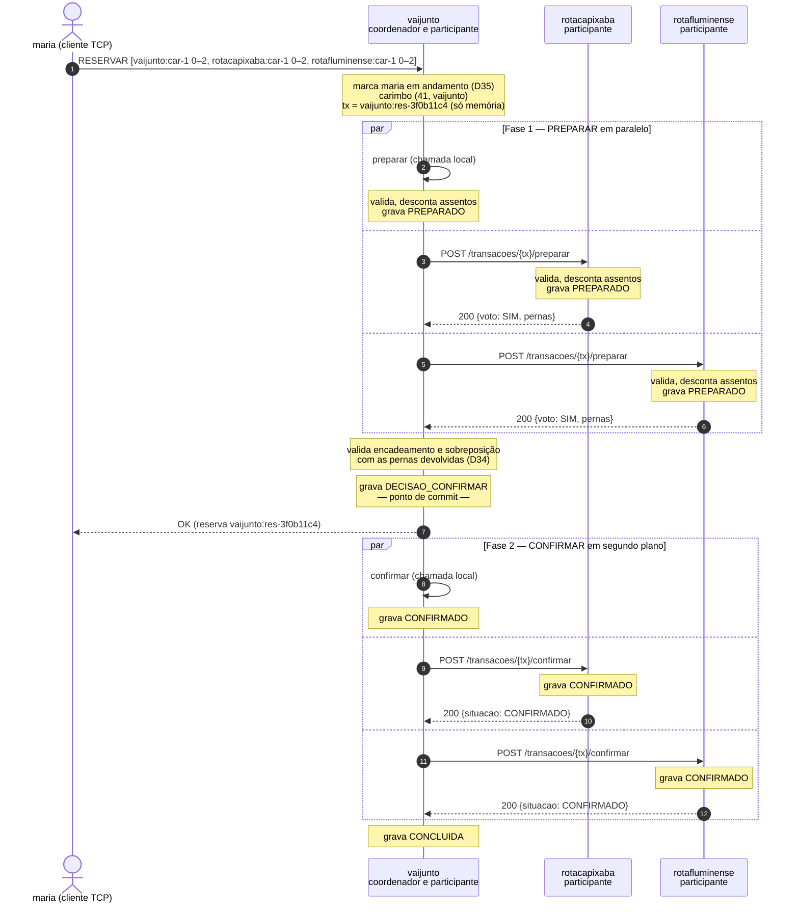

# Roteiro de demonstração — VAIJUNTO, Problema 2

Documento **operacional**. Ele não explica o sistema: ele o encena, na ordem
certa, de modo que cada caixa de `checklist_avaliacao.md` seja marcada por algo
que aparece na tela. A explicação teórica e as respostas às perguntas do tutor
estão no documento irmão, `ESTUDO_ARGUICAO.md`.

Três máquinas, uma empresa em cada. Seis partes:

| Parte | O que cobre | Quando | Marca |
|---|---|---|---|
| **0** | Preparar as três máquinas: IPs, firewall, imagens, prazos | Antes, fora do tempo | — |
| **1** | Subir as três e provar a arquitetura | ~4 min | 1.1–1.4, 2.2, 3.1 |
| **2** | Demonstrações D-1 a D-8 | ~15 min | 2.*, 3.*, 4.*, 5.*, 6.*, 7.*, 8.* |
| **3** | Os testes na tela | ~4 min | 10.1–10.4 |
| **4** | Quando o tutor derrubar uma empresa | A qualquer momento | 8.*, 9.*, 11.3, 11.4 |
| **5** | Se algo der errado | Só se precisar | — |

## Convenção sobre as saídas reproduzidas aqui

As saídas deste documento vêm de duas origens, e a diferença importa no ensaio:

- **Sem marca** — copiada de uma execução real do consórcio. Pode ser lida como
  o que vai aparecer.
- **⚠ ensaiar** — saída **esperada**, derivada da especificação e do código, mas
  ainda não capturada numa execução. Confira no ensaio antes de prometer ao
  tutor. A lista completa está em [Ensaio obrigatório](#ensaio-obrigatório).

---

# Mapa: cada caixa do checklist e onde ela é marcada

Esta é a tabela que o tutor acompanha. São 41 caixas em 11 itens.

| Caixa | Texto | Onde se marca |
|---|---|---|
| 1.1 | Pelo menos 3 servidores de empresa independentes | 1.1, 1.2 — três `docker run` em três máquinas, três boots |
| 1.2 | Cada empresa é a única dona dos seus trechos | 1.4 — `/federacao/caronas` de cada uma só traz as dela |
| 1.3 | Sem servidor central, coordenador fixo ou BD compartilhado | 1.4 — `docker ps` e `--pares`; D-1 × D-3, coordenador diferente |
| 1.4 | Compara com a arquitetura centralizada do P1 | 1.5 — a frase do mutex, dita na tela |
| 2.1 | API REST documentada (recursos, métodos, códigos) | 1.3 e D-7 — `API_CONSORCIO.md` aberto, HTTP cru no `curl` |
| 2.2 | Timeout em toda chamada entre servidores | 1.6 — o `grep` do ponto único; D-4b, o prazo estourando |
| 2.3 | ID de transação nas operações que alteram estado | D-1 — o `txID` na URL de cada chamada |
| 2.4 | Repetir um COMMIT não reserva duas vezes | **D-8** — `confirmar` repetido com `curl`, contadores iguais |
| 3.1 | Encontra itinerário com trechos de 2 ou mais empresas | 1.3 e D-1 — uma perna em cada empresa |
| 3.2 | Estratégia justificada (tempo real ou catálogo) | D-1 — as duas chamadas `GET /federacao/caronas` no terminal |
| 3.3 | Empresa fora do ar gera resultado parcial, não erro | D-4a — `parcial: true` e a empresa nomeada |
| 3.4 | Confirmação sempre decidida pelo dono do trecho | D-2 — a busca oferece, o `PREPARAR` do dono recusa |
| 4.1 | O dono serializa os pedidos sobre os seus trechos | D-2 — exatamente um `OK` |
| 4.2 | Reservas simultâneas por empresas diferentes: só uma confirma | D-2 e D-3 — dois clientes, duas máquinas, um `OK` |
| 4.3 | Mecanismo escolhido é justificado | D-2, fala final — autoridade do dono, sem lock distribuído |
| 5.1 | Protocolo identificado (2PC, TCC ou saga) | D-1 — `PREPARAR`, votos, `DECISAO`, `CONFIRMAR` |
| 5.2 | Apresenta o diagrama de sequência da confirmação | 0.7 e D-1 — diagrama aberto na tela ([apêndice](#apêndice-o-diagrama-da-confirmação)) |
| 5.3 | Recusa de um participante desfaz os demais trechos | D-2c — a perna capixaba do perdedor em `ABORTADO` |
| 5.4 | Após votar SIM, o participante não expira sozinho | D-5c — `em_espera` fica 1 enquanto o coordenador está fora |
| 6.1 | Critério definido e justificado | D-3 — os carimbos `(lamport, empresa)` no terminal |
| 6.2 | Não usa o relógio físico dos servidores sem tratamento | 0.1 e 1.2 — relógios não sincronizados, de propósito |
| 6.3 | Reconhece o efeito da latência e dos pedidos em trânsito | D-3, nota de honestidade — e o TR3 na Parte 3 |
| 7.1 | Mecanismo explícito (ordem global, no-wait, wait-die, timeout) | D-3 — `AGUARDE` × `PRECEDENCIA` |
| 7.2 | Demonstra reservas cruzadas sem travar o sistema | D-3 — um `OK`, um `DISPUTA_PERDIDA`, nada pendurado |
| 7.3 | Reconhece efeitos colaterais (abortos, livelock) | D-3 — as três linhas `ABORTAR` do mesmo carimbo |
| 8.1 | Detecta a queda por timeout ou heartbeat | D-4b e 4.1 — `→ sem resposta (2000 ms)` |
| 8.2 | As demais empresas continuam operando | D-4c — reserva local normal com B fora |
| 8.3 | Distingue falha do coordenador e do participante | D-5 (coordenador) × D-4 (participante) |
| 8.4 | Explica o participante que votou SIM e perdeu o coordenador | D-5c e D-7 — bloqueio residual e terminação cooperativa |
| 9.1 | Armazenamento local durável em cada empresa | 1.2 — três `.wal` distintos; `tail -f` durante a D-1 |
| 9.2 | Registro da transação gravado antes de responder | D-1 — `tail -f` mostra `PREPARADO` antes do voto |
| 9.3 | Ao reiniciar, conclui ou desfaz as transações pendentes | D-5d — `1 reserva(s) com a fase 2 a retomar` |
| 9.4 | Nenhum assento bloqueado após a recuperação | D-5e e 4.4 — `em_espera [0,0]`, `outbox: []` |
| 10.1 | Testes automatizados executados na apresentação | 3.1, 3.2 — `go test -race` na tela |
| 10.2 | Carga com reservas simultâneas de todas as empresas | 3.3 — simulador contra as três |
| 10.3 | Verifica venda dupla, reserva pela metade e assento bloqueado | 3.2 e 3.4 — TR1, TR2, TF*, invariantes |
| 10.4 | Mede o desempenho; resultados constam no relatório | 3.5 — curva e CSVs |
| 11.1 | Cada empresa em um contêiner isolado | 1.1 — `docker run` com volumes próprios |
| 11.2 | Pelo menos 3 empresas em computadores distintos | 1.1 e 1.3 — `--pares` por IP, `/saude` cruzado |
| 11.3 | Tutor derruba um contêiner durante uma transação | **D-5b** e Parte 4 — `docker kill` sob carga |
| 11.4 | Recuperação observada após o reinício | D-4d, D-5d, 4.3 — replay e relógio restaurado |

**As quatro caixas mais frágeis**, que só se marcam se você provocar: **2.4**
(D-8), **5.4** (D-5c), **6.3** (a nota de honestidade da D-3) e **11.3** (D-5b).
Nenhuma delas aparece sozinha no caminho feliz — se faltar tempo, corte
outra coisa, não estas.

---

# Parte 0: preparação

## 0.1 As três máquinas

Uma empresa por máquina, cada uma com **duas** portas: 9000 para os clientes
dela e 8080 para os pares.

| Máquina | Empresa | IP | Variável |
|---|---|---|---|
| A | `vaijunto` | | `IP_A` |
| B | `rotacapixaba` | | `IP_B` |
| C | `rotafluminense` | | `IP_C` |

Anote os IPs com `hostname -I` e exporte os três **em todos os terminais** de
todas as máquinas:

```bash
export IP_A=192.168.0.10 IP_B=192.168.0.11 IP_C=192.168.0.12
```

As três máquinas precisam estar no **mesmo commit** (`git log -1 --oneline`).

Os relógios **não** precisam estar sincronizados, e isso é argumento, não
descuido: nenhuma decisão entre servidores usa relógio físico (caixa 6.2). Se o
tutor perguntar, não sincronize — mostre que não faz diferença.

## 0.2 Firewall: 9000 e 8080

Cada contêiner fica na rede *bridge* da sua máquina, e redes *bridge* de
máquinas diferentes não se enxergam. O que resolve é publicar as portas no host
— por isso as duas precisam estar liberadas nas três máquinas:

```bash
sudo ufw allow 9000/tcp && sudo ufw allow 8080/tcp     # ou o firewall da distro
```

Esquecer a 8080 é a falha mais provável desta demonstração, e ela se disfarça:
os clientes conectam normalmente, a busca volta **parcial** e toda reserva
federada responde `EMPRESA_INDISPONIVEL`, como se os outros servidores
estivessem fora do ar.

## 0.3 Montar as imagens

A montagem baixa `golang:1.23-alpine` e `alpine:3.20`. Na raiz do repositório:

```bash
# Nas três máquinas: a imagem do servidor
docker build -f Dockerfile.servidor -t vaijunto-servidor .

# Onde for rodar cliente ou simulador (as três, por segurança)
docker build -f Dockerfile.cliente -t vaijunto-cliente .
```

Sem internet no laboratório, monte antes e leve num pendrive:

```bash
docker save vaijunto-servidor vaijunto-cliente | gzip > vaijunto.tar.gz
docker load < vaijunto.tar.gz
```

A imagem do cliente traz `/bin/passageiro`, `/bin/motorista`, `/bin/simulador` e
`/bin/carga` compilados, então a máquina que só roda clientes não precisa de Go.

**Leve Go instalado em pelo menos uma máquina.** A Parte 3 roda `go test` na
tela, e é o que marca as caixas 10.1 e 10.3.

## 0.4 Diretório de estado

O log write-ahead (D22) fica num diretório **da máquina**, não dentro do
contêiner. É o que torna o `--rm` seguro: o contêiner é descartável, o estado
não. Em cada máquina, na raiz do repositório:

```bash
mkdir -p estado && rm -f estado/*.wal     # começa do zero; a semente recarrega (D37)
```

## 0.5 Prazos desta semente

A semente tem caronas em **05 e 06/11/2026** e os prazos de cancelamento são
aplicados com o relógio **real** (D13). Confira antes de ensaiar:

| Demonstração | Depende do relógio? | Limite |
|---|---|---|
| D-1, D-2, D-3 | Não | Reservar e buscar não conferem se a carona já partiu |
| D-4, D-5, D-7, D-8 | Não | — |
| **D-6** | **Sim** | `rotafluminense:car-1` parte em **06/11/2026 08:00**; depois disso, cancelar a carona é recusado |
| Cancelar reserva (opcional) | Sim | Uma hora antes da primeira perna: `vaijunto:car-1` parte 05/11 05:00, logo o limite é **04/11 04:00** |

Passado o limite da D-6, a saída é deslocar as datas da semente nos três
`dados/<empresa>/caronas.json` — o que muda a seção 12.2 do `PROJETO_P2.md`, a
tabela de assentos deste roteiro e os testes que citam 05 e 06/11. **Não é
mudança para se fazer na véspera.** Se a apresentação for depois de 06/11 e nada
tiver sido deslocado, pule a D-6 e diga o motivo: o item 8 ainda se sustenta
pela D-4, D-5 e D-7.

## 0.6 Conferências finais

- `curl` e `nc` disponíveis nas três máquinas (`nc` é usado só no diagnóstico).
- Combinado quem aperta o segundo Enter nas disputas D-2 e D-3.
- Go instalado em pelo menos uma máquina, para a Parte 3.
- `python3` na máquina A, se quiser ler a auditoria formatada (opcional).

## 0.7 O que deixar aberto na tela

Abra **antes** de começar, porque abrir arquivo no meio da arguição custa tempo
e credibilidade:

| Janela | Conteúdo | Serve a |
|---|---|---|
| 1 | `checklist_avaliacao.md` | acompanhar as caixas com o tutor |
| 2 | **O diagrama de sequência** da confirmação | **caixa 5.2** |
| 3 | `PROJETO_P2.md` seção 5.1, o diagrama de arquitetura | caixas 1.1–1.3 |
| 4 | `API_CONSORCIO.md` seção 4, a tabela de recursos | caixa 2.1 |

O diagrama da caixa 5.2 está em `API_CONSORCIO.md` seção 6.1 e também no
[apêndice](#apêndice-o-diagrama-da-confirmação) deste roteiro, para não precisar
de dois arquivos. Se puder renderizar o Mermaid, melhor; se não, o texto serve —
o que o item pede é que você **apresente** o diagrama, e ele existe.

---

# Parte 1: subir as três empresas e provar a arquitetura

## 1.1 Um comando por máquina

Cada empresa monta **só** o seu diretório de dados; nenhum volume é
compartilhado (RD07, RD11).

```bash
# Máquina A — vaijunto
docker run --rm --name vaijunto -p 9000:9000 -p 8080:8080 -e TZ=America/Bahia \
  -v "$(pwd)/dados/vaijunto:/dados:ro" -v "$(pwd)/estado:/estado" \
  --user "$(id -u):$(id -g)" vaijunto-servidor \
  --empresa vaijunto \
  --pares rotacapixaba=http://$IP_B:8080,rotafluminense=http://$IP_C:8080 \
  --dados /dados --log /estado/vaijunto.wal --auditoria

# Máquina B — rotacapixaba
docker run --rm --name rotacapixaba -p 9000:9000 -p 8080:8080 -e TZ=America/Bahia \
  -v "$(pwd)/dados/rotacapixaba:/dados:ro" -v "$(pwd)/estado:/estado" \
  --user "$(id -u):$(id -g)" vaijunto-servidor \
  --empresa rotacapixaba \
  --pares vaijunto=http://$IP_A:8080,rotafluminense=http://$IP_C:8080 \
  --dados /dados --log /estado/rotacapixaba.wal --auditoria

# Máquina C — rotafluminense
docker run --rm --name rotafluminense -p 9000:9000 -p 8080:8080 -e TZ=America/Bahia \
  -v "$(pwd)/dados/rotafluminense:/dados:ro" -v "$(pwd)/estado:/estado" \
  --user "$(id -u):$(id -g)" vaijunto-servidor \
  --empresa rotafluminense \
  --pares vaijunto=http://$IP_A:8080,rotacapixaba=http://$IP_B:8080 \
  --dados /dados --log /estado/rotafluminense.wal --auditoria
```

Deixe cada terminal visível durante toda a demonstração: é nele que o 2PC
aparece.

**Marque aqui as caixas 11.1 e 11.2**, apontando três coisas no comando:

1. `-v .../dados/<empresa>:/dados:ro` — cada contêiner monta **só** os dados da
   sua empresa, e somente leitura.
2. `--log /estado/<empresa>.wal` — cada um escreve o **seu** log, na **sua**
   máquina. Não há volume comum.
3. `--pares <empresa>=http://<IP>:8080` — a lista de pares é estática e por IP.
   Não há serviço de descoberta, porque ele seria o componente central proibido.

**Por que `--auditoria`.** Expõe `GET /auditoria`, somente leitura, com os
contadores por trecho, as participações e o outbox da empresa. É o que a D-5 e a
D-8 usam para provar o que afirmam, e o que o verificador da Parte 3 lê. **Não
participa de nenhuma decisão**: é instrumento de observação, como o `-race`. Em
produção ficaria desligada, porque mostra participações, que nenhum par tem o
direito de ver (D32). Diga isso **antes** que o tutor pergunte se a auditoria é
um componente central.

**Por que `--user`.** Sem ela o `.wal` nasce com dono `root` no host, e o
próximo `docker run` sem `--user` passa a falhar.

## 1.2 Boot esperado

Três linhas, nesta ordem:

```
servidor: log /estado/vaijunto.wal aberto, 0 registros reaplicados, relógio de Lamport em 0
servidor: empresa vaijunto atendendo clientes em [::]:9000 e pares em [::]:8080 (pares: 2, registro de operações: true)
servidor: recuperação: 0 reserva(s) com a fase 2 a retomar, 0 participação(ões) em PREPARADO com o prazo de dúvida armado, 0 aviso(s) no outbox a entregar
```

O que apontar:

- **Linha 1 marca a caixa 9.1.** Cada empresa abre o **seu** log, com o nome
  dela. São três arquivos, em três máquinas.
- **`pares: 2`** confirma que o `--pares` foi lido. Se vier `pares: 0`, a lista
  está errada e nenhuma reserva federada vai funcionar — pare e corrija.
- **Linha 3 sai em todo boot**, porque todo boot é uma recuperação (seção 9.1).
  Num servidor que subiu limpo as três listas vêm vazias. É a mesma linha que,
  na D-5, vai mostrar `1 reserva(s) com a fase 2 a retomar` — guarde isso, é a
  caixa 9.3.

## 1.3 Provar que as três se enxergam

De cada máquina, pergunte a saúde das outras duas:

```bash
curl -s http://$IP_B:8080/saude && echo && curl -s http://$IP_C:8080/saude
```

```json
{"empresa":"rotacapixaba","versao_api":1,"instante":"2026-11-03T11:25:47.749706005-03:00"}
```

Nos terminais dos servidores, nada: `/saude` é diagnóstico e aceita chamada sem
os cabeçalhos do consórcio, então o `curl` de uma pessoa funciona. **Esta é a
evidência isolada da caixa 11.2**, e separa "a rede está errada" de "o cliente
está errado" antes de a apresentação começar.

Confirmação pelo caminho que a demonstração usa de verdade — uma busca federada
na máquina A, com um cliente ou com `nc`:

```bash
printf '{"id":"1","tipo":"LOGIN","dados":{"usuario":"maria","senha":"abcd"}}\n{"id":"2","tipo":"BUSCAR_ITINERARIOS","dados":{"origem":"Salvador","destino":"Petrópolis","data":"2026-11-05"}}\n' | nc -q1 localhost 9000
```

Precisa vir **um** itinerário, `"parcial":false` e `"empresas_indisponiveis":[]`.
No terminal de A aparecem as duas chamadas que ela fez:

```
[vaijunto] → rotacapixaba GET /federacao/caronas?ate=…&desde=… L=0 → 200 (2.380 ms)
[vaijunto] → rotafluminense GET /federacao/caronas?ate=…&desde=… L=0 → 200 (2.735 ms)
```

**Marca as caixas 3.1 e 3.2 de uma vez:** o itinerário tem perna em cada
empresa, e as duas chamadas no terminal mostram que a estratégia é **consulta em
tempo real**, não catálogo replicado — a prova é que a busca produz tráfego.

Se vier `"parcial":true`, pare aqui e volte à 0.2: é a porta 8080.

## 1.4 Provar que não há nada central

Três comandos, meio minuto, e as caixas 1.1, 1.2 e 1.3 ficam marcadas por
evidência e não por afirmação.

**(a) Não existe um quarto processo.** Em cada máquina:

```bash
docker ps
```

Uma linha por máquina, e as portas publicadas:

```
CONTAINER ID   IMAGE               PORTS                                              NAMES
…             vaijunto-servidor   0.0.0.0:8080->8080/tcp, 0.0.0.0:9000->9000/tcp     vaijunto
```

Três máquinas, três contêineres, um por empresa. Nenhum banco, nenhum
coordenador, nenhum serviço de descoberta, nenhum volume comum. **Caixa 1.3.**

**(b) Cada empresa só conhece as caronas dela.** Pergunte o catálogo de cada uma
diretamente, e compare:

```bash
curl -s "http://$IP_B:8080/federacao/caronas?desde=2026-11-05T00:00:00-03:00&ate=2026-11-07T00:00:00-03:00" \
  -H 'X-VaiJunto-Empresa: vaijunto' -H 'X-VaiJunto-Lamport: 1'
```

Só vêm caronas com prefixo `rotacapixaba:`. ⚠ ensaiar — confira que nenhum
`car-` de outro prefixo aparece na resposta das três. **Caixa 1.2:** a empresa
não tem o que responder sobre trecho que não é dela, porque não guarda.

**(c) O coordenador não é fixo.** Isto não é um comando, é uma observação a
cobrar do tutor mais adiante: na **D-1** o coordenador é a `vaijunto`, e nas
linhas `DECISAO` o prefixo é `vaijunto:res-…`; na **D-3** os coordenadores são a
`rotacapixaba` e a `rotafluminense`, e os prefixos mudam. O papel vem do prefixo
do `txID`, que é a empresa do passageiro. **Caixa 1.3**, segunda metade.

## 1.5 A frase do P1 (caixa 1.4)

O checklist pede, com estas palavras, que você explique *por que a trava do
Problema 1 não protege mais um itinerário que envolve empresas diferentes*. É
caixa própria, e se perde por esquecimento. Diga, apontando a tela:

> No P1 havia um processo só, com um `sync.Mutex` global. Reservar um itinerário
> inteiro era uma seção crítica: eu travava, conferia os assentos de todos os
> trechos, descontava todos e destravava. A atomicidade era consequência da
> exclusão mútua — não precisei de protocolo nenhum, e a decisão D07 registra
> isso explicitamente: *sem reserva em duas fases*.
>
> Agora os assentos de um itinerário estão em três processos, em três máquinas.
> O mutex da `vaijunto` não alcança a memória da `rotacapixaba`: ele continua
> existindo, mas o escopo dele encolheu para os assentos de uma empresa só. Ele
> garante que ninguém venda duas vezes o mesmo assento **daquela** empresa, e
> isso é exclusão mútua. O que ele deixou de garantir é que os três descontos
> aconteçam ou nenhum aconteça — e isso é atomicidade, que passou a precisar de
> protocolo. É por isso que a D07 foi revogada e virou a D21, o 2PC.

A frase de uma linha, se o tempo apertar: **o mutex ficou local, então ele ainda
dá exclusão mútua, mas não dá mais atomicidade.**

## 1.6 O ponto único do prazo (caixa 2.2)

A caixa pede *timeout em toda chamada entre servidores*. Prove que é estrutural,
não disciplina, com dois comandos numa máquina com o repositório:

```bash
grep -rn "context.WithTimeout" internal/federacao/cliente.go
grep -rn "http.Get\|http.DefaultClient" internal/ cmd/
```

O primeiro acha `internal/federacao/cliente.go:316`, dentro de `chamar`, que é
o funil pelo qual **toda** chamada a par passa. O segundo não acha uso nenhum —
só um comentário dizendo que não se usa. Diga:

> Não é que eu tenha lembrado de pôr prazo em cada chamada: existe um único
> método que fala com par, e o prazo está dentro dele. O `context` cobre
> resolução de nome, conexão, envio e espera, e é cancelado no retorno, então
> uma chamada que estoura não deixa goroutine nem conexão pendurada.

Os prazos são todos configuráveis por flag (`--prazo-chamada`, `--prazo-votacao`,
`--prazo-duvida`, …), o que é o que permite os testes rodarem em milissegundos.

## 1.7 Abrir os clientes

| Máquina | Terminal | Cliente | Usuário | Usado em |
|---|---|---|---|---|
| A | servidor | — | — | todas |
| A | PA | passageiro | `maria` / `abcd` | D-1, D-6 |
| A | PA2 | passageiro | `pedro` / `abcd` | D-2 |
| A | PA3 | passageiro | `lucia` / `abcd` | D-4 |
| B | servidor | — | — | todas |
| B | PB | passageiro | `clara` / `abcd` | D-2 |
| B | PB2 | passageiro | `paulo` / `abcd` | D-3 |
| C | servidor | — | — | todas |
| C | PC | passageiro | `tiago` / `abcd` | D-3 |
| C | MC | motorista | `marcos` / `1234` | D-6 |

```bash
docker run --rm -it -e VAIJUNTO_SERVIDOR=$IP_A:9000 vaijunto-cliente /bin/passageiro
docker run --rm -it -e VAIJUNTO_SERVIDOR=$IP_C:9000 vaijunto-cliente /bin/motorista
```

Os clientes precisam de `-it`, porque leem do terminal; sem isso o processo
morre ao ler EOF do stdin.

**Cada passageiro só se conecta ao servidor da própria empresa**, e é por isso
que a tabela amarra usuário a máquina. `maria` não existe na `rotacapixaba`, e
`clara` não existe na `vaijunto`: os nomes são únicos dentro da empresa, e
`vaijunto:teste01` e `rotacapixaba:teste01` são pessoas diferentes. Isto também
é evidência da caixa 1.2 — a identidade é propriedade da empresa.

**Por que estes usuários.** Cada demonstração precisa de um passageiro **sem
reserva ativa que se sobreponha** ao itinerário pedido, senão a resposta é
`CONFLITO_HORARIO` e não o que se quer mostrar. maria, pedro e lucia começam sem
reservas; `lucia` fica reservada à D-4 por isso.

---

# Parte 2: demonstrações

A ordem importa: a D-2 depende do assento que a D-1 consome, a D-8 depende da
reserva que a D-1 cria, e a D-6 cancela o que a D-1 e a D-2 criaram.

## D-1 — Busca e reserva entre três empresas

Marca: **2.1, 2.3, 3.1, 3.2, 5.1, 5.2, 9.2.**

**Onde:** PA (máquina A), `maria`.
**Ação:** `1) Buscar itinerários`, Salvador → Petrópolis, `2026-11-05`, e
reservar o único itinerário oferecido.

**Antes de apertar Enter**, abra num quarto terminal da máquina A:

```bash
tail -f estado/vaijunto.wal
```

É o que marca a caixa 9.2: as linhas `PREPARADO` aparecem no disco **antes** de
o voto sair.

**Esperado no cliente:** um itinerário, com uma perna em cada empresa e a
empresa dona visível em cada linha, por **R$ 430,00**, de 05/11 05:00 a 06/11
14:30. Depois, `Reserva vaijunto:res-… confirmada.`

**Esperado no terminal de A** — é aqui que o 2PC fica visível:

```
[vaijunto] → rotacapixaba POST /transacoes/vaijunto:res-3c590165/preparar L=105 → 200 (5.697 ms)
[vaijunto] → rotafluminense POST /transacoes/vaijunto:res-3c590165/preparar L=105 → 200 (7.870 ms)
[vaijunto] DECISAO tx="vaijunto:res-3c590165" carimbo=(105,vaijunto) → CONFIRMAR
[172.18.0.1:47596] maria    RESERVAR               id="2" → OK (11.065 ms)
[vaijunto] → rotacapixaba POST /transacoes/vaijunto:res-3c590165/confirmar L=108 → 200 (2.453 ms)
[vaijunto] → rotafluminense POST /transacoes/vaijunto:res-3c590165/confirmar L=110 → 200 (2.642 ms)
[vaijunto] DECISAO tx="vaijunto:res-3c590165" → CONCLUIDA
```

**Esperado nos terminais de B e de C**, a mesma transação vista de dono:

```
[rotafluminense] ← vaijunto POST /transacoes/vaijunto:res-3c590165/preparar L=106 tx=vaijunto:res-3c590165 carimbo=(105,vaijunto) voto=SIM → 200 (7.267 ms)
[rotafluminense] ← vaijunto POST /transacoes/vaijunto:res-3c590165/confirmar L=111 tx=vaijunto:res-3c590165 CONFIRMAR situacao=CONFIRMADO → 200 (2.028 ms)
```

**Anote o `txID` que apareceu.** A D-8 vai precisar dele.

**O que apontar.** Quatro coisas, na tela, nesta ordem:

1. **O protocolo, nomeado (caixa 5.1).** `preparar` → votos → `DECISAO` →
   `confirmar`. É two-phase commit. Mostre o diagrama da janela 2 ao lado das
   linhas do terminal e percorra-o com o dedo: **isso marca a caixa 5.2**.
2. **O `txID` está em toda URL (caixa 2.3).**
   `/transacoes/vaijunto:res-3c590165/preparar`. O identificador é global, com
   o prefixo da empresa coordenadora, e é por ele que toda operação é
   idempotente — é o que a D-8 vai explorar.
3. **Os dois `preparar` saem em paralelo** e os dois votos voltam SIM. É na
   fase 1, sob o mutex de cada dono, que o assento é descontado — não na fase 2.
4. **`DECISAO … → CONFIRMAR` é o ponto de commit**, e **`RESERVAR → OK` sai
   antes dos `confirmar`**. A decisão já está no log com `fsync`, e os assentos
   em `PREPARADO` já contam como ocupados; maria não precisa esperar a fase 2.

## D-2 — Último assento disputado entre empresas diferentes

Marca: **3.4, 4.1, 4.2, 4.3, 5.3.**

Depois da D-1, resta **um** assento no primeiro trecho de
`rotafluminense:car-1`.

**Onde:** PA2 (`pedro`, máquina A) e PB (`clara`, máquina B).
**Ação:** pedro busca **Salvador → Rio de Janeiro** em `2026-11-05`; clara busca
**Vitória → Rio de Janeiro** em `2026-11-05`. Os dois param em "Reservar
qual?". Na contagem "3, 2, 1", cada um dá Enter na sua máquina.

Os dois itinerários passam pelo mesmo trecho: `rotafluminense:car-1` de
Cachoeiro ao Rio, que tem um assento. O de pedro usa também `vaijunto:car-1` e
`rotacapixaba:car-1`; o de clara, só `rotacapixaba:car-1` — que tem vaga.

**Esperado:** exatamente um confirma. O outro recebe

```
Assento esgotado no trecho 0 da carona rotafluminense:car-1.
```

**(a) A exclusão mútua (caixas 4.1 e 4.2).** Duas requisições, de dois
passageiros, de **duas empresas diferentes**, em duas máquinas, pelo mesmo
assento — e exatamente um `OK`. Diga:

> Quem serializou isso foi o mutex da `rotafluminense`, que é a dona do trecho.
> Os dois `PREPARAR` chegaram nela e foram atendidos um depois do outro; só o
> primeiro encontrou `Livres ≥ 1`. Não houve lock distribuído, nem relógio, nem
> acordo entre coordenadores: a garantia é local porque o dado é local.

**(b) A busca oferece, o dono decide (caixa 3.4).** Isto é importante e passa
batido: o itinerário **foi oferecido aos dois** pela busca, porque a busca é
informativa e dos dois lados havia assento no instante da consulta. Quem
recusou foi o **dono do trecho**, no `PREPARAR`, revalidando sob o mutex dele.
A busca nunca promete assento.

**(c) A atomicidade (caixa 5.3).** O perdedor **não** ficou com o assento da
`rotacapixaba`, que estava livre. Na máquina B:

```bash
curl -s http://localhost:8080/auditoria
```

A participação da transação perdedora está `ABORTADO` e `rotacapixaba:car-1` tem
`em_espera: [0,0]`:

```
rotacapixaba:car-1 livres [1,1] confirmados [2,2] em_espera [0,0]
participações: rotacapixaba:res-542c6365 ABORTADO, vaijunto:res-… CONFIRMADO, …
```

Ou todos os trechos, ou nenhum — e o "nenhum" é **verificável**, não uma
afirmação. É exatamente o que a caixa 5.3 pede: *recusa de um participante
desfaz os demais trechos*.

**Nota para a arguição.** A ordem das duas linhas de `RESERVAR` no terminal não
prova quem chegou primeiro: a linha é escrita depois que o lock foi liberado. O
que prova a serialização é o resultado — exatamente um `OK`.

## D-3 — Disputa cruzada

Marca: **6.1, 6.3, 7.1, 7.2, 7.3.**

Duas caronas de **um assento cada**, em empresas diferentes, pedidas na ordem
inversa por dois passageiros ao mesmo tempo. É o cenário clássico de deadlock
distribuído.

**Onde:** PB2 (`paulo`, máquina B) e PC (`tiago`, máquina C).
**Ação:** os dois buscam **Vitória → Nilópolis** em `2026-11-06` e param em
"Reservar qual?". Na contagem, Enter ao mesmo tempo.

O itinerário combina `rotacapixaba:car-2` (beatriz, Vitória → Cachoeiro, 1
assento) e `rotafluminense:car-2` (fernanda, Cachoeiro → Nilópolis, 1 assento).
paulo é coordenado por B e tiago por C, então os dois `PREPARAR` cruzam.

**Esperado:** exatamente um confirma; o outro recebe

```
O assento foi disputado por outra reserva; nenhum assento foi reservado. Tente de novo.
```

(`DISPUTA_PERDIDA`, depois das três tentativas da D36.) **Não importa qual
vence** — quem vence é a transação de **carimbo mais velho**, e o carimbo é
atribuído na chegada.

**O que apontar nos terminais:**

```
[rotafluminense] ← rotacapixaba POST …/res-542c6365/preparar  carimbo=(6,rotacapixaba)  voto=AGUARDE → 200
[rotafluminense] ← rotacapixaba POST …/res-542c6365/preparar  carimbo=(6,rotacapixaba)  voto=NAO motivo=SEM_ASSENTO → 200
[rotafluminense] ← rotacapixaba POST …/res-f59eb636/preparar  carimbo=(20,rotacapixaba) voto=SIM → 200
[rotafluminense] DECISAO tx="rotafluminense:res-f7c35691" carimbo=(22,rotafluminense) → ABORTAR
[rotafluminense] DECISAO tx="rotafluminense:res-4a6accba" carimbo=(22,rotafluminense) → ABORTAR
[rotafluminense] DECISAO tx="rotafluminense:res-248fb240" carimbo=(22,rotafluminense) → ABORTAR
```

**(a) O critério de precedência (caixa 6.1).** Os carimbos estão na tela:
`(6,rotacapixaba)`, `(20,rotacapixaba)`, `(22,rotafluminense)`. Diga:

> O critério é relógio lógico de Lamport, com desempate pelo identificador da
> empresa em ordem alfabética. Isso dá uma **ordem total**, idêntica em todos os
> servidores, sem nenhuma mensagem a mais: os dois donos do assento chegam à
> mesma conclusão sobre quem é mais velho sem conversarem entre si.

**(b) O mecanismo de deadlock (caixas 7.1 e 7.2).** `(20,rotacapixaba)` é mais
velho que `(22,rotafluminense)`:

> É wait-die. A mais velha recebe `AGUARDE` e o coordenador dela repete em
> 200 ms; a mais nova recebe `PRECEDENCIA` e desiste na hora. Como uma transação
> só espera por transações **mais novas**, um ciclo de espera exigiria que
> alguma esperasse por uma mais velha, o que a regra proíbe. Não há grafo de
> espera a construir nem detector a rodar — e isso importa num sistema sem
> componente central, porque um detector de deadlock distribuído **seria** esse
> componente.

E prove a caixa 7.2 pelo que **não** aconteceu: o sistema não travou. Os dois
clientes voltaram a responder em segundos, um com reserva e outro com recusa
explícita. `AGUARDE` é resposta imediata — quem espera é o coordenador, fora da
seção crítica; o handler HTTP não fica pendurado e o lock não fica preso.

**(c) Os efeitos colaterais (caixa 7.3).** Aponte as **três** linhas `ABORTAR`
com o mesmo carimbo `(22,rotafluminense)`:

> São as três tentativas da mesma reserva. É o custo do wait-die: transações
> jovens desistem e refazem, então sob contenção há mais abortos do que
> reservas. Duas coisas limitam o dano. O carimbo é o **mesmo** nas três
> tentativas, de propósito: a transação envelhece em termos relativos e, na
> próxima disputa, espera em vez de desistir — é o que impede inanição e
> livelock. E há um teto de três tentativas: passado ele, o passageiro recebe
> `DISPUTA_PERDIDA`, uma recusa explícita, em vez de ficar tentando para sempre.
> O número é um limite assumido, e aparece nas métricas do simulador.

**(d) Honestidade sobre o que o terminal mostra (caixa 6.3).** Diga isto sem
esperar a pergunta — é a caixa que se ganha admitindo:

> Ao vivo eu não controlo a ordem de chegada: a disputa cruzada acontece se as
> duas requisições se encavalarem, e isso depende da latência da rede. Duas
> consequências que eu reconheço. A primeira é que `AGUARDE` e `PRECEDENCIA` só
> geram linha REST quando o voto perdedor vem de um dono **remoto**; se o trecho
> esgotado for da própria empresa do perdedor, o voto é decidido localmente, sem
> rede. A segunda é mais funda: quando um dono decide uma disputa, ele decide
> com os carimbos que **já chegaram** nele. Pode haver uma transação mais velha
> ainda em trânsito, que chegará depois e perderá o assento para uma mais nova.
> A ordem de Lamport é total e consistente, mas a decisão é tomada sobre
> conhecimento parcial — garantir o contrário exigiria esperar por mensagens que
> talvez nunca cheguem. A prova determinística do cruzamento é o teste **TR3**,
> que usa uma rede em memória para eu decidir a ordem de chegada em cada dono,
> em vez de torcer pelo escalonador. Ele está na Parte 3.

## D-4 — Queda de uma empresa

Marca: **3.3, 8.1, 8.2, 9.1, 11.4.**

**Onde:** o tutor derruba a máquina B, ou:

```bash
docker kill rotacapixaba
```

Três coisas, nesta ordem, em PA3 (`lucia`, máquina A):

**(a) A busca volta parcial (caixa 3.3).** Salvador → Petrópolis em `2026-11-05`:

```
Aviso: busca incompleta — sem resposta de: rotacapixaba.
```

E nenhum itinerário, porque o único que existia tinha perna capixaba. **A busca
não falha**: ela entrega o que ouviu e **diz quem não respondeu**. Diga:

> Resultado parcial, não erro. Os itinerários que vieram são válidos, e tratar a
> queda de um par como falha da busca faria uma empresa fora do ar derrubar a
> consulta das outras duas — o contrário do que o enunciado pede. E o cliente
> sabe que a resposta está incompleta, e de quem: o nome da empresa vem na
> resposta.

**(b) Reserva com perna capixaba é recusada, sem deixar nada preso (caixa 8.1):**

```
Uma das empresas do itinerário não respondeu; nenhum assento foi reservado.
```

(`EMPRESA_INDISPONIVEL`, depois do prazo de votação de 5 s.) No terminal de A,
as linhas da detecção:

```
[vaijunto] → rotacapixaba POST /transacoes/… → sem resposta (2000.431 ms)
```

> `2000 ms` é o `--prazo-chamada`. **A detecção é por timeout, e só por
> timeout**: não há heartbeat nem protocolo de pertencimento, porque nenhuma
> decisão do protocolo depende de saber antecipadamente quem está vivo. Cada
> operação tem o seu caminho seguro para o prazo estourado, e é isso que faz a
> queda de um par ser evento comum e não erro fatal.

**(c) Reserva sem perna capixaba funciona normalmente (caixa 8.2).** lucia
reserva **Feira de Santana → Jequié** em `2026-11-05` (`vaijunto:car-2`, de
carlos): `Reserva vaijunto:res-… confirmada.`

> A queda de uma empresa não para o consórcio; para só os passageiros dela. As
> outras duas continuam buscando, reservando e confirmando entre si.

**(d) A empresa volta, e o estado volta com ela (caixa 11.4).** Religar é
repetir o mesmo comando da 1.1:

```
servidor: log /estado/rotacapixaba.wal aberto, 16 registros reaplicados, relógio de Lamport em 33
servidor: recuperação: 0 reserva(s) com a fase 2 a retomar, 0 participação(ões) em PREPARADO com o prazo de dúvida armado, 0 aviso(s) no outbox a entregar
```

`16 registros reaplicados` é o replay (D37), e `relógio de Lamport em 33` é o
relógio restaurado no maior valor do log, para nunca andar para trás. A
auditoria de B mostra as reservas da D-1 e da D-2 ainda `CONFIRMADO`. Repita a
busca do item (a): o itinerário voltou, e `"parcial":false`.

## D-5 — Queda no meio de uma transação

Marca: **5.4, 8.3, 8.4, 9.3, 9.4, 11.3.**

É a demonstração mais valiosa do roteiro: ela sozinha marca seis caixas, duas
delas (**5.4** e **11.3**) que nada mais marca. Tem duas variantes, e **faça as
duas**: a (a)–(e) é determinística e você escolhe o ponto; a (f) é a que o
checklist pede com estas palavras — *o tutor derruba o contêiner durante uma
transação*.

### D-5a a D-5e: a queda no ponto exato, escolhida por você

O caso em que o 2PC bloqueia de verdade: a decisão de confirmar está no log do
coordenador, e nenhum `CONFIRMAR` saiu.

**(a) Armar o ponto de falha na máquina A.** Pare o servidor de A e suba-o de
novo com a variável:

```bash
docker run --rm --name vaijunto -p 9000:9000 -p 8080:8080 -e TZ=America/Bahia \
  -e FALHAR_EM=coord-apos-decidir \
  -v "$(pwd)/dados/vaijunto:/dados:ro" -v "$(pwd)/estado:/estado" \
  --user "$(id -u):$(id -g)" vaijunto-servidor \
  --empresa vaijunto \
  --pares rotacapixaba=http://$IP_B:8080,rotafluminense=http://$IP_C:8080 \
  --dados /dados --log /estado/vaijunto.wal --auditoria
```

O servidor avisa na subida que vai morrer de propósito:

```
servidor: ATENÇÃO: FALHAR_EM=coord-apos-decidir armado (D31); o servidor vai morrer de propósito neste ponto
```

Diga por que existe esse mecanismo, antes que pareça truque:

> `docker kill` acerta um instante qualquer. Eu preciso acertar um ponto
> específico do protocolo — entre o `fsync` da decisão e o envio do primeiro
> `CONFIRMAR` —, porque é esse ponto que produz o estado interessante. São oito
> pontos nomeados, um por caso do protocolo, cada um com um teste. Sem a
> variável de ambiente, nenhum está ativo. E eu uso os dois caminhos: o ponto
> nomeado para ser determinístico, e o `docker kill` do tutor para mostrar que
> não dependo de ponto nomeado — é a variante (f).

**(b) Uma reserva derruba o coordenador.** Em PA, com `teste01` / `teste`
(maria já tem reserva no período), reserve Salvador → Cachoeiro de Itapemirim em
`2026-11-05`. O cliente **não recebe resposta**: o processo morreu entre gravar
a decisão e enviar o primeiro `CONFIRMAR`.

```
servidor: FALHAR_EM=coord-apos-decidir (D31): encerrando neste ponto do protocolo
```

**(c) O assento ficou em espera na outra empresa — caixas 5.4 e 8.4.** Na
máquina B:

```bash
curl -s http://localhost:8080/auditoria
```

```
rotacapixaba:car-1 assentos 3 livres [0,0] confirmados [2,2] em_espera [1,1]
em PREPARADO: vaijunto:res-c4db8ba5
```

**Pare aqui e explique, porque esta é a caixa decisiva do item 5.** O checklist
diz: *após votar a favor da confirmação, um participante não pode liberar
sozinho a reserva provisória por expiração de prazo*. Diga:

> A `rotacapixaba` votou SIM, gravou `PREPARADO` com `fsync` e descontou o
> assento. O coordenador caiu. Repare no que ela **não** faz: ela não tem prazo
> que libere esse assento. Se ela liberasse por expiração, o assento poderia ser
> vendido a outro passageiro — e o coordenador, que talvez já tenha gravado a
> decisão de confirmar, confirmaria um itinerário cujo trecho já foi vendido.
> Seriam dois passageiros no mesmo assento, com o sistema achando que está
> consistente. Votar SIM é uma **promessa**: a partir dela, só a decisão do
> coordenador move essa participação.
>
> O que ela faz, em vez disso, é perguntar. Passado o prazo de dúvida, ela
> consulta o coordenador; se ele não responde, consulta os **outros
> participantes**, cuja lista ela recebeu no próprio `PREPARAR`. Ela só age com
> evidência conclusiva: se algum outro dono já está `CONFIRMADO`, houve decisão
> de confirmar e ela confirma; se algum já abortou, a unanimidade é impossível e
> ela aborta. Se ninguém sabe dizer, ela **permanece em dúvida** e pergunta de
> novo no próximo tique. Isso é terminação cooperativa, e é a D-7 ao vivo.
>
> Este estado na tela é o bloqueio residual do 2PC, que eu assumo e delimito:
> enquanto todos os que votaram SIM estão em `PREPARADO` e o coordenador está
> fora, nenhuma escolha unilateral é segura. Fica preso o assento **daquela
> transação**, não a empresa, e termina quando o coordenador volta.

**(d) A empresa volta e retoma a fase 2 — caixa 9.3.** Repita o comando da 1.1,
**sem** `FALHAR_EM`:

```
servidor: log /estado/vaijunto.wal aberto, 16 registros reaplicados, relógio de Lamport em 41
servidor: recuperação: 1 reserva(s) com a fase 2 a retomar, 1 participação(ões) em PREPARADO com o prazo de dúvida armado, 0 aviso(s) no outbox a entregar
[vaijunto] → rotacapixaba POST /transacoes/vaijunto:res-c4db8ba5/confirmar L=41 → 200 (2.874 ms)
[vaijunto] DECISAO tx="vaijunto:res-c4db8ba5" → CONCLUIDA
```

Aponte o `1 reserva(s) com a fase 2 a retomar`:

> É a caixa 9.3. A decisão de confirmar estava no log, com `fsync`, gravada
> antes de qualquer envio. No boot eu reaplico o log, encontro uma reserva
> decidida e não concluída, e retomo a fase 2 — repetindo o `CONFIRMAR` até cada
> participante responder. A regra que sustenta a atomicidade é esta: **decisão
> gravada sempre chega**.

**(e) Nenhum assento ficou preso — caixa 9.4.** A auditoria de B, de novo:

```
rotacapixaba:car-1 assentos 3 livres [0,0] confirmados [3,3] em_espera [0,0]
em PREPARADO: []
```

O assento saiu de `em_espera` e entrou em `confirmados`: a decisão chegou. É
exatamente o que o enunciado pede — nenhum assento bloqueado **após a queda e a
recuperação**.

**O que mais apontar.** O passageiro perdeu a resposta de uma operação que **deu
certo**, e isso é inerente a sistemas distribuídos: quem não recebe resposta não
sabe se a operação aconteceu. O resultado é observável depois — `2) Minhas
reservas` em PA mostra a reserva de `teste01`. É também o argumento da caixa
2.4: o cliente que não sabe pode **repetir**, e repetir é seguro.

**Cuidado.** Religar **sem** `FALHAR_EM`. Com a variável ainda armada, o próximo
`RESERVAR` mataria o servidor outra vez — a variável é do contêiner, não da
execução.

### D-5f: a queda escolhida pelo tutor, durante uma transação

Marca: **11.3** — e reforça 8.1, 8.2, 9.4, 10.2.

O checklist pede que *o tutor possa interromper qualquer contêiner a qualquer
momento, inclusive durante uma transação*. Uma reserva isolada dura cerca de
11 ms, então convidar o tutor a acertar esse intervalo seria encenação. A forma
honesta de garantir que a queda caia **dentro** de uma transação é manter
transações em voo o tempo todo: ponha o consórcio sob carga e deixe que ele
derrube quando quiser.

**(a) Carga contínua, da máquina A, contra as três:**

```bash
docker run --rm --user "$(id -u):$(id -g)" -e TZ=America/Bahia \
  -v "$(pwd)/resultados:/resultados" vaijunto-cliente /bin/simulador \
  --empresas=vaijunto=$IP_A:9000,rotacapixaba=$IP_B:9000,rotafluminense=$IP_C:9000 \
  --cenario=federado --passageiros=5 --duracao=120s \
  --saida=/resultados --rotulo=queda-do-tutor
```

Cinco passageiros virtuais por empresa, 120 s, cenário federado — **toda
reserva tem perna nas três empresas**, então a qualquer instante há `PREPARAR`
e `CONFIRMAR` em voo. Os três terminais ficam rolando.

**(b) Convide o tutor.** "Derrube qualquer uma, quando quiser":

```bash
docker kill rotacapixaba        # na máquina dele, ou na B
```

**(c) O que apontar, com a carga ainda rodando.** ⚠ ensaiar — confira cada um:

- Os terminais de A e de C **continuam** registrando operações. O consórcio não
  parou (caixa 8.2).
- Linhas `→ rotacapixaba … → sem resposta (2000 ms)` nos dois (caixa 8.1).
- As reservas federadas passam a responder `EMPRESA_INDISPONIVEL`, que é
  **código de resposta do protocolo, não falha**: o simulador o conta como
  resultado e os passageiros virtuais seguem trabalhando.
- **Os passageiros virtuais da `rotacapixaba` encerram**, por falha de
  transporte: eles só se conectam ao servidor dela. É o esperado — a queda tira
  de serviço os clientes **daquela** empresa, e só eles. Diga isso antes que
  pareça defeito.

**(d) Religue, e espere a quiescência.** Mesmo comando da 1.1, sem apagar
`estado/`. Deixe a carga terminar.

**(e) Prove que nada ficou preso — caixa 9.4, agora sobre uma queda que você não
escolheu.** De uma máquina com Go:

```bash
VAIJUNTO_AUDITORIA=vaijunto=http://$IP_A:8080,rotacapixaba=http://$IP_B:8080,rotafluminense=http://$IP_C:8080 \
  go test -run TestInvariantesDoAmbiente ./testes -v
```

`PASS`. Ele espera a quiescência (até 90 s) e confere as cinco invariantes nas
três empresas: nenhum assento vendido duas vezes, nenhum itinerário pela metade,
nenhuma participação presa em `PREPARADO`, outbox vazio. **Esta é a resposta
mais forte do roteiro**, porque o ponto da queda foi escolhido pelo tutor, no
meio de uma carga concorrente, e as invariantes valem igual.

## D-6 — Cancelamento em cascata entre empresas

Marca: **8.2** (reforço), e mostra a parte "depois da confirmação".

> Confira o prazo da 0.5: se já passou de **06/11/2026 08:00**, esta
> demonstração não roda. Pule-a e diga o motivo.

**Onde:** MC (`marcos`, máquina C).
**Ação:** `4) Cancelar carona`, escolher `rotafluminense:car-1`, confirmar com
`s`.

**Esperado no cliente:**

```
Carona rotafluminense:car-1 cancelada. 2 reservas de passageiro canceladas em cascata.
```

São duas porque a D-1 (maria) e a D-2 (pedro) usavam essa carona — as duas
coordenadas pela `vaijunto`.

**Esperado no terminal de A** — o aviso inverso e o leque do outbox:

```
[vaijunto] ← rotafluminense POST /avisos/carona-cancelada L=44 tx=vaijunto:res-074be78c AVISO_CARONA_CANCELADA situacao_reserva=CANCELADA → 200 (8.536 ms)
[vaijunto] → rotafluminense POST /transacoes/vaijunto:res-074be78c/cancelar L=45 → 200 (3.545 ms)
[vaijunto] → rotacapixaba   POST /transacoes/vaijunto:res-074be78c/cancelar L=45 → 200 (6.000 ms)
```

**O que apontar.**

1. **A direção se inverte.** `/avisos/carona-cancelada` é o único recurso em que
   um participante chama o coordenador, e é por isso que ele fica fora de
   `/transacoes/{tx}`.
2. **O itinerário é cancelado por inteiro.** Em PA, `2) Minhas reservas` de
   maria e de pedro vem vazio.
3. **Os assentos voltam nas caronas de joao e de rafael**, que nada tinham a ver
   com o cancelamento:

```
vaijunto:car-1       livres [2,2] confirmados [1,1] em_espera [0,0] cancelada false
rotacapixaba:car-1   livres [2,2] confirmados [1,1] em_espera [0,0] cancelada false
rotafluminense:car-1 livres [2,2] confirmados [0,0] em_espera [0,0] cancelada true
outbox das três: []
```

4. **O cancelamento não é 2PC, e é de propósito.** Ninguém pode recusá-lo —
   então não há o que votar; basta **entrega confiável** da decisão. Se A
   estivesse fora do ar, o aviso ficaria no outbox de C e seria entregue na
   volta, e até lá os assentos de joao e de rafael continuariam ocupados. A
   propagação é conservadora: o assento volta **depois**, nunca antes, e por
   isso nunca causa venda dupla. Saber **quando não usar** o protocolo caro é
   parte da resposta ao item 5.

## D-7 — Terminação cooperativa e abort presumido, com `curl`

Marca: **2.1, 5.4, 8.4.**

Mostra o que a D-5c explicou, **sem derrubar nenhum servidor**, e deixa claro
que entre os servidores só há HTTP e JSON.

**(a) Um `PREPARAR` à mão, da máquina C, fingindo ser a `vaijunto`:**

```bash
curl -s -i -X POST http://$IP_B:8080/transacoes/vaijunto:res-0000abcd/preparar \
  -H 'Content-Type: application/json' \
  -H 'X-VaiJunto-Empresa: vaijunto' \
  -H 'X-VaiJunto-Lamport: 100' \
  -d '{
    "coordenador": "vaijunto",
    "participantes": ["vaijunto", "rotacapixaba"],
    "carimbo": {"lamport": 100, "empresa": "vaijunto"},
    "passageiro": {"ref": "vaijunto:maria", "nome": "Maria Souza"},
    "itens": [{"carona_id": "rotacapixaba:car-1", "de": 0, "ate": 2}]
  }'
```

```
HTTP/1.1 200 OK
X-Vaijunto-Empresa: rotacapixaba
X-Vaijunto-Lamport: 101

{"voto":"SIM","pernas":[{"carona_id":"rotacapixaba:car-1","empresa":"rotacapixaba","motorista_nome":"Rafael Mendonça Pires","de":0,"ate":2,"cidades":["Vitória da Conquista","Vitória","Cachoeiro de Itapemirim"],"partida":"2026-11-05T14:00:00-03:00","chegada":"2026-11-06T06:30:00-03:00","preco_centavos":21500}]}
```

**Marca a caixa 2.1 melhor que qualquer documento:** é REST sobre HTTP com JSON,
com recurso identificado pelo `txID`, cabeçalhos do consórcio e `200` no
sucesso. O `X-Vaijunto-Lamport: 101` é a regra de recebimento, `max(L, 100) + 1`
— o relógio lógico visível no cabeçalho. (O Go canoniza os nomes de cabeçalho,
daí a grafia `X-Vaijunto`.)

**(b) O assento ficou em espera.** `curl -s http://$IP_B:8080/auditoria` mostra
`em_espera: [1,1]` e a participação em `PREPARADO`. Mas a transação
`vaijunto:res-0000abcd` **nunca existiu** na `vaijunto`.

**(c) A própria B resolve, sozinha, em 10 s.** Passado o prazo de dúvida:

```
[rotacapixaba] → vaijunto POST /transacoes/vaijunto:res-0000abcd/consultar L=101 → 200 (3.541 ms)
[rotacapixaba] DECISAO tx="vaijunto:res-0000abcd" carimbo=(100,vaijunto) → TERMINACAO → ABORTADO por coordenador
```

E a auditoria volta a `livres [3,3] em_espera [0,0]`, com a participação
`ABORTADO`. **O assento voltou sozinho — mas não por expiração.** Esta distinção
é a caixa 5.4, e vale dizê-la em voz alta:

> O assento não voltou porque um prazo venceu. Ele voltou porque a
> `rotacapixaba` **perguntou** e recebeu uma resposta conclusiva. O prazo de
> dúvida não libera nada: ele só decide quando vale a pena perguntar.

**(d) A mesma pergunta, à mão**, para mostrar o que B perguntou:

```bash
curl -s -X POST http://$IP_A:8080/transacoes/vaijunto:res-0000abcd/consultar \
  -H 'Content-Type: application/json' \
  -H 'X-VaiJunto-Empresa: rotacapixaba' \
  -H 'X-VaiJunto-Lamport: 102' -d '{}'
```

```json
{"papel":"COORDENADOR","decisao":"ABORTADA"}
```

A `vaijunto` não encontra a transação nem na memória nem no log, e responde
`ABORTADA` **sem gravar nada**. É o abort presumido: ausência de decisão **é** a
decisão de abortar. Não gravar o abort é o que torna o protocolo econômico — o
caso comum, a transação que ninguém mais procura, não custa um `fsync`.

## D-8 — Repetir o COMMIT não reserva duas vezes

Marca: **2.4.** Nada mais no roteiro marca esta caixa; não a pule.

A caixa pede, com estas palavras, que *repetir uma confirmação após um timeout
não reserve o mesmo assento duas vezes*. Na D-5 isso aconteceu de fato — o boot
repetiu o `CONFIRMAR` —, mas lá o resultado é indistinguível do caminho normal.
Aqui você repete à mão, com os contadores antes e depois na tela.

Use o `txID` que você anotou na **D-1**: `vaijunto:res-3c590165`.

**(a) O estado antes.** Na máquina B:

```bash
curl -s http://localhost:8080/auditoria
```

Localize a carona e a participação daquela transação:

```
rotacapixaba:car-1 livres [1,1] confirmados [2,2] em_espera [0,0]
participações: vaijunto:res-3c590165 CONFIRMADO, …
```

**(b) Repita o `CONFIRMAR`, exatamente como o coordenador faria** depois de um
timeout na fase 2:

```bash
curl -s -i -X POST http://$IP_B:8080/transacoes/vaijunto:res-3c590165/confirmar \
  -H 'Content-Type: application/json' \
  -H 'X-VaiJunto-Empresa: vaijunto' \
  -H 'X-VaiJunto-Lamport: 200' -d '{}'
```

⚠ ensaiar. Esperado:

```
HTTP/1.1 200 OK

{"situacao":"CONFIRMADO"}
```

**A mesma resposta da primeira vez.** Não é `409`, não é erro: é a confirmação
de que o efeito já aconteceu.

**(c) O estado depois.** Repita o `curl` do (a). **Os números são idênticos**:
`confirmados [2,2]`, não `[3,3]`. Nenhum assento foi descontado de novo.

**O que dizer:**

> Toda operação de transação é idempotente pelo `txID`, e a idempotência está no
> **domínio**, dentro da seção crítica, não na borda HTTP. O `confirmar` começa
> consultando a participação daquele `txID` sob o mutex: se ela já está
> `CONFIRMADO`, ele não faz nada e devolve `CONFIRMADO`. O mesmo vale para o
> `preparar` — uma participação que já existe devolve as **mesmas** pernas, sem
> tocar nos contadores — e para o `abortar`.
>
> Isso não é um refinamento: é o que torna a fase 2 implementável. O
> coordenador repete o `CONFIRMAR` a cada dois segundos, **sem limite**, até
> cada participante responder, porque a decisão gravada tem de chegar. Sem
> idempotência, cada repetição descontaria um assento, e a recuperação do item 9
> seria impossível.

**(d) Se sobrar tempo, mostre a máquina de estados.** `API_CONSORCIO.md` seção
4.4 tem a tabela de quatro linhas: `PREPARADO` grava e confirma; `CONFIRMADO`
não faz nada; `CANCELADO` responde `CANCELADO`; `ABORTADO` ou desconhecida
responde **`409 VIOLACAO_PROTOCOLO`**. E explique o `409`:

> Confirmar uma participação abortada seria violar o argumento de atomicidade —
> nunca deveria acontecer. O `409` existe para que, se acontecer, fique visível
> e registrado em vez de corromper em silêncio, e é o único status que **encerra**
> a repetição do coordenador, em vez de pedir outra tentativa.

## Estado dos assentos ao longo da demonstração

Assentos livres por trecho, para responder perguntas sem abrir a auditoria:

| Depois de | vj:car-1 | vj:car-2 | rc:car-1 | rc:car-2 | rf:car-1 | rf:car-2 |
|---|---|---|---|---|---|---|
| início | [3,3] | [2] | [3,3] | [1,1] | [2,2] | [1,1] |
| D-1 (maria) | [2,2] | [2] | [2,2] | [1,1] | [1,1] | [1,1] |
| D-2 (um vence) | [1,1] | [2] | [1,1] | [1,1] | [0,1] | [1,1] |
| D-3 (um vence) | [1,1] | [2] | [1,1] | [0,1] | [0,1] | [0,1] |
| D-4c (lucia) | [1,1] | [1] | [1,1] | [0,1] | [0,1] | [0,1] |
| D-5 (teste01) | [0,0] | [1] | [0,0] | [0,1] | [0,1] | [0,1] |
| D-6 (cascata) | [2,2] | [1] | [2,2] | [0,1] | cancelada | [0,1] |

Em toda linha e para toda carona vale **`livres + confirmados + em espera ==
assentos`** — é a invariante mestra (I-P2-1), e é o que `GET /auditoria` permite
conferir linha a linha. A D-8 não altera nenhuma célula desta tabela, e é
justamente isso que ela prova.

---

# Parte 3: os testes na tela

Esta parte existe porque o checklist pede, no item 10, que *os testes sejam
executados durante a apresentação*. São quatro minutos e marcam quatro caixas.
Rode de uma máquina com Go e o repositório.

## 3.1 A suíte inteira, com detector de corrida (caixa 10.1)

```bash
go build ./... && go vet ./... && go test -race ./...
```

Verificado em 03/11/2026 na árvore de trabalho:

```
BUILD OK
VET OK
?   	vaijunto/cmd/motorista	[no test files]
?   	vaijunto/cmd/passageiro	[no test files]
?   	vaijunto/cmd/servidor	[no test files]
?   	vaijunto/cmd/simulador	[no test files]
ok  	vaijunto/internal/cliente	1.091s
ok  	vaijunto/internal/dominio	1.375s
ok  	vaijunto/internal/federacao	1.250s
ok  	vaijunto/internal/persistencia	1.042s
ok  	vaijunto/internal/protocolo	1.048s
ok  	vaijunto/internal/servidor	1.313s
ok  	vaijunto/internal/simulador	1.039s
ok  	vaijunto/internal/transacao	1.038s
ok  	vaijunto/testes	10.986s
```

Onze segundos no pacote `testes`, que é onde as três empresas sobem no mesmo
processo com `httptest`. Aproveite para dizer o que o `go.mod` prova:

```bash
cat go.mod
```

Nenhum `require`: **só biblioteca padrão**. Nada de ZooKeeper, etcd, Redis,
banco de dados ou biblioteca de consenso — a coordenação é código nosso, como o
enunciado exige. É verificável em dois segundos.

## 3.2 Os testes que respondem às caixas 10.3 (e a 4.2, 5.3, 6.1, 9.3)

Nomeie o que cada um prova, e rode-os com nome:

```bash
# venda dupla: 1 assento, 50 passageiros das TRÊS empresas
go test -race -count=20 -run TestTR1UmAssentoCinquentaPassageirosDasTresEmpresas ./testes

# itinerário pela metade: A+B+C, C com 1 assento, 50 simultâneos
go test -race -run TestTR2ItinerarioEntreTresEmpresasEhAtomico ./testes

# disputa cruzada determinística, com a rede em memória
go test -race -run TestTR3DisputaCruzadaAMaisVelhaConfirma ./testes

# assento bloqueado após queda e recuperação: os dez cenários de falha
go test -race -run 'TestTF[0-9]+_' -v ./testes
```

O que dizer de cada um:

- **TR1 — venda dupla.** Uma carona com **um** assento, 50 passageiros das três
  empresas reservando ao mesmo tempo, `-race -count=20`: exatamente um `OK`, e a
  invariante mestra vale ao final. Rodado: `ok vaijunto/testes 6.102s`.
- **TR2 — itinerário pela metade.** A+B+C com C tendo 1 assento e A e B tendo
  10; 50 passageiros simultâneos: **um** sucesso, e depois da quiescência A e B
  com exatamente 9 livres. É a prova de que uma recusa em C não deixa assento
  preso em A e B — a caixa 5.3 por teste, e não por `curl`.
- **TR3 — a disputa cruzada que a D-3 não garante.** Usa a rede em memória, que
  implementa a mesma interface do cliente HTTP e permite injetar atraso, perda e
  partição: o teste **decide** em que ordem cada `PREPARAR` chega a cada dono,
  em vez de torcer pelo escalonador. É aqui que a caixa 6.3 se fecha — ao vivo a
  ordem não é controlável, e por isso a prova é determinística aqui.
- **TF1 a TF10 — dez cenários de falha**, 10/10 PASS: coordenador que cai sem
  decidir, depois de decidir, durante o `confirmar`; participante que cai antes
  do `fsync`, depois do `fsync`, depois de votar SIM, depois de confirmar; aviso
  gravado e não enviado; o veto; e o bloqueio residual terminando quando o
  coordenador volta.

Se o tutor quiser o teste de concorrência a sério, é este — **sem** `-race` e
**sem** `-count` alto não conta como verificação:

```bash
go test -race -count=20 ./testes
```

## 3.3 Carga com reservas das três empresas (caixa 10.2)

Se a D-5f já rodou, esta caixa está marcada; esta é a versão sem queda, para a
medição. Suba as três com `--log-operacoes=false` (a 3.5 explica por quê) e, de
uma máquina:

```bash
docker run --rm --user "$(id -u):$(id -g)" -e TZ=America/Bahia \
  -v "$(pwd)/resultados:/resultados" vaijunto-cliente /bin/simulador \
  --empresas=vaijunto=$IP_A:9000,rotacapixaba=$IP_B:9000,rotafluminense=$IP_C:9000 \
  --cenario=federado --curva=1,10,50,100 --duracao=5s \
  --saida=/resultados --rotulo=tres-maquinas
```

> O simulador é um binário sem interface que fala **o mesmo protocolo TCP dos
> clientes reais**, contra as três empresas ao mesmo tempo. Os passageiros
> virtuais são repartidos entre elas — 100 vira 34, 33 e 33 —, e no cenário
> federado cada reserva tem perna nas três, então a carga é de reservas
> **simultâneas originadas nos servidores de todas as empresas**, que é o que a
> caixa pede.

E a decisão de método, que vale dizer: **códigos de negócio são resultados, não
erros**. `SEM_ASSENTO`, `DISPUTA_PERDIDA` e `EMPRESA_INDISPONIVEL` entram na
contagem por código; só falha de transporte encerra um passageiro virtual. Medir
um sistema com disputa tratando recusa legítima como erro produziria uma taxa de
erro que é, na verdade, o sistema funcionando.

## 3.4 As invariantes depois da carga (caixa 10.3)

O simulador fala **só TCP**: ele é um cliente, e conferir as invariantes é
trabalho de quem observa as três de fora. Daí serem dois comandos.

```bash
VAIJUNTO_AUDITORIA=vaijunto=http://$IP_A:8080,rotacapixaba=http://$IP_B:8080,rotafluminense=http://$IP_C:8080 \
  go test -run TestInvariantesDoAmbiente ./testes -v
```

Espera a quiescência (até 90 s) e confere as cinco invariantes nas três
empresas:

| Invariante | O que proíbe | Caixa |
|---|---|---|
| I-P2-1 | `livres + confirmados + em espera ≠ assentos` — venda dupla | 10.3 |
| I-P2-2 | participação em estado inconsistente com o log | 9.3 |
| I-P2-3 | participação presa em `PREPARADO`; outbox não vazio | 9.4 |
| I-P2-4 | reserva ativa sem as pernas correspondentes | 10.3 |
| I-P2-5 | reserva ativa no coordenador sem `CONFIRMADO` em todos os donos — itinerário pela metade | 10.3 |

## 3.5 A medição e os resultados (caixa 10.4)

**Regras da medição**, e cada uma tem motivo:

- **Registro de operações desligado** (`--log-operacoes=false`). Cada linha é
  uma escrita síncrona no terminal, que entra na latência e disputa com o mutex
  do estado.
- **`estado/` limpo antes de cada cenário.** O log cresce indefinidamente, e com
  ele crescem o replay do boot e a verificação de sobreposição. Só rodadas com o
  mesmo ponto de partida são comparáveis.
- **Mesma duração** das rodadas já medidas: 5 s por ponto.
- **Sem `-race`**, nem no simulador nem nos servidores: o detector multiplica o
  custo de cada acesso à memória, e o número medido seria o dele. Concorrência
  roda **com** `-race`; carga roda **sem**. São objetivos diferentes.
- **Nenhum cliente manual aberto**, e uma carga por vez.

**Resultados já medidos** (compose numa máquina, 5 s por ponto, registro
desligado, `estado/` limpo). Esta tabela está em `PROJETO_P2.md` seção 11.6 e
precisa constar do relatório:

| Passageiros | Reserva local (p50) | Reserva federada (p50) | Vazão local | Vazão federada |
|---|---|---|---|---|
| 1 | 3,4 ms | 7,1 ms | 289 req/s | 184 req/s |
| 10 | 20,5 ms | 56,7 ms | 691 req/s | 280 req/s |
| 50 | 135,6 ms | 353,0 ms | 685 req/s | 272 req/s |
| 100 | 264,9 ms | 658,1 ms | 683 req/s | 272 req/s |

Os CSVs estão em `resultados/simulador-{local,federado}-{curva,limpo}-20261026-*.csv`,
com p50, p95 e p99 **por operação** e a contagem por código de resposta.

**A leitura, que é o que o item 10 cobra de verdade:**

> O ciclo local do P2 custa 3,4 ms de p50 contra 0,27 ms do P1 na mesma imagem,
> e o que mudou é o `fsync` por mudança de estado — foi o preço de revogar a
> decisão de manter estado só em memória. Sob carga a distância cresce além do
> dobro: 2,5× no p50 com 100 passageiros. E a razão **não é a rede**: no cenário
> federado toda empresa participa de toda transação, então o mutex de cada uma
> serializa o triplo de trabalho. É o gargalo do mutex por servidor, que eu
> conheço e delimito; a saída seria lock por carona e *group commit*, e está em
> trabalho futuro.

**Terceira configuração — a medir no laboratório.** A seção 11.6 pede três
configurações: local, federada, e a mesma com os servidores em **máquinas
distintas**. As duas primeiras estão medidas. A terceira só o laboratório
produz, e é o número que liga o item 10 ao item 11. Rode a 3.3 com os IPs,
repita com `--cenario=local --rotulo=tres-maquinas-local` apagando `estado/`
antes, e anote:

| Item | Valor |
|---|---|
| Data e hora | |
| Commit (`git log -1 --oneline`) | |
| IPs de A, B e C | |
| Sistema e processador de cada máquina | |
| Rede: cabo ou Wi-Fi, e switch | |
| p50 federado, 1 / 10 / 50 / 100 | |
| Vazão federada, 1 / 10 / 50 / 100 | |

Se não houver tempo, a resposta honesta é: *a terceira configuração está
especificada, com procedimento pronto, e o salto que interessa — o custo da
coordenação distribuída — já está medido entre a primeira e a segunda.*

**Salve os registros antes de parar os servidores.** Com `--rm`, o `Ctrl+C` leva
o `docker logs` junto. Em outro terminal de cada máquina:

```bash
docker logs vaijunto > registro-vaijunto.txt 2>&1
```

Recolha também os CSVs de `resultados/` e capturas de D-2c, D-5c, D-5e, D-6 e
D-8: são as telas que o relatório precisa.

---

# Parte 4: quando o tutor derrubar uma empresa

O checklist diz que o tutor *deve poder interromper qualquer contêiner a qualquer
momento*. Então vai acontecer, possivelmente fora de hora. Não é incidente: é a
D-4 sem aviso, e marca as mesmas caixas.

## 4.1 Primeiro, identifique qual caiu

```bash
curl -s --max-time 2 http://$IP_A:8080/saude; echo
curl -s --max-time 2 http://$IP_B:8080/saude; echo
curl -s --max-time 2 http://$IP_C:8080/saude; echo
```

Quem não responde é quem caiu. Os servidores de pé registram a tentativa:

```
[vaijunto] → rotacapixaba POST /transacoes/… → sem resposta (2000.431 ms)
```

**E diga a frase que o item 8 cobra sem ter caixa própria:**

> Repare que eu não sei o que aconteceu. Este timeout é compatível com três
> coisas: o servidor dela morreu, a rede entre nós caiu, ou ela está apenas
> lenta e vai responder depois do prazo. **Nenhum servidor consegue distinguir
> esses casos**, e não é limitação da minha implementação: num sistema assíncrono
> não há como diferenciar um processo parado de uma mensagem atrasada. É por isso
> que eu não tenho detector de falhas que declare alguém morto. O que eu tenho é
> um prazo por operação e um **caminho seguro** para cada prazo estourado, de
> modo que a decisão continue correta nos três casos.

Para fechar o argumento, é útil ter pronta a consequência: se ela estiver viva e
só incomunicável, o abort presumido ainda funciona — o coordenador aborta, e
quando a comunicação volta a participação dela é liberada pela terminação
cooperativa, que foi a D-7. Nada depende de o diagnóstico estar certo.

## 4.2 O que dizer, com a empresa ainda fora

A tabela que responde ao item 8:

| Operação | Comportamento |
|---|---|
| Busca em outra empresa | Resultado parcial, sem as caronas dela, avisando a indisponibilidade |
| Reserva sem perna dela | Normal |
| Reserva com perna dela | `EMPRESA_INDISPONIVEL` após o prazo de votação; **nenhum assento fica preso** |
| Passageiros e motoristas dela | Sem serviço: eles só se conectam a ela |
| Cancelamento que precisa avisá-la | Fica no outbox e é entregue quando ela volta |
| Assento de outra empresa em `PREPARADO` por transação que ela coordenava | Bloqueio residual, até ela voltar |

E **mostre, não só diga**: faça a busca parcial e a reserva local nas duas que
sobraram, como na D-4.

**Se ele perguntar de quem era a culpa**, use a distinção da caixa 8.3: se a
empresa caída era **participante** de uma transação, o coordenador esgota o prazo
e aborta — ninguém fica preso; se era **coordenadora**, os participantes que
votaram SIM ficam em dúvida, e aí depende de ela ter gravado a decisão antes de
cair. A D-5 encena o caso difícil.

## 4.3 Religar

Repita **o mesmo comando** da 1.1 na máquina derrubada — sem nenhuma flag nova,
sem `FALHAR_EM`, e **sem apagar `estado/`**.

> O boot é a recuperação. O servidor não tem rotina de desligamento: `docker
> stop` e `docker kill` têm o mesmo efeito do ponto de vista do protocolo, e todo
> boot passa pelo mesmo caminho. É uma escolha, não um descuido — se houvesse um
> desligamento limpo, haveria um caminho de recuperação menos testado, exercitado
> justamente quando as coisas dão errado.

Aponte as três linhas do boot (caixa 11.4):

```
servidor: log /estado/rotacapixaba.wal aberto, 16 registros reaplicados, relógio de Lamport em 33
servidor: empresa rotacapixaba atendendo clientes em [::]:9000 e pares em [::]:8080 (pares: 2, registro de operações: true)
servidor: recuperação: 0 reserva(s) com a fase 2 a retomar, 0 participação(ões) em PREPARADO com o prazo de dúvida armado, 0 aviso(s) no outbox a entregar
```

- **`N registros reaplicados`**: o estado veio do log, aplicado **sem
  revalidar** — as regras temporais dependem do relógio, e revalidar rejeitaria
  fatos legitimamente aceitos no passado. A semente é recarregada primeiro, e o
  log vai por cima. "Sem revalidar" não é "sem checar": tipo desconhecido, dados
  ilegíveis ou ID repetido recusam o boot, com o número do registro.
- **`relógio de Lamport em L`**: restaurado no maior valor do log, para nunca
  andar para trás — sem isso, duas transações distintas apareceriam como
  simultâneas na ordem de precedência.
- **`recuperação: …`**: as três tarefas. Números diferentes de zero são a
  recuperação **trabalhando**, não um problema.

## 4.4 Provar que nada ficou preso (caixa 9.4)

É a afirmação que o enunciado cobra. Nas três máquinas:

```bash
curl -s http://localhost:8080/auditoria
```

Procure, em cada uma:

- **`em_espera` zerado** em toda carona — nenhuma participação ficou em
  `PREPARADO`;
- **`outbox: []`** — todo aviso de cancelamento foi entregue;
- **`livres + confirmados + em_espera == assentos`** em toda linha.

Se houver Go numa das máquinas, o verificador faz as cinco invariantes de uma
vez, com o comando da 3.4. **Prefira o verificador**: ele é um teste que passa
ou falha, e isso é mais forte do que você lendo números.

Depois, mostre que a empresa voltou a **servir**, e não apenas a responder:
repita a busca Salvador → Petrópolis, que precisa voltar com `"parcial":false`, e
faça uma reserva federada nova.

> Uma empresa que religasse e recusasse tudo passaria em todas as invariantes. É
> por isso que a verificação não termina nas invariantes: tem de haver uma carga
> limpa depois da recuperação.

## 4.5 Se ele derrubar no meio de uma reserva

É a D-5 sem aviso. O passageiro fica sem resposta, e o assento fica em
`em_espera` nas outras empresas. Diga as três coisas, nesta ordem:

1. **Se a queda foi antes do ponto de commit**, nada foi decidido: o abort
   presumido devolve os assentos, e quem não recebeu o `abortar` descobre
   perguntando — foi a D-7.
2. **Se foi depois**, a decisão está no log: na volta, a fase 2 é retomada e
   todos confirmam. O passageiro perdeu a resposta de uma operação que **deu
   certo**, e a encontra em `Minhas reservas`.
3. **Enquanto ela está fora**, os assentos daquela transação ficam presos nas
   outras empresas, e isso é o limite conhecido do 2PC — assumido, delimitado a
   uma transação, e resolvido na volta. Evitá-lo exigiria replicar o coordenador
   com consenso, como no Paxos Commit.

E então rode o verificador da 3.4 depois de religar. Terminar uma queda
imprevista com um teste `PASS` é a melhor forma de fechar o item 8.

---

# Parte 5: se algo der errado

| Sintoma | Causa provável | O que fazer |
|---|---|---|
| Busca sempre `"parcial":true` | Porta **8080** fechada no firewall, ou `--pares` com IP errado | Teste `curl http://$IP_B:8080/saude` da outra máquina. Confira `pares: 2` na linha de boot |
| Toda reserva federada dá `EMPRESA_INDISPONIVEL` | O mesmo de cima | Idem. O sintoma é o mesmo de uma empresa fora do ar, de propósito |
| `pares: 0` no boot | `--pares` vazio ou malformado | Formato é `empresa=url,empresa=url`, com `http://` e a porta |
| `--empresa é obrigatória` | Faltou a flag | Sem default de propósito: uma empresa que sobe com o nome de outra geraria IDs com prefixo errado |
| O cliente não conecta | IP errado, servidor parado ou porta 9000 fechada | `docker ps` precisa mostrar `0.0.0.0:9000->9000/tcp` e `0.0.0.0:8080->8080/tcp` |
| O cliente fecha logo ao abrir | Faltou `-it` | `docker run --rm -it …` |
| Porta 9000 ou 8080 ocupada | Outro processo na máquina | Suba com `-p 9100:9000` e use `$IP_A:9100` nos clientes; para a 8080, mude também o `--pares` **das outras duas** |
| `permission denied` ao abrir o log | `.wal` com dono `root`, de uma execução sem `--user` | `sudo rm -f estado/*.wal` e suba com `--user "$(id -u):$(id -g)"` |
| `RESERVA_EM_ANDAMENTO` | O passageiro já tem um `RESERVAR` em curso | Espere o prazo de votação (5 s) e repita |
| `CONFLITO_HORARIO` | O passageiro já tem reserva que se sobrepõe ao período | Use outro usuário da tabela 1.7; é o motivo de `lucia` ficar reservada à D-4 |
| `CARONA_EM_TRANSACAO` na D-6 | Alguma participação em `PREPARADO` usa a carona | Espere alguns segundos e repita: é a disputa de outra demonstração terminando |
| Cancelamento recusado por prazo | Passou de 06/11/2026 08:00 (carona) ou 04/11 04:00 (reserva) | Seção 0.5. Pule a D-6 e registre o motivo |
| O servidor morre sozinho ao reservar | `FALHAR_EM` ainda armado de um ensaio da D-5 | Religue **sem** a variável; ela é do contêiner, não da execução |
| Busca sem o itinerário de R$ 430,00 | `estado/` com caronas de um ensaio anterior, ou carona cancelada na D-6 | `rm -f estado/*.wal` nas três e suba de novo: a semente é recarregada |
| A D-8 devolve `409` | O `txID` está errado, ou a reserva foi cancelada na D-6 | Faça a D-8 **antes** da D-6, e confira o `txID` na auditoria |
| Horários 3 h deslocados | Servidor sem `-e TZ=America/Bahia` | Não afeta o domínio — o fuso das cidades é propriedade dele —, só as linhas de boot. Reinicie com a variável |
| Nada aparece no terminal durante a carga | Correto: a 3.3 roda com `--log-operacoes=false` | Se aparecer, reinicie com a flag e refaça a rodada |
| A rede do laboratório falha de vez | — | Rode as três numa máquina com `docker compose up -d` e siga o mesmo roteiro pelas portas 9001–9003 e 8081–8083. As disputas perdem o efeito de três máquinas, mas continuam válidas. **Diga que é contingência**, e que o comando de três máquinas é o da 1.1 |
| Registro perdido | O servidor foi reiniciado antes do `docker logs` | Refaça a parte, ou use as capturas de tela |

---

# Ensaio obrigatório

O que **precisa** ser rodado uma vez antes da apresentação, porque a saída
esperada vem da especificação e não de uma captura:

| Passo | Por que ensaiar | Esperado |
|---|---|---|
| **1.4b** | nunca capturei a resposta de `/federacao/caronas` por `curl` cru | Só caronas com o prefixo daquela empresa |
| **D-5f** | nunca rodei carga com `docker kill` no meio nas três máquinas | Os três comportamentos da (c), e `TestInvariantesDoAmbiente` PASS |
| **D-8b** | nunca repeti o `confirmar` por `curl` à mão | `200 {"situacao":"CONFIRMADO"}` e contadores idênticos |
| **3.3 e 3.5** | terceira configuração de 11.6 nunca medida | Dois CSVs em `resultados/`, 4 pontos cada |

Fora disso, ensaie a **ordem**: D-1 → D-2 → D-8 → D-3 → D-4 → D-5 → D-6 → D-7.
A D-8 **antes** da D-6, porque a cascata cancela a reserva que ela usa.

---

# Apêndice: o diagrama da confirmação

Para a **caixa 5.2**, que pede explicitamente que o diagrama de sequência seja
apresentado. A versão renderizável está em `API_CONSORCIO.md` seção 6.1, com
outros três (abort por falta de assento, queda do coordenador, cascata). Cenário:
maria, passageira da `vaijunto`, de Salvador a Petrópolis, com uma perna em cada
empresa. A `vaijunto` é coordenadora porque maria é passageira dela, e **também**
participante porque a primeira perna é de uma carona dela.



**Os cinco pontos para ler no diagrama**, percorrendo-o com o dedo:

1. **O coordenador é a `vaijunto` porque maria é passageira dela** — não porque
   seja um papel fixo. Na D-3, quem coordena são a `rotacapixaba` e a
   `rotafluminense`.
2. **Os assentos são descontados na fase 1**, sob o mutex de cada dono. É ali, e
   não na fase 2, que se garante que nenhum assento é vendido duas vezes.
3. **A validação do encadeamento roda sobre as pernas devolvidas no voto**, não
   sobre o resultado da busca: entre buscar e reservar passa tempo, e a busca é
   informativa. Os participantes devolvem os dados autoritativos, e é sobre eles
   que a validação roda.
4. **`grava DECISAO_CONFIRMAR` é o ponto de commit.** Antes dele, uma queda leva
   ao abort presumido; depois dele, à retomada da fase 2. Tudo o que o item 8
   pergunta se decide por qual lado desta linha a falha caiu.
5. **maria recebe `OK` antes de a fase 2 terminar**, e é seguro: a decisão está
   gravada com `fsync` e vai chegar, e os assentos em `PREPARADO` já contam como
   ocupados.
