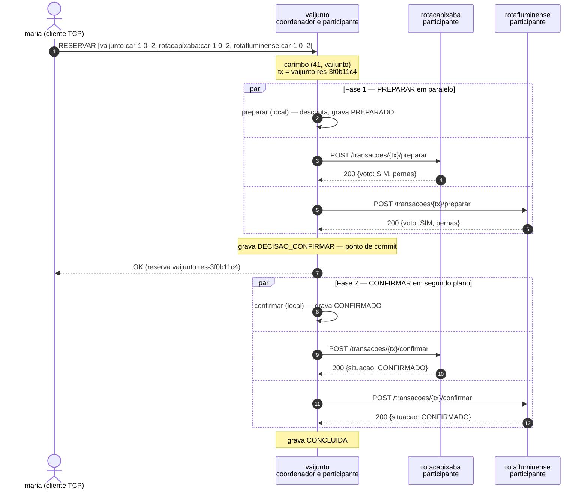

# Roteiro de demonstração (versão curta) — VAIJUNTO, Problema 2

Versão condensada do `ROTEIRO_DEMONSTRACAO.md`. Serve para **ter tudo pronto
na tela antes do tutor entrar** e para seguir a apresentação sem reabrir o
documento longo. Em caso de dúvida sobre uma fala ou sobre o "porquê" de algo,
o documento longo e o `ESTUDO_ARGUICAO.md` têm o detalhe; aqui ficam os
comandos, o passo a passo de cada ação e a saída esperada.

Pré-requisitos (ver `ROTEIRO_DEMONSTRACAO.md` Parte 0 para o detalhe de cada
um): IPs anotados e exportados (`$IP_A`, `$IP_B`, `$IP_C`), portas 9000 e 8080
liberadas nas três máquinas, imagens já montadas (`vaijunto-servidor` e
`vaijunto-cliente`), diretório `estado/` presente em cada máquina (ele é
zerado automaticamente pelo comando de subida, ver abaixo), semente com datas
em 05–06/11 e já conferida.

Esta versão reduz o roteiro às demonstrações que cobrem, sem sobreposição, os
pontos centrais do trabalho: descentralização, atomicidade entre empresas
(2PC), controle de concorrência (Lamport + wait-die), tolerância a falha
(timeout, WAL, recuperação) e o cancelamento em cascata. As demais
demonstrações do documento longo ficam como material de reserva, não
precisam entrar na apresentação principal.

---

## Checklist de terminais — deixe tudo isto aberto antes de começar

Catorze janelas: seis na máquina A, quatro em cada uma das máquinas B e C.
Abra na ordem da tabela: primeiro os três servidores (as outras janelas
dependem deles estarem no ar). Depois disso, abra também as janelas de
leitura (linha final da tabela) para consulta durante a arguição.

Cada máquina ganha uma janela extra de **apoio** (A6, B4, C4): um shell livre,
sem cliente nem servidor rodando nela, usado só para os comandos que provam
alguma coisa que não aparece na interface do passageiro/motorista — `curl`
direto na API entre empresas, `docker kill`/`docker ps`, `grep` no código e
os `go test`/`go build`. Cada passo do roteiro abaixo diz explicitamente em
qual janela (nome de A1–C4) rodar o comando; **é sempre uma janela de apoio
para comandos novos, nunca a janela de um cliente TCP** (que só aceita as
opções do próprio menu) **nem a do servidor** (que já está ocupada rodando o
processo em primeiro plano).

A janela de apoio A (A6) é também a **máquina de testes**: é nela que ficam
o repositório clonado com Go instalado e a pasta `resultados/`, usados nos
`grep`, `go build`/`go vet`/`go test` e no simulador de carga. Se o
repositório e o Go estiverem só numa máquina diferente da A, troque as
instruções abaixo que dizem "em A6" por "na máquina de testes", mantendo o
comando igual.

Os comandos de subida fazem duas coisas em sequência: (1) zeram o conteúdo de
`estado/` e ajustam o dono dos arquivos para o usuário atual, usando um
contêiner Alpine descartável (necessário porque não há senha de `sudo` nos
laboratórios); (2) sobem o servidor com `--user "$(id -u):$(id -g)"`, para que
o `.wal` criado dentro do contêiner já pertença ao usuário do host. Rode cada
bloco inteiro (as duas linhas unidas por `&&`) de uma vez, no diretório que
contém `dados/` e `estado/`.

### Máquina A — `vaijunto`

| # | Janela | Comando / login | Usada em |
|---|---|---|---|
| A1 | servidor | ```bash\ndocker run --rm -v "$(pwd)/estado:/estado" alpine sh -c "rm -rf /estado/* && chown -R $(id -u):$(id -g) /estado" && \\\ndocker run --rm --name vaijunto -p 9000:9000 -p 8080:8080 -e TZ=America/Bahia \\\n  -v "$(pwd)/dados/vaijunto:/dados:ro" -v "$(pwd)/estado:/estado" \\\n  --user "$(id -u):$(id -g)" vaijunto-servidor \\\n  --empresa vaijunto \\\n  --pares rotacapixaba=http://$IP_B:8080,rotafluminense=http://$IP_C:8080 \\\n  --dados /dados --log /estado/vaijunto.wal --auditoria\n``` | todas |
| A2 | WAL ao vivo | `tail -f estado/vaijunto.wal` | D-1 |
| A3 | PA — passageiro | `docker run --rm -it -e VAIJUNTO_SERVIDOR=$IP_A:9000 vaijunto-cliente /bin/passageiro` → login `maria` / `abcd` | D-1 |
| A4 | PA2 — passageiro | mesmo comando de A3 → login `pedro` / `abcd` | D-2 |
| A5 | PA3 — passageiro | mesmo comando de A3 → login `lucia` / `abcd` | D-4 |
| A6 | apoio A (shell livre, repo + Go) | sem comando fixo — fica livre para os comandos indicados em cada passo | Parte 1, D-1, D-4, Parte 3, Extras |

Login extra, só quando chegar na D-4b: `teste01` / `teste` na própria janela
A3 ou A4 (depois de maria/pedro já terem reservado).

### Máquina B — `rotacapixaba`

| # | Janela | Comando / login | Usada em |
|---|---|---|---|
| B1 | servidor | ```bash\ndocker run --rm -v "$(pwd)/estado:/estado" alpine sh -c "rm -rf /estado/* && chown -R $(id -u):$(id -g) /estado" && \\\ndocker run --rm --name rotacapixaba -p 9000:9000 -p 8080:8080 -e TZ=America/Bahia \\\n  -v "$(pwd)/dados/rotacapixaba:/dados:ro" -v "$(pwd)/estado:/estado" \\\n  --user "$(id -u):$(id -g)" vaijunto-servidor \\\n  --empresa rotacapixaba \\\n  --pares vaijunto=http://$IP_A:8080,rotafluminense=http://$IP_C:8080 \\\n  --dados /dados --log /estado/rotacapixaba.wal --auditoria\n``` | todas |
| B2 | PB — passageiro | `docker run --rm -it -e VAIJUNTO_SERVIDOR=$IP_B:9000 vaijunto-cliente /bin/passageiro` → login `clara` / `abcd` | D-2 |
| B3 | PB2 — passageiro | mesmo comando de B2 → login `paulo` / `abcd` | D-3 |
| B4 | apoio B (shell livre) | sem comando fixo — fica livre para os comandos indicados em cada passo | Parte 1, D-2, D-4 |

### Máquina C — `rotafluminense`

| # | Janela | Comando / login | Usada em |
|---|---|---|---|
| C1 | servidor | ```bash\ndocker run --rm -v "$(pwd)/estado:/estado" alpine sh -c "rm -rf /estado/* && chown -R $(id -u):$(id -g) /estado" && \\\ndocker run --rm --name rotafluminense -p 9000:9000 -p 8080:8080 -e TZ=America/Bahia \\\n  -v "$(pwd)/dados/rotafluminense:/dados:ro" -v "$(pwd)/estado:/estado" \\\n  --user "$(id -u):$(id -g)" vaijunto-servidor \\\n  --empresa rotafluminense \\\n  --pares vaijunto=http://$IP_A:8080,rotacapixaba=http://$IP_B:8080 \\\n  --dados /dados --log /estado/rotafluminense.wal --auditoria\n``` | todas |
| C2 | PC — passageiro | `docker run --rm -it -e VAIJUNTO_SERVIDOR=$IP_C:9000 vaijunto-cliente /bin/passageiro` → login `tiago` / `abcd` | D-3 |
| C3 | MC — motorista | `docker run --rm -it -e VAIJUNTO_SERVIDOR=$IP_C:9000 vaijunto-cliente /bin/motorista` → login `marcos` / `1234` | D-5 |
| C4 | apoio C (shell livre) | sem comando fixo — fica livre para os comandos indicados em cada passo | Parte 1 |

Todos os logins usam senha de teste da semente; nenhum é secreto.

### Janelas de leitura (qualquer máquina, para consulta)

| Conteúdo | Para o momento |
|---|---|
| Diagrama de sequência da confirmação (apêndice deste documento ou `API_CONSORCIO.md` §6.1) | Parte 1 / D-1 |
| `PROJETO_P2.md` §5.1 (diagrama de arquitetura) | Parte 1 |
| `API_CONSORCIO.md` §4 (tabela de recursos) | Parte 1, D-4 extra |

### Confirme antes de liberar o tutor

Em A6 (apoio A):

```bash
docker ps                                   # 1 contêiner nesta máquina (vaijunto)
curl -s http://$IP_B:8080/saude && echo && curl -s http://$IP_C:8080/saude
```

Boot de cada servidor precisa mostrar `pares: 2`. Se vier `pares: 0` ou a
busca voltar `"parcial":true`, pare e confira a porta 8080 — é a falha mais
comum (ver tabela de problemas no fim).

---

## Ordem da demonstração

**Parte 1 (arquitetura, ~4 min) → D-1 → D-2 → D-3 → D-4 → D-5 → Parte 3
(testes, ~4 min)**

### Parte 1 — provar a arquitetura

Com os servidores já de pé (checklist acima):

1. Em A6, B4 e C4 (uma janela de apoio por máquina), rode `docker ps` em cada
   uma. Mostre que cada máquina tem **um único contêiner**, com um nome
   diferente (`vaijunto`, `rotacapixaba`, `rotafluminense`) — nenhum
   processo central, nenhum contêiner compartilhado entre elas.
2. Em A6, B4 e C4, rode na respectiva janela:
   ```bash
   curl -s "http://localhost:8080/federacao/caronas?desde=2026-11-05T00:00:00-03:00&ate=2026-11-07T00:00:00-03:00"
   ```
   Mostre que a resposta de cada servidor só lista caronas com o prefixo da
   própria empresa (`vaijunto:car-…` em A, `rotacapixaba:car-…` em B,
   `rotafluminense:car-…` em C) — cada servidor só guarda os dados da sua
   empresa.
3. Em A3 (maria), faça a busca Salvador → Petrópolis, 05/11 (o passo a passo
   completo está na D-1 abaixo; aqui o objetivo é só mostrar que o resultado
   junta trechos das três empresas num único itinerário, com
   `"parcial":false`).
4. Diga a frase do mutex: *"o mutex ficou local, um por servidor — ainda dá
   exclusão mútua dentro de cada empresa, mas não dá mais atomicidade do
   itinerário inteiro; isso é o que o 2PC resolve"*.
5. Em A6, dentro do diretório do repositório:
   ```bash
   grep -rn "context.WithTimeout" internal/federacao/cliente.go
   grep -rn "http.Get\|http.DefaultClient" internal/ cmd/
   ```
   O primeiro mostra o prazo estrutural de toda chamada entre pares; o
   segundo não acha nada — nenhuma chamada de rede escapa do cliente HTTP do
   pacote de federação.

### D-1 — Busca e reserva atômica entre três empresas (+ idempotência)

Passo a passo em A3 (login já feito como `maria`):

1. No menu "O que você quer fazer?", escolha **1 — Buscar itinerários**.
2. Em "Origem:", digite `Salvador`. Em "Destino:", digite `Petrópolis`.
3. Em "Data (AAAA-MM-DD):", digite `2026-11-05`.
4. A resposta deve trazer **1 itinerário**, com três trechos (um por
   empresa) e sem aviso de busca parcial.
5. Escolha o itinerário (digite `1`) para reservar.
6. Enquanto a reserva está em voo, olhe a janela A2 (`tail -f` do WAL):
   a entrada `PREPARADO` da perna local precisa aparecer **antes** da
   resposta do voto — é o fsync acontecendo dentro da seção crítica, não
   depois.
7. Na janela A1 (o servidor, em primeiro plano — não digite nada ali, só
   leia a saída), aponte as duas chamadas `preparar` saindo em paralelo para
   `rotacapixaba` e `rotafluminense`, depois `DECISAO → CONFIRMAR`, e só
   então os dois `confirmar` em segundo plano.
8. No cliente, a tela final mostra `Reserva vaijunto:res-… confirmada. Total: R$ …`.
   **Anote o `ReservaID`** (ex.: `vaijunto:res-3f0b11c4`) — ele é o `txID`
   usado no passo de idempotência abaixo e também é reaproveitado, se
   couber no tempo, nas demonstrações extras do fim do documento.
9. Acompanhe com o diagrama de sequência (janela de leitura, ou o apêndice
   deste documento) enquanto narra os passos 6–7.

**Idempotência do commit**, em A6 (apoio A), usando o `txID` anotado no
passo 8. Primeiro confira o contador de assentos antes de repetir o
`confirmar`:

```bash
curl -s http://$IP_B:8080/auditoria
```

Agora cole o `confirmar` abaixo (troque `TX=` pelo `ReservaID` real) e rode
o mesmo bloco **duas vezes seguidas**:

```bash
TX="vaijunto:res-3f0b11c4"   # troque pelo txID real anotado no passo 8
curl -s -i -X POST http://$IP_B:8080/transacoes/$TX/confirmar \
  -H 'Content-Type: application/json' \
  -H 'X-VaiJunto-Empresa: vaijunto' \
  -H 'X-VaiJunto-Lamport: 999' \
  -d '{}'
```

As duas respostas devem ser `200 {"situacao":"CONFIRMADO"}`. Rode de novo o
`curl .../auditoria` de cima: o contador de assentos de B não muda entre as
chamadas — repetir o `confirmar` nunca reserva de novo.

### D-2 — Último assento disputado entre empresas

Passo a passo, coordenado entre A4 (pedro) e B2 (clara):

1. Em A4, já logado como `pedro`: menu → **1 — Buscar itinerários** → origem
   `Salvador`, destino `Rio de Janeiro`, data a combinada com a semente
   (mesma data usada no ensaio). Escolha o itinerário e **pare na tela de
   confirmação de reserva sem apertar Enter ainda**.
2. Em B2, já logado como `clara`: mesmo caminho, origem `Vitória`, destino
   `Rio de Janeiro`, mesma data, mesmo itinerário (mesmo trecho final
   disputado). Pare também sem confirmar.
3. Combine "3, 2, 1" e aperte Enter **nas duas janelas ao mesmo tempo**.
4. Um dos dois recebe a confirmação normal; o outro recebe a recusa
   `Assento esgotado…` (ou equivalente, conforme a mensagem do protocolo).
5. Em B4 (apoio B):
   ```bash
   curl -s http://localhost:8080/auditoria
   ```
   Mostre que a participação perdedora aparece como `ABORTADO` e que o
   trecho da `rotacapixaba` está livre de novo — ou a reserva inteira
   passou, ou nenhuma perna ficou presa.

### D-3 — Disputa cruzada entre empresas (Lamport + wait-die)

Passo a passo, coordenado entre B3 (paulo) e C2 (tiago):

1. Em B3, logado como `paulo`: busca Vitória → Nilópolis, data 06/11.
   Escolha o itinerário e pare na tela de confirmação.
2. Em C2, logado como `tiago`: mesma busca, mesmo itinerário. Pare também.
3. "3, 2, 1", Enter nas duas janelas juntas.
4. Um confirma; o outro recebe `DISPUTA_PERDIDA`.
5. Aponte, nas janelas B1 e C1 (os servidores, só leitura — não digite
   nada ali), os carimbos `(lamport, empresa)` nas mensagens: o critério de
   prioridade é Lamport e, em caso de empate, o nome da empresa (nunca o
   relógio físico).
6. Se aparecer `AGUARDE` ou algo como `PRECEDENCIA` no log antes da decisão
   final, explique que é o wait-die: quem tem prioridade menor espera, sem
   travar o servidor; três tentativas de `ABORTAR` do mesmo carimbo é o teto
   assumido, não um bug.
7. Diga a nota de honestidade **antes** de qualquer pergunta: a ordem de
   chegada ao vivo, numa demonstração com dois terminais humanos, não é
   100% controlável — a prova determinística dessa disputa é o teste TR3,
   mostrado na Parte 3.

### D-4 — Queda de uma empresa: fora e no meio de uma transação

Esta é a demonstração mais importante porque junta timeout, WAL e
recuperação — faça as três variantes se o tempo permitir; se precisar cortar
alguma, corte a (c), nunca a (a) ou a (b).

**(a) Queda fora de uma transação — efeito na busca e na reserva.**

1. Em B4 (apoio B, ou peça ao tutor para rodar na máquina B):
   ```bash
   docker kill rotacapixaba
   ```
2. Em A5, logado como `lucia`: menu → **1 — Buscar itinerários** → Salvador
   → Petrópolis, 05/11. A resposta deve trazer o aviso
   `Aviso: busca incompleta — sem resposta de: rotacapixaba` e só os
   itinerários que não dependem da perna capixaba.
3. Na mesma janela, tente reservar um itinerário que passe por
   `rotacapixaba`. Depois de ~2 s a resposta deve ser
   `EMPRESA_INDISPONIVEL`.
4. Ainda em A5, busque e reserve um itinerário que **não** toque
   `rotacapixaba` (ex.: Feira de Santana → Jequié). Deve funcionar
   normalmente — a queda de uma empresa não trava as outras duas.
5. Na janela B1, religue B com o mesmo comando já usado para subir B (o
   bloco completo está na linha B1 da tabela de terminais — copie e cole o
   mesmo bloco de novo). No boot, aponte a linha que mostra os registros do
   WAL sendo reaplicados e o relógio de Lamport restaurado.
6. Repita a busca do passo 2 → agora deve voltar `"parcial":false`.

**(b) Queda no meio de uma transação, em ponto escolhido.**

1. Na janela A1, suba A de novo com a mesma estrutura do comando original,
   só acrescentando `-e FALHAR_EM=coord-apos-decidir` logo depois de
   `-e TZ=America/Bahia`:
   ```bash
   docker run --rm -v "$(pwd)/estado:/estado" alpine sh -c "rm -rf /estado/* && chown -R $(id -u):$(id -g) /estado" && \
   docker run --rm --name vaijunto -p 9000:9000 -p 8080:8080 -e TZ=America/Bahia -e FALHAR_EM=coord-apos-decidir \
     -v "$(pwd)/dados/vaijunto:/dados:ro" -v "$(pwd)/estado:/estado" \
     --user "$(id -u):$(id -g)" vaijunto-servidor \
     --empresa vaijunto \
     --pares rotacapixaba=http://$IP_B:8080,rotafluminense=http://$IP_C:8080 \
     --dados /dados --log /estado/vaijunto.wal --auditoria
   ```
2. Em A3 ou A4, faça login como `teste01` / `teste` e reserve
   Salvador → Cachoeiro de Itapemirim, 05/11. O cliente trava sem resposta —
   o servidor morreu de propósito depois de decidir, antes de confirmar.
3. Em B4 (apoio B):
   ```bash
   curl -s http://localhost:8080/auditoria
   ```
   Deve aparecer `em_espera:[1,1]` (ou equivalente) e a participação dessa
   transação em `PREPARADO`.
4. Pare e diga: *"ela votou SIM, gravou com fsync e descontou o assento;
   não existe prazo que libere esse assento sozinho — ela só confirma ou
   aborta com evidência conclusiva de outro participante ou do
   coordenador"*.
5. Na janela A1, religue A **sem** `FALHAR_EM` — cole de novo o comando
   original da linha A1 da tabela de terminais (sem a variável extra). No
   boot, aponte a linha `1 reserva(s) com a fase 2 a retomar`.
6. Em B4, repita o mesmo `curl` do passo 3: `em_espera` deve voltar a
   `[0,0]` e o contador de confirmados deve estar atualizado.

**(c) Queda sob carga, em ponto escolhido pelo tutor (se houver tempo).**

1. Em A6 (apoio A), rode o simulador contra as três empresas (cenário
   federado, ~120 s):
   ```bash
   docker run --rm --user "$(id -u):$(id -g)" -e TZ=America/Bahia \
     -v "$(pwd)/resultados:/resultados" vaijunto-cliente /bin/simulador \
     --empresas=vaijunto=$IP_A:9000,rotacapixaba=$IP_B:9000,rotafluminense=$IP_C:9000 \
     --cenario=federado --curva=1,10,50,100 --duracao=120s \
     --saida=/resultados --rotulo=tres-maquinas
   ```
2. Convide o tutor a escolher uma máquina e a rodar, na janela de apoio
   dela (A6/B4/C4), `docker kill <nome-do-contêiner>` no meio da carga.
3. Mostre que os outros dois continuam respondendo e que o log registra
   timeout de 2 s contra o caído.
4. Religue o contêiner derrubado (cole de novo o comando da linha
   A1/B1/C1 correspondente, na janela do próprio servidor), espere a carga
   do passo 1 terminar e, em A6, rode:
   ```bash
   VAIJUNTO_AUDITORIA=vaijunto=http://$IP_A:8080,rotacapixaba=http://$IP_B:8080,rotafluminense=http://$IP_C:8080 \
     go test -run TestInvariantesDoAmbiente ./testes -v
   ```
   Resultado esperado: `PASS` — nenhum assento vendido duas vezes, nenhuma
   reserva perdida.

### D-5 — Cancelamento em cascata

Só roda até 06/11/2026 08:00 — confira a data antes de começar.

1. Em C3, logado como `marcos`: menu → **4 — Cancelar carona**.
2. Escolha a carona `rotafluminense:car-1` na lista.
3. Confirme o cancelamento quando perguntado. A resposta deve ser algo como
   `2 reservas de passageiro canceladas em cascata`.
4. Na janela A1 (o servidor A, só leitura), aponte o aviso recebido em
   `/avisos/carona-cancelada`, seguido da chamada `cancelar` que A dispara
   para os outros donos das reservas afetadas.
5. Diga: *"não é 2PC — ninguém pode recusar um cancelamento, então basta
   entrega confiável com repetição até `2xx`; o assento volta depois, nunca
   antes, por isso nunca causa venda dupla"*.

### Parte 3 — os testes na tela (~4 min)

Tudo nesta parte roda em A6 (apoio A — a máquina de testes, com o
repositório e o Go).

```bash
go build ./... && go vet ./... && go test -race ./...
cat go.mod                                                  # só stdlib
go test -race -count=20 -run TestTR1UmAssentoCinquentaPassageirosDasTresEmpresas ./testes
go test -race -run TestTR2ItinerarioEntreTresEmpresasEhAtomico ./testes
go test -race -run TestTR3DisputaCruzadaAMaisVelhaConfirma ./testes
go test -race -run 'TestTF[0-9]+_' -v ./testes
```

Explique cada teste em uma frase:

- `TestTR1…`: venda dupla, 1 assento, 50 passageiros simulados das três
  empresas disputando ao mesmo tempo.
- `TestTR2…`: um itinerário inteiro, pela metade, com falha injetada numa
  das pernas — ou tudo confirma, ou tudo aborta.
- `TestTR3…`: a mesma disputa cruzada da D-3, só que em rede simulada em
  memória, com ordem de chegada determinística — é a prova que fecha a nota
  de honestidade dita na D-3.
- `TestTF1…TestTF10…`: dez cenários de falha (queda de participante, queda
  de coordenador, timeout de voto, etc.), todos esperados `PASS`.

Se a D-4c não tiver rodado, mostre também os invariantes depois de uma carga
curta, ainda em A6:

```bash
docker run --rm --user "$(id -u):$(id -g)" -e TZ=America/Bahia \
  -v "$(pwd)/resultados:/resultados" vaijunto-cliente /bin/simulador \
  --empresas=vaijunto=$IP_A:9000,rotacapixaba=$IP_B:9000,rotafluminense=$IP_C:9000 \
  --cenario=federado --curva=1,10,50,100 --duracao=5s \
  --saida=/resultados --rotulo=tres-maquinas

VAIJUNTO_AUDITORIA=vaijunto=http://$IP_A:8080,rotacapixaba=http://$IP_B:8080,rotafluminense=http://$IP_C:8080 \
  go test -run TestInvariantesDoAmbiente ./testes -v
```

Números já medidos estão em `PROJETO_P2.md` §11.6 — leitura: *"o ciclo local
custa 3,4 ms de p50 contra 0,27 ms do P1, pelo fsync a cada mudança de
estado; sob carga federada a distância cresce 2,5× porque toda empresa
participa de toda transação, serializando o triplo de trabalho no mutex por
servidor — é o gargalo que conheço e delimito"*.

---

## Extras — só se sobrar tempo

Não fazem parte do caminho principal; servem para aprofundar uma pergunta
específica sem precisar derrubar nenhum servidor.

### Terminação cooperativa só com `curl` (abort presumido)

Mostra que uma empresa em dúvida se resolve sozinha, sem esperar prazo
nenhum, perguntando ao coordenador.

1. Em A6 (apoio A), monte um `preparar` à mão, fingindo ser a `vaijunto`,
   com um `txID` que nunca existiu de verdade:
   ```bash
   curl -s -i -X POST http://$IP_B:8080/transacoes/vaijunto:res-0000abcd/preparar \
     -H 'Content-Type: application/json' \
     -H 'X-VaiJunto-Empresa: vaijunto' \
     -H 'X-VaiJunto-Lamport: 100' \
     -d '{
       "coordenador": "vaijunto",
       "participantes": ["vaijunto", "rotacapixaba"],
       "carimbo": {"lamport": 100, "empresa": "vaijunto"},
       "passageiro": {"ref": "vaijunto:maria", "nome": "Maria Souza"},
       "itens": [{"carona_id": "rotacapixaba:car-1", "de": 0, "ate": 2}]
     }'
   ```
2. A resposta é `200 {"voto":"SIM", ...}` — B votou SIM e ficou em
   `PREPARADO`, sem saber que a `vaijunto` nunca vai mandar `confirmar`.
3. Espere ~10 s. B consulta a `vaijunto` sozinha (reproduza a consulta à
   mão, ainda em A6, se quiser mostrar o payload exato):
   ```bash
   curl -s -X POST http://$IP_A:8080/transacoes/vaijunto:res-0000abcd/consultar \
     -H 'Content-Type: application/json' \
     -H 'X-VaiJunto-Empresa: rotacapixaba' \
     -H 'X-VaiJunto-Lamport: 102' \
     -d '{}'
   ```
   Resposta esperada: `{"papel":"COORDENADOR","decisao":"ABORTADA"}` — a
   `vaijunto` não tem registro dessa transação, então a ausência de decisão
   **é** a decisão de abortar. O assento de B volta sem nenhum registro de
   compensação.

---

## Se algo der errado (resumo)

| Sintoma | Causa provável | Ação |
|---|---|---|
| Busca sempre `"parcial":true` / toda reserva federada `EMPRESA_INDISPONIVEL` | Porta 8080 fechada ou `--pares` errado | `curl $IP:8080/saude` de outra máquina; confira `pares: 2` no boot |
| `pares: 0` no boot | `--pares` malformado | Formato `empresa=http://ip:8080,…` |
| Cliente não conecta / fecha logo | Porta 9000 fechada / faltou `-it` | `docker ps` mostra as duas portas; sempre `-it` |
| `permission denied` no log, mesmo com o comando novo | `estado/` ficou com dono de uma subida anterior sem o `--user` | Repita o comando completo do B1/A1/C1 (a limpeza com `chown` vem embutida nele) |
| `CONFLITO_HORARIO` | Usuário já tem reserva no período | Use outro da tabela de logins |
| D-5 recusada por prazo | Passou de 06/11 08:00 | Pule e registre o motivo |
| Repetir o `confirmar` da D-1 devolve `409` | `txID` errado ou reserva já cancelada | Confira o `ReservaID` anotado no passo 8 da D-1 |
| Servidor morre sozinho ao reservar | `FALHAR_EM` ainda armado | Religar sem a variável |

Tabela completa de problemas: `ROTEIRO_DEMONSTRACAO.md`, Parte 5.

---

## Apêndice: diagrama de sequência da confirmação



Pontos a ler com o dedo: coordenador = empresa do passageiro, não papel fixo;
assentos descontados na **fase 1**; validação do encadeamento usa as pernas
**devolvidas no voto**, não a busca; `DECISAO_CONFIRMAR` é o ponto de commit
que separa abort presumido de retomada da fase 2; `OK` sai antes da fase 2
terminar porque a decisão já está no log com `fsync`.
