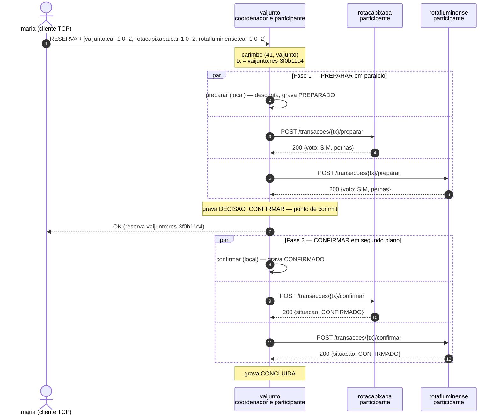

# Roteiro de demonstração (versão curta) — VAIJUNTO, Problema 2

Versão condensada do `ROTEIRO_DEMONSTRACAO.md`. Serve para **ter tudo pronto
na tela antes do tutor entrar** e para seguir a apresentação sem reabrir o
documento longo. Em caso de dúvida sobre uma fala ou sobre o "porquê" de algo,
o documento longo e o `ESTUDO_ARGUICAO.md` têm o detalhe; aqui só ficam os
comandos, as saídas esperadas e a frase mínima de cada caixa.

Pré-requisitos (ver `ROTEIRO_DEMONSTRACAO.md` Parte 0 para o detalhe de cada
um): IPs anotados e exportados, portas 9000 e 8080 liberadas nas três
máquinas, imagens montadas, `estado/` zerado, semente com datas em 05–06/11 e
já conferida, Go instalado em ao menos uma máquina.

---

## Checklist de terminais — deixe tudo isto aberto antes de começar

Nove janelas, três por máquina. Abra na ordem da tabela: primeiro os três
servidores (as outras janelas dependem deles estarem no ar). Depois disso,
abra também as janelas de leitura (linha final da tabela) para consulta
durante a arguição.

### Máquina A — `vaijunto`

| # | Janela | Comando / login | Usada em |
|---|---|---|---|
| A1 | servidor | ```bash\ndocker run --rm --name vaijunto -p 9000:9000 -p 8080:8080 -e TZ=America/Bahia \\\n  -v "$(pwd)/dados/vaijunto:/dados:ro" -v "$(pwd)/estado:/estado" \\\n  --user "$(id -u):$(id -g)" vaijunto-servidor \\\n  --empresa vaijunto \\\n  --pares rotacapixaba=http://$IP_B:8080,rotafluminense=http://$IP_C:8080 \\\n  --dados /dados --log /estado/vaijunto.wal --auditoria\n``` | todas |
| A2 | WAL ao vivo | `tail -f estado/vaijunto.wal` | D-1 (caixa 9.2) |
| A3 | PA — passageiro | `docker run --rm -it -e VAIJUNTO_SERVIDOR=$IP_A:9000 vaijunto-cliente /bin/passageiro` → login `maria` / `abcd` | D-1, D-6 |
| A4 | PA2 — passageiro | mesmo comando de A3 → login `pedro` / `abcd` | D-2 |
| A5 | PA3 — passageiro | mesmo comando de A3 → login `lucia` / `abcd` | D-4 |

Login extra, só quando chegar na D-5b: `teste01` / `teste` na própria janela
A3 ou A4 (depois de maria/pedro já terem reservado).

### Máquina B — `rotacapixaba`

| # | Janela | Comando / login | Usada em |
|---|---|---|---|
| B1 | servidor | ```bash\ndocker run --rm --name rotacapixaba -p 9000:9000 -p 8080:8080 -e TZ=America/Bahia \\\n  -v "$(pwd)/dados/rotacapixaba:/dados:ro" -v "$(pwd)/estado:/estado" \\\n  --user "$(id -u):$(id -g)" vaijunto-servidor \\\n  --empresa rotacapixaba \\\n  --pares vaijunto=http://$IP_A:8080,rotafluminense=http://$IP_C:8080 \\\n  --dados /dados --log /estado/rotacapixaba.wal --auditoria\n``` | todas |
| B2 | PB — passageiro | `docker run --rm -it -e VAIJUNTO_SERVIDOR=$IP_B:9000 vaijunto-cliente /bin/passageiro` → login `clara` / `abcd` | D-2 |
| B3 | PB2 — passageiro | mesmo comando de B2 → login `paulo` / `abcd` | D-3 |

### Máquina C — `rotafluminense`

| # | Janela | Comando / login | Usada em |
|---|---|---|---|
| C1 | servidor | ```bash\ndocker run --rm --name rotafluminense -p 9000:9000 -p 8080:8080 -e TZ=America/Bahia \\\n  -v "$(pwd)/dados/rotafluminense:/dados:ro" -v "$(pwd)/estado:/estado" \\\n  --user "$(id -u):$(id -g)" vaijunto-servidor \\\n  --empresa rotafluminense \\\n  --pares vaijunto=http://$IP_A:8080,rotacapixaba=http://$IP_B:8080 \\\n  --dados /dados --log /estado/rotafluminense.wal --auditoria\n``` | todas |
| C2 | PC — passageiro | `docker run --rm -it -e VAIJUNTO_SERVIDOR=$IP_C:9000 vaijunto-cliente /bin/passageiro` → login `tiago` / `abcd` | D-3 |
| C3 | MC — motorista | `docker run --rm -it -e VAIJUNTO_SERVIDOR=$IP_C:9000 vaijunto-cliente /bin/motorista` → login `marcos` / `1234` | D-6 |

Todos os logins usam senha de teste da semente; nenhum é secreto.

### Janelas de leitura (qualquer máquina, para consulta)

| Conteúdo | Para a caixa |
|---|---|
| `checklist_avaliacao.md` | acompanhar com o tutor |
| Diagrama de sequência da confirmação (apêndice deste documento ou `API_CONSORCIO.md` §6.1) | 5.2 |
| `PROJETO_P2.md` §5.1 (diagrama de arquitetura) | 1.1–1.3 |
| `API_CONSORCIO.md` §4 (tabela de recursos) | 2.1 |

### Confirme antes de liberar o tutor

```bash
docker ps                                   # três contêineres, 1 por máquina
curl -s http://$IP_B:8080/saude && echo && curl -s http://$IP_C:8080/saude
```

Boot de cada servidor precisa mostrar `pares: 2`. Se vier `pares: 0` ou a
busca voltar `"parcial":true`, pare e confira a porta 8080 — é a falha mais
comum (ver tabela de problemas no fim).

---

## Ordem da demonstração e o que cada passo marca

Ensaie nesta ordem — D-8 **antes** da D-6, porque a cascata cancela a reserva
que a D-8 usa:

**Parte 1 (arquitetura, ~4 min) → D-1 → D-2 → D-8 → D-3 → D-4 → D-5 → D-6 → D-7
→ Parte 3 (testes, ~4 min)**

### Parte 1 — provar a arquitetura

Com os servidores já de pé (checklist acima):

1. **`docker ps`** nas três máquinas → um contêiner cada, nenhum central. **1.3**
2. **`curl .../federacao/caronas` de cada empresa** → só vem o prefixo dela.
   **1.2**
3. Busca federada Salvador→Petrópolis 05/11 por `nc`/cliente → 1 itinerário,
   `"parcial":false`. **3.1, 3.2**
4. Diga a frase do mutex: *"o mutex ficou local — ainda dá exclusão mútua, mas
   não dá mais atomicidade do itinerário inteiro"*. **1.4**
5. `grep -rn "context.WithTimeout" internal/federacao/cliente.go` e
   `grep -rn "http.Get\|http.DefaultClient" internal/ cmd/` (o segundo não
   acha nada) → prazo é estrutural, num único funil. **2.2**

### D-1 — Busca e reserva entre três empresas
**Marca:** 2.1, 2.3, 3.1, 3.2, 5.1, 5.2, 9.2.
Em PA (maria): buscar e reservar Salvador→Petrópolis, 05/11. Olhar A2 (`tail
-f`): `PREPARADO` grava **antes** do voto. No terminal do servidor A: duas
chamadas `preparar` em paralelo, `DECISAO → CONFIRMAR`, depois os dois
`confirmar`. Aponte o diagrama (janela de leitura) junto das linhas do
terminal. **Anote o `txID`** — a D-8 usa.

### D-2 — Último assento disputado entre empresas
**Marca:** 3.4, 4.1, 4.2, 4.3, 5.3.
PA2 (pedro, Salvador→Rio) e PB (clara, Vitória→Rio), mesma data, "3,2,1",
Enter juntos. Um confirma, outro recebe `Assento esgotado…`. `curl
localhost:8080/auditoria` em B mostra a participação perdedora `ABORTADO` e o
trecho da `rotacapixaba` livre — ou tudo, ou nada.

### D-8 — Repetir o COMMIT não reserva duas vezes
**Marca:** 2.4 (única caixa que a marca). Usar o `txID` da D-1. Repetir o
`confirmar` por `curl -i -X POST .../confirmar` com os mesmos cabeçalhos →
`200 {"situacao":"CONFIRMADO"}`, contadores de assento **idênticos** antes e
depois.

### D-3 — Disputa cruzada
**Marca:** 6.1, 6.3, 7.1, 7.2, 7.3.
PB2 (paulo) e PC (tiago), Vitória→Nilópolis 06/11, Enter juntos. Um confirma,
outro recebe `DISPUTA_PERDIDA`. Apontar os carimbos `(lamport, empresa)` no
terminal: critério = Lamport + empresa (**6.1**); `AGUARDE`/`PRECEDENCIA` =
wait-die, sem travar (**7.1, 7.2**); três `ABORTAR` do mesmo carimbo = custo
assumido, com teto de 3 tentativas (**7.3**). Dizer a nota de honestidade
**antes** da pergunta: a ordem de chegada ao vivo não é controlável — a prova
determinística é o teste TR3, na Parte 3. **6.3**

### D-4 — Queda de uma empresa
**Marca:** 3.3, 8.1, 8.2, 9.1, 11.4.
`docker kill rotacapixaba` (ou o tutor). Em PA3 (lucia): busca
Salvador→Petrópolis → `Aviso: busca incompleta — sem resposta de:
rotacapixaba` (**3.3**); reserva com perna capixaba → `EMPRESA_INDISPONIVEL`
após 2 s (**8.1**); reserva sem perna capixaba (Feira de Santana→Jequié)
funciona normal (**8.2**). Religar com o mesmo comando de B1 → boot mostra
registros reaplicados e relógio restaurado (**11.4**); repetir a busca →
`"parcial":false`.

### D-5 — Queda no meio de uma transação (a mais valiosa — marca 6 caixas)
**Marca:** 5.4, 8.3, 8.4, 9.3, 9.4, 11.3. Faça as duas variantes.

**(a) Ponto escolhido (`FALHAR_EM=coord-apos-decidir`).** Suba A de novo com
essa variável no comando A1. Reserve em PA/PA2 com `teste01`/`teste`,
Salvador→Cachoeiro de Itapemirim 05/11 — o cliente não recebe resposta (o
servidor morreu de propósito). `curl localhost:8080/auditoria` em B mostra
`em_espera:[1,1]`, participação em `PREPARADO`. **Pare e diga:** *"ela votou
SIM, gravou com fsync e descontou o assento; não existe prazo que libere esse
assento sozinho — ela só confirma ou aborta com evidência conclusiva de outro
participante ou do coordenador"*. **5.4, 8.4.** Religar A **sem**
`FALHAR_EM` → boot mostra `1 reserva(s) com a fase 2 a retomar` (**9.3**),
confirma a pendência, e a auditoria de B volta a `em_espera:[0,0]`,
`confirmados` atualizado (**9.4**).

**(b) Ponto escolhido pelo tutor, sob carga.** Rodar o simulador contra as
três (cenário federado, 120 s) e convidar o tutor a `docker kill` qualquer
contêiner quando quiser. Os outros dois continuam operando (**8.2**),
registram timeout de 2 s contra o caído (**8.1**), e os passageiros virtuais
daquela empresa encerram (esperado). Religar, esperar quiescência, e rodar
`go test -run TestInvariantesDoAmbiente ./testes -v` → `PASS`. **11.3, 9.4.**

### D-6 — Cancelamento em cascata
**Marca:** 8.2 (reforço). Só roda até 06/11/2026 08:00 — confira a data antes.
Em MC (marcos): cancelar `rotafluminense:car-1` → `2 reservas de passageiro
canceladas em cascata`. No terminal de A: aviso inverso
(`/avisos/carona-cancelada`) seguido de `cancelar` nos outros donos. Diga:
*"não é 2PC — ninguém pode recusar um cancelamento, então basta entrega
confiável; o assento volta depois, nunca antes, por isso nunca causa venda
dupla"*.

### D-7 — Terminação cooperativa, só com `curl`
**Marca:** 2.1, 5.4, 8.4. Um `PREPARAR` à mão para B, fingindo ser a
`vaijunto`, com um `txID` que nunca existiu de verdade. B vota SIM, fica em
`PREPARADO`, e depois de 10 s **pergunta sozinha** ao coordenador
(`/consultar`) e recebe `ABORTADA` porque a `vaijunto` não tem registro — abort
presumido, sem gravar nada. Dizer: *"o assento não voltou por expiração; voltou
porque ela perguntou e a ausência de decisão **é** a decisão de abortar"*.

### Parte 3 — os testes na tela (~4 min)
**Marca:** 10.1–10.4.

```bash
go build ./... && go vet ./... && go test -race ./...     # 10.1
cat go.mod                                                  # só stdlib
go test -race -count=20 -run TestTR1UmAssentoCinquentaPassageirosDasTresEmpresas ./testes
go test -race -run TestTR2ItinerarioEntreTresEmpresasEhAtomico ./testes
go test -race -run TestTR3DisputaCruzadaAMaisVelhaConfirma ./testes
go test -race -run 'TestTF[0-9]+_' -v ./testes               # 10.3
```

TR1 = venda dupla (1 assento, 50 passageiros das 3 empresas); TR2 = itinerário
pela metade; TR3 = disputa cruzada determinística (rede em memória, resolve a
nota de honestidade da D-3); TF1–TF10 = dez cenários de falha, todos `PASS`.

Carga (10.2) e invariantes depois da carga (10.3), se a D-5b não tiver rodado
ainda:

```bash
docker run --rm --user "$(id -u):$(id -g)" -e TZ=America/Bahia \
  -v "$(pwd)/resultados:/resultados" vaijunto-cliente /bin/simulador \
  --empresas=vaijunto=$IP_A:9000,rotacapixaba=$IP_B:9000,rotafluminense=$IP_C:9000 \
  --cenario=federado --curva=1,10,50,100 --duracao=5s \
  --saida=/resultados --rotulo=tres-maquinas

VAIJUNTO_AUDITORIA=vaijunto=http://$IP_A:8080,rotacapixaba=http://$IP_B:8080,rotafluminense=http://$IP_C:8080 \
  go test -run TestInvariantesDoAmbiente ./testes -v
```

Resultados já medidos (10.4) estão em `PROJETO_P2.md` §11.6 — leitura: *"o
ciclo local custa 3,4 ms de p50 contra 0,27 ms do P1, pelo fsync a cada
mudança de estado; sob carga federada a distância cresce 2,5× porque toda
empresa participa de toda transação, serializando o triplo de trabalho no
mutex por servidor — é o gargalo que conheço e delimito"*.

---

## As quatro caixas que só se marcam se você provocar

Não aparecem no caminho feliz — se faltar tempo, corte outra coisa, não estas:

- **2.4** — D-8, repetir o `confirmar` com `curl`.
- **5.4** — D-5a(c), dizer explicitamente que o assento não expira sozinho.
- **6.3** — D-3, a nota de honestidade sobre ordem de chegada + TR3.
- **11.3** — D-5b, queda escolhida pelo tutor sob carga.

---

## Se algo der errado (resumo)

| Sintoma | Causa provável | Ação |
|---|---|---|
| Busca sempre `"parcial":true` / toda reserva federada `EMPRESA_INDISPONIVEL` | Porta 8080 fechada ou `--pares` errado | `curl $IP:8080/saude` de outra máquina; confira `pares: 2` no boot |
| `pares: 0` no boot | `--pares` malformado | Formato `empresa=http://ip:8080,…` |
| Cliente não conecta / fecha logo | Porta 9000 fechada / faltou `-it` | `docker ps` mostra as duas portas; sempre `-it` |
| `permission denied` no log | `.wal` criado sem `--user` | `sudo rm -f estado/*.wal` e suba com `--user` |
| `CONFLITO_HORARIO` | Usuário já tem reserva no período | Use outro da tabela de logins |
| D-6 recusada por prazo | Passou de 06/11 08:00 | Pule e registre o motivo |
| D-8 devolve `409` | `txID` errado ou reserva já cancelada na D-6 | Fazer D-8 antes da D-6 |
| Servidor morre sozinho ao reservar | `FALHAR_EM` ainda armado | Religar sem a variável |

Tabela completa de problemas: `ROTEIRO_DEMONSTRACAO.md`, Parte 5.

---

## Apêndice: diagrama de sequência da confirmação (caixa 5.2)



Pontos a ler com o dedo: coordenador = empresa do passageiro, não papel fixo;
assentos descontados na **fase 1**; validação do encadeamento usa as pernas
**devolvidas no voto**, não a busca; `DECISAO_CONFIRMAR` é o ponto de commit
que separa abort presumido de retomada da fase 2; `OK` sai antes da fase 2
terminar porque a decisão já está no log com `fsync`.
